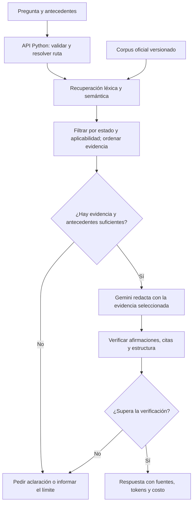

# Práctica 2: consultas HTTP autenticadas con Gemini

Miniaplicación de Skillnest para consultar Gemini desde Python y mediante una API local protegida con Bearer token. Incluye las actividades de conexión HTTP, arquitectura, comparación de modelos y prompts con salida JSON estructurada.

El recorrido de este README es: actividades del curso, instalación, preparación y configuración, uso y comandos, verificación y referencia técnica. La [justificación del proyecto](#justificación-del-proyecto-actual) y la [propuesta final de Ley REP](#proyecto-final-de-skillnest-asistente-rag-para-ley-rep) se encuentran al final.

## Índice

1. [Actividades del curso](#actividades-del-curso)
2. [Instalación](#instalación)
    1. [uv y Python](#uv-y-python)
    2. [Cliente HTTP opcional](#cliente-http-opcional)
3. [Preparación](#preparación)
4. [Configuración](#configuración)
    1. [Configurar las credenciales](#configurar-las-credenciales)
    2. [Conversión de USD a CLP](#conversión-de-usd-a-clp)
5. [Uso y comandos](#uso-y-comandos)
    1. [Resumen de comandos](#resumen-de-comandos)
    2. [Consultar Gemini desde Python](#consultar-gemini-desde-python)
    3. [Iniciar la API local](#iniciar-la-api-local)
    4. [Probar con Yaak o Postman](#probar-con-yaak-o-postman)
        1. [Consulta directa a Gemini](#consulta-directa-a-gemini)
        2. [Consulta mediante la API Python](#consulta-mediante-la-api-python)
    5. [Comparar costo y latencia: Bloque 9](#comparar-costo-y-latencia-bloque-9)
    6. [Banco de prompts y salida estructurada: Bloque 10](#banco-de-prompts-y-salida-estructurada-bloque-10)
        1. [Prompts para el proyecto final de Ley REP](#prompts-para-el-proyecto-final-de-ley-rep)
        2. [Evaluar el banco](#evaluar-el-banco)
6. [Pruebas y comprobaciones](#pruebas-y-comprobaciones)
    1. [Pruebas automatizadas](#pruebas-automatizadas)
    2. [Comprobaciones de la tarea](#comprobaciones-de-la-tarea)
7. [Referencia de la API](#referencia-de-la-api)
    1. [Solicitud de consulta](#solicitud-de-consulta)
    2. [Campos y validaciones](#campos-y-validaciones)
    3. [Agente y modelos habilitados](#agente-y-modelos-habilitados)
    4. [Inspeccionar la respuesta original de Gemini](#inspeccionar-la-respuesta-original-de-gemini)
    5. [Contrato común de respuestas](#contrato-común-de-respuestas)
    6. [Tokens y costo por consulta](#tokens-y-costo-por-consulta)
8. [Resolver problemas](#resolver-problemas)
9. [Estructura del proyecto](#estructura-del-proyecto)
10. [Justificación del proyecto actual](#justificación-del-proyecto-actual)
    1. [Tecnologías actuales](#tecnologías-actuales)
11. [Proyecto final de Skillnest: asistente RAG para Ley REP](#proyecto-final-de-skillnest-asistente-rag-para-ley-rep)
    1. [Objetivo y justificación](#objetivo-y-justificación)
    2. [Qué aporta el avance existente](#qué-aporta-el-avance-existente)
    3. [Dónde se usará IA y dónde se aplicarán reglas](#dónde-se-usará-ia-y-dónde-se-aplicarán-reglas)
    4. [Qué justifica la comparación de modelos y qué falta comprobar](#qué-justifica-la-comparación-de-modelos-y-qué-falta-comprobar)
    5. [Plan de desarrollo y criterios de avance](#plan-de-desarrollo-y-criterios-de-avance)

## Actividades del curso

Sigue estas actividades después de instalar y configurar el proyecto:

| Actividad | Qué hacer | Entrega o evidencia |
| --- | --- | --- |
| Bloque 4: HTTP autenticada | [Consultar desde Python](#consultar-gemini-desde-python) y [probar la API local](#iniciar-la-api-local). | Función `obtener_dato_de_prueba(pregunta)`, colecciones HTTP y [evidencias de peticiones](docs/). |
| Bloque 8: arquitectura | Revisar el recorrido de la pregunta, las credenciales y el manejo de errores. | [Explicación](docs/arquitectura.md), [diagrama](docs/diagrama_arquitectura.png) y [fuente editable](docs/diagrama_arquitectura.drawio). |
| Bloque 9: elección de modelo | [Comparar costo y latencia](#comparar-costo-y-latencia-bloque-9) con las mismas preguntas. | [Decisión de arquitectura](docs/decision-arquitectura.md) y [mediciones reales](docs/evaluaciones/gemini-2026-10-20.json). |
| Bloque 10: prompts y JSON | [Usar el banco y evaluar su consistencia](#banco-de-prompts-y-salida-estructurada-bloque-10). | [Banco](prompts/banco.py), [evaluador](prompts/test_consistencia.py), [resultados](prompts/registro_resultados.json) y [guía de estudio](docs/bloque-10-prompts.md). |

Las comprobaciones de cada actividad están en [Pruebas y comprobaciones](#pruebas-y-comprobaciones).

## Instalación

### uv y Python

Instala `uv` en Linux o macOS:

```bash
curl -LsSf https://astral.sh/uv/install.sh | sh
```

En Windows, desde PowerShell:

```powershell
powershell -ExecutionPolicy ByPass -c "irm https://astral.sh/uv/install.ps1 | iex"
```

Si la terminal no reconoce `uv`, ciérrala y vuelve a abrirla. Comprueba la instalación e instala Python:

```bash
uv --version
uv python install 3.12
```

El proyecto fija Python 3.12 en `.python-version`. Consulta la [instalación oficial de uv](https://docs.astral.sh/uv/getting-started/installation/) si necesitas otra forma de instalarlo.

### Cliente HTTP opcional

Para las pruebas manuales puedes usar [Yaak](https://yaak.app/) o [Postman](https://learning.postman.com/docs/getting-started/installation/install-app/). El repositorio incluye una colección para consultar Gemini y otra para probar la API local.

Necesitas conexión a Internet para instalar las dependencias y realizar consultas reales a Gemini.

## Preparación

Ejecuta los comandos desde la carpeta raíz del repositorio:

```bash
uv sync --locked
uv run python --version
```

`uv sync --locked` crea `.venv` e instala las dependencias con las versiones de `uv.lock`. Los comandos con `uv run` utilizan ese entorno automáticamente.

## Configuración

### Configurar las credenciales

Si todavía no tienes `.env`, créalo a partir del ejemplo. En Linux o macOS:

```bash
cp .env.example .env
```

En Windows, desde PowerShell:

```powershell
Copy-Item .env.example .env
```

Completa el archivo con tus credenciales:

```dotenv
GEMINI_API_KEY=tu_clave_de_google_ai_studio
API_BEARER_TOKEN=tu_token_de_la_api
```

| Variable | Para qué se usa |
| --- | --- |
| `GEMINI_API_KEY` | Autentica la petición que Python envía a Gemini. Obtén la clave en [Google AI Studio](https://aistudio.google.com/api-keys). |
| `API_BEARER_TOKEN` | Protege los endpoints de la API local. Tú generas este token. |
| `USD_CLP` | Opcional: pesos chilenos por dólar, con punto decimal. Si queda vacío, se consulta automáticamente el dólar observado. |

Para generar el token local:

```bash
uv run python -c "import secrets; print(secrets.token_urlsafe(32))"
```

Copia el resultado a `API_BEARER_TOKEN`, sin el prefijo `Bearer`. Las credenciales reales van en `.env`, que está excluido de Git. `.env.example` contiene únicamente las variables vacías.

### Conversión de USD a CLP

Cada importe en CLP se calcula multiplicando su valor en USD por `tipo_cambio.clp_por_usd`, sin redondear a pesos enteros. Por defecto se obtiene el último dólar observado publicado en [indicadores.cl](https://indicadores.cl/api/), cuya fuente es el Banco Central de Chile. La respuesta incluye la fecha del dato y la fuente; cada proceso reutiliza la tasa durante un máximo de una hora. La consulta pública del dólar no recibe claves ni el mensaje enviado a Gemini.

`tarifas_por_millon_clp` contiene las tarifas de entrada, entrada desde caché y salida por **1.000.000 de tokens**, convertidas con el mismo tipo de cambio de los costos de la consulta: `tarifa_clp = tarifa_usd × clp_por_usd`. Se conservan los símbolos de moneda y todos los decimales significativos.

Puedes fijar tu propia tasa con la variable opcional `USD_CLP` en `.env`, sin símbolo de moneda y con punto decimal:

```dotenv
# Ejemplo de tasa manual, no una cotización vigente.
USD_CLP=950.50
```

Con una tasa manual no se consulta la fuente pública; `tipo_cambio.fuente` indica `USD_CLP (.env)` y `fecha` queda en `null`. Para volver a la consulta automática, deja `USD_CLP` vacío. Reinicia el servidor si cambias esta variable.

`aviso_clp: null` significa que la conversión a CLP se completó correctamente y no hay advertencias. Si la fuente del dólar falla o la tasa configurada es inválida, se conservan el texto, los tokens, el costo y las tarifas en USD; `clp`, `tipo_cambio` y `tarifas_por_millon_clp` quedan en `null`, y `aviso_clp` contiene un mensaje que explica cómo corregirlo.

El resultado es una estimación con precios de pago: no consulta la facturación de Google ni detecta si tu cuenta usa el nivel gratuito, créditos o descuentos. No incluye impuestos ni otros servicios. Revisa las tarifas antes de actualizarlas o habilitar otro modelo.

Si el consumo está ausente, incompleto o es inválido, `uso` y `costo_estimado` son `null` y se conserva el texto generado. Si el consumo es válido pero el modelo no tiene tarifas registradas, se devuelve `uso` y `costo_estimado` queda en `null`. Un importe cero se reserva para consumo cero reportado por el proveedor.

## Uso y comandos

Ejecuta los comandos desde la raíz del repositorio, después de completar la preparación y configuración.

### Resumen de comandos

| Acción | Comando |
| --- | --- |
| Instalar dependencias | `uv sync --locked` |
| Consultar Gemini con la pregunta de prueba | `uv run python -m src.agente_gemini` |
| Enviar tu pregunta | `uv run python -m src.agente_gemini "¿Qué es una API?"` |
| Elegir el modelo para tu pregunta | `uv run python -m src.agente_gemini --modelo flash "¿Qué es una API?"` |
| Ver el JSON original del proveedor | `uv run python -m src.agente_gemini --raw "Hola"` |
| Usar un prompt con salida estructurada | `uv run python -m src.agente_gemini --prompt explicar_concepto "¿Qué es una API?"` |
| Iniciar la API local | `uv run uvicorn src.api:app --host 127.0.0.1 --port 8000 --reload` |
| Consultar el catálogo accesible de Gemini | `uv run python -m src.comparar_modelos --listar-modelos` |
| Comparar modelos | `uv run python -m src.comparar_modelos --repeticiones 3 --salida docs/evaluaciones/gemini-nueva-ejecucion.json` |
| Evaluar el banco de prompts | `uv run python -m prompts.test_consistencia --salida prompts/registro_resultados_nueva_ejecucion.json` |
| Ejecutar pruebas sin llamadas reales | `uv run python -m tests -v` |
| Revisar estilo y errores de código | `uv run ruff check src tests prompts` |
| Revisar tipos | `uv run basedpyright` |

Las consultas y evaluaciones reales requieren `GEMINI_API_KEY`. La API local también requiere `API_BEARER_TOKEN`. Para repetir una evaluación, elige un archivo de salida que no exista. Los detalles de cada comando aparecen a continuación.

### Consultar Gemini desde Python

Ejecuta este comando para comprobar que Gemini responde:

```bash
uv run python -m src.agente_gemini
```

Si no pasas una pregunta, el módulo llama a `obtener_dato_de_prueba(pregunta)` con la pregunta por defecto:

> Estoy aprendiendo a programar en Python y quiero entender cómo se conecta una aplicación con una inteligencia artificial. ¿Puedes explicar qué es una API, cómo viaja una pregunta desde Python hasta Gemini y cómo vuelve la respuesta? Incluye una analogía cotidiana, explica para qué sirve una API key y menciona tres errores comunes al hacer la conexión con una forma de resolver cada uno. Responde en español, con secciones breves y en unas 200 palabras.

La salida es un JSON con `respuesta`, `uso` y `costo_estimado`. En `respuesta` aparece una explicación con una analogía, el recorrido de la consulta, el uso de la API key y tres errores con sus soluciones. El texto y el consumo se generan en cada ejecución y pueden variar.

La función está en [src/agente_gemini.py](src/agente_gemini.py). Carga `.env`, resuelve el modelo seleccionado del catálogo (por defecto, `flash-lite`), realiza la consulta autenticada y devuelve un objeto `Resultado` con texto, tokens y costos. Al ejecutar el módulo, ese resultado se imprime como JSON en la terminal, con la misma estructura que `detalles` en la API.

Esta prueba requiere `GEMINI_API_KEY`. Puedes ejecutarla sin iniciar la API local y sin configurar `API_BEARER_TOKEN`.

Para pasar tu propia pregunta como parámetro, escríbela entre comillas después del nombre del módulo:

```bash
uv run python -m src.agente_gemini "Explica la diferencia entre una API y una página web con un ejemplo de cada una."
```

La pregunta entre comillas reemplaza la predeterminada para esa ejecución. Las comillas permiten enviar varias palabras como un solo argumento. Una pregunta vacía o compuesta solo por espacios se rechaza antes de consultar Gemini.

Para elegir un modelo, agrega `--modelo` con uno de los alias disponibles en [src/catalogo.py](src/catalogo.py):

| Alias para `--modelo` | Modelo del proveedor |
| --- | --- |
| `flash-lite` (predeterminado) | `gemini-3.5-flash-lite` |
| `flash` | `gemini-3.6-flash` |
| `flash-3-8` | `gemini-3.8-flash` |

Por ejemplo, para consultar con `flash`:

```bash
uv run python -m src.agente_gemini --modelo flash "¿Qué es una API?"
```

Si omites `--modelo`, se usa `flash-lite`. También puedes elegir el modelo con la pregunta predeterminada o combinarlo con `--raw` y `--prompt`. Un alias desconocido se rechaza antes de realizar la consulta.

Para inspeccionar el JSON completo de Gemini desde la terminal, agrega `--raw`:

```bash
uv run python -m src.agente_gemini --raw "Hola, responde con una frase breve."
```

También puedes usar `uv run python -m src.agente_gemini --raw` con la pregunta predeterminada. Esta opción carga `GEMINI_API_KEY` desde `.env` y consulta directamente a Gemini; puedes ejecutarla sin iniciar la API local. Imprime todos los campos del proveedor, igual que una respuesta exitosa de `/consultar/raw`, y no calcula costos ni consulta el tipo de cambio.

Para ver la ayuda del comando:

```bash
uv run python -m src.agente_gemini --help
```

También puedes importar la función desde otro módulo del proyecto:

```python
from src.agente_gemini import obtener_dato_de_prueba

resultado = obtener_dato_de_prueba(
    "Explica tres usos de la inteligencia artificial en la educación, "
    "con un ejemplo práctico y una limitación de cada uno.",
    modelo="flash",
)
print(resultado.respuesta)
print(resultado.uso)
if resultado.costo_estimado is not None:
    costos = resultado.costo_estimado.model_dump(mode="json")
    print("Costo estimado en USD:", costos["usd"]["total"])
    if costos["clp"] is not None:
        print("Costo estimado en CLP:", costos["clp"]["total"])
```

Si la consulta falla, el comando muestra un mensaje de error y termina con un código de salida distinto de cero.

### Iniciar la API local

Con ambas credenciales configuradas, ejecuta:

```bash
uv run uvicorn src.api:app --host 127.0.0.1 --port 8000 --reload
```

Mantén esa terminal abierta mientras realizas las peticiones. Si falta `API_BEARER_TOKEN`, el servidor avisa al arrancar y no inicia. Reinícialo después de cambiar ese token en `.env`.

Todos los endpoints requieren este encabezado:

```http
Authorization: Bearer <API_BEARER_TOKEN>
```

Sustituye `<API_BEARER_TOKEN>` por el valor de tu `.env`.

| Método | URL | Resultado esperado |
| --- | --- | --- |
| GET | `http://127.0.0.1:8000/health` | HTTP 200 con `detalles.estado` igual a `ok`. |
| POST | `http://127.0.0.1:8000/consultar` | HTTP 200 con texto, tokens y costo estimado dentro de `detalles`. |
| POST | `http://127.0.0.1:8000/consultar/raw` | HTTP 200 con el JSON completo de Gemini directamente en el cuerpo. |

Usa las rutas sin una barra final. Un token ausente o incorrecto devuelve HTTP 401. Las páginas `/docs` y `/redoc` están deshabilitadas.

### Probar con Yaak o Postman

#### Consulta directa a Gemini

1. Importa [gemini.postman_collection.json](gemini.postman_collection.json).
2. Configura la variable local `GEMINI_API_KEY` con tu clave de Google AI Studio.
3. Revisa que la autenticación sea **Bearer Token** y use `{{GEMINI_API_KEY}}`.
4. Envía **Consultar Gemini** y comprueba HTTP 200. El texto generado se encuentra en `choices[0].message.content`.

Esta colección realiza la petición directamente al proveedor.

#### Consulta mediante la API Python

1. Inicia el servidor y déjalo ejecutándose.
2. Importa [api.postman_collection.json](api.postman_collection.json). En Yaak puedes usar **Import Data**.
3. Configura `API_BEARER_TOKEN` en el cliente con el mismo valor de tu `.env`, sin el prefijo `Bearer`.
4. Revisa **Auth → Bearer Token**. Si el importador no conserva la autenticación, selecciónala y coloca el token en ese campo.
5. Envía **Estado de la API** y comprueba HTTP 200.
6. Envía **Consultar desde la API Python** y comprueba el texto en `detalles.respuesta`, los tokens en `detalles.uso` y el costo en `detalles.costo_estimado`.
7. Envía **Consultar respuesta raw de Gemini** para inspeccionar directamente el JSON completo del proveedor.
8. Envía **Autenticación - sin token** para comprobar HTTP 401.
9. Envía **Validación - campos faltantes** y **Validación - valores inválidos** para comprobar HTTP 422.

La colección usa `BASE_URL=http://127.0.0.1:8000`, `AGENTE=gemini` y `MODELO=flash-lite`. Los tokens de ambas colecciones están vacíos: los clientes HTTP no leen el `.env` del proyecto automáticamente.

En Postman, la colección de la API incluye comprobaciones del contrato común y de que `codigo` coincida con el estado HTTP. Las respuestas exitosas de `/consultar/raw` se comprueban como objetos JSON del proveedor.

### Comparar costo y latencia: Bloque 9

Esta evaluación corresponde a la práctica de consultas breves. La [propuesta de Ley REP](#qué-justifica-la-comparación-de-modelos-y-qué-falta-comprobar) establece cómo ampliar la comparación antes de elegir un modelo para el RAG normativo.

La evaluación reutiliza `consultar_gemini_raw()` y los cálculos de costos de la aplicación. Para consultar el inventario accesible con tu clave, sin generar respuestas:

```bash
uv run python -m src.comparar_modelos --listar-modelos
```

Para repetir la comparación de `gemini-3.5-flash-lite` y `gemini-3.6-flash`:

```bash
uv run python -m src.comparar_modelos --repeticiones 3 --salida docs/evaluaciones/gemini-nueva-ejecucion.json
```

Necesita `GEMINI_API_KEY` en `.env` y hace **18 consultas reales**: tres casos, tres repeticiones y dos modelos. Consumen cuota y pueden generar cobros. `--repeticiones 1` reduce la prueba a seis consultas; `--modelos` selecciona candidatos con tarifas registradas en `src/costos.py`. Esta selección es independiente del catálogo de modelos habilitados en la API.

El JSON se guarda después de cada intento y conserva preguntas, respuestas, consumo, costos, tiempos y errores. La salida **1** indica errores o respuestas incompletas; revisa la evidencia antes de interpretar los promedios. Se rechazan rutas de salida existentes para conservar las mediciones anteriores. Listar un modelo no garantiza cuota ni éxito al generar texto.

La [decisión del Bloque 9](docs/decision-arquitectura.md) documenta metodología, tarifas, resultados y limitaciones, incluida la exploración interrumpida de Flash 3.8. Las [mediciones originales](docs/evaluaciones/gemini-2026-10-20.json) permiten auditar los números. Los costos son estimaciones a precios de pago, no comprobantes de facturación.

### Banco de prompts y salida estructurada: Bloque 10

El [banco](prompts/banco.py) centraliza seis tareas: tres educativas y tres para preparar el proyecto final de Ley REP. Cada una contiene nombre, versión, instrucciones de sistema, entrada de ejemplo y un modelo Pydantic que genera el JSON Schema y valida la respuesta.

El código se organiza por responsabilidad:

| Archivo | Responsabilidad |
| --- | --- |
| [banco.py](prompts/banco.py) | Punto de entrada: reúne los grupos en `BANCO_DE_PROMPTS` y exporta `NombrePrompt` y `Prompt`. |
| [base.py](prompts/base.py) | Tipos, contrato `Prompt`, modelo de salida base y reglas de formato compartidas. |
| [educativos.py](prompts/educativos.py) | Instrucciones, ejemplos y esquemas de las tres tareas educativas. |
| [ley_rep.py](prompts/ley_rep.py) | Instrucciones, ejemplo documental y esquemas de las tres tareas de Ley REP. |
| [contexto_ley_rep.py](prompts/contexto_ley_rep.py) | Carga la fuente local y prepara preguntas o artículos para los prompts de Ley REP. |

Los clientes siguen importando el banco desde `prompts.banco`. Para agregar una tarea, define su esquema y su `Prompt` en el módulo del grupo e incorpora su nombre a `NombrePrompt` en `base.py`. `preparar_entrada` permite asociar una función que añada contexto documental antes de enviar el mensaje a Gemini. Si creas otro grupo, regístralo también en `banco.py`.

| `prompt` | Campos de la salida |
| --- | --- |
| `explicar_concepto` | `concepto`, `explicacion`, `analogia`, `ejemplo`. |
| `diagnosticar_error_http` | `codigo_http` (entero o `null`), `causa_probable`, `pasos_revision` (lista). |
| `resumir_texto_tecnico` | `resumen`, `puntos_clave` (lista). |
| `preparar_consulta_rep` | `consulta_interpretada`, `busquedas_sugeridas`, `antecedentes_faltantes`. |
| `resumir_fragmento_rep` | `id_fragmento`, `resumen`, `puntos_clave`, `limites`. |
| `responder_ley_rep` | `estado`, `respuesta`, `citas`, `antecedentes_faltantes`. |

Desde la terminal:

```bash
uv run python -m src.agente_gemini --prompt explicar_concepto "¿Qué es una API?"
```

Desde `POST /consultar`, con el Bearer token local habitual:

```json
{
  "agente": "gemini",
  "modelo": "flash-lite",
  "prompt": "diagnosticar_error_http",
  "mensaje": "POST /consultar devuelve HTTP 401 antes de llamar a Gemini. ¿Qué reviso?"
}
```

Al elegir un prompt, `detalles.respuesta` es un **objeto JSON validado**. `uso` y `costo_estimado` conservan su función. Si se omite `prompt` o vale `null`, `respuesta` sigue siendo texto libre. El cliente envía el sistema en un mensaje `system` y el esquema mediante `response_format`, porque utiliza la interfaz compatible con OpenAI de Gemini. Una salida truncada, JSON inválido o un contrato incorrecto produce HTTP 502 sin reintentos automáticos.

`POST /consultar/raw` y `--raw` también aceptan un prompt; permiten inspeccionar todo el JSON del proveedor y no validan su contenido generado ni calculan costos.

#### Prompts para el proyecto final de Ley REP

La copia PDF aportada se convirtió a [texto completo](datos/ley_rep/ley_20920.txt) y a [50 fragmentos con metadatos](datos/ley_rep/ley_20920.json): 46 artículos y cuatro transitorios. Se conserva el [PDF original](datos/ley_rep/Ley-20920_01-JUN-2016.pdf), sus páginas y hashes de integridad. La [guía de la fuente](datos/ley_rep/README.md) explica el tratamiento del texto y cómo reproducir la conversión.

La versión que declara el PDF es **01-JUN-2016**. Las respuestas se basan en esa copia; la extracción no incorpora decretos ni acredita vigencia actual. El banco obtiene de ella el artículo 1 completo como ejemplo, en lugar del extracto parcial anterior.

`preparar_consulta_rep` recibe la consulta del usuario y propone búsquedas y preguntas para obtener antecedentes. Permite practicar la preparación de una consulta sin afirmar obligaciones ni ejecutar una búsqueda:

```bash
uv run python -m src.agente_gemini --modelo flash-lite --prompt preparar_consulta_rep "Mi empresa importa productos envasados. ¿Qué antecedentes necesito para revisar mi caso?"
```

Más preguntas para `preparar_consulta_rep`, a partir de casos hipotéticos:

| Caso | Pregunta para probar |
| --- | --- |
| Importación de productos envasados | «Importamos alimentos en cajas de cartón y envases plásticos. ¿Qué información debo reunir para revisar nuestro caso bajo la Ley REP?» |
| Fabricación y venta | «Fabricamos detergentes y los vendemos en botellas plásticas. ¿Qué documentos y datos necesitas antes de revisar nuestras posibles obligaciones?» |
| Reventa en Chile | «Compramos productos envasados a un proveedor chileno y los revendemos. ¿Qué antecedentes faltan para determinar nuestro rol?» |
| Uso propio | «Importamos neumáticos para maquinaria que utiliza nuestra empresa. ¿Qué información necesitas para orientar la búsqueda normativa?» |
| Comercio electrónico | «Vendemos por internet y agregamos cajas y material de protección al despacho. ¿Qué aspectos del negocio debo describir para analizar el caso?» |
| Residuos de una empresa | «Nuestra oficina genera residuos de papel, cartón y equipos eléctricos. ¿Qué datos necesitas para distinguir las actividades y buscar las normas pertinentes?» |
| Períodos distintos | «Quiero revisar nuestras operaciones de 2025 y 2026. ¿Qué antecedentes debería separar por período para hacer una consulta precisa?» |
| Consulta demasiado general | «¿Mi empresa tiene que cumplir la Ley REP? ¿Qué deberías preguntarme antes de intentar responder?» |

Puedes reemplazar la pregunta entre comillas del comando por cualquiera de las anteriores. Esta tarea devuelve la consulta interpretada, búsquedas sugeridas y antecedentes faltantes; la respuesta normativa se trabaja con `responder_ley_rep` y los fragmentos correspondientes. Por ejemplo:

```bash
uv run python -m src.agente_gemini --modelo flash --prompt preparar_consulta_rep \
  "Compramos productos envasados a un proveedor chileno y los revendemos. ¿Qué antecedentes faltan para determinar nuestro rol?"
```

`resumir_fragmento_rep` permite elegir un artículo de la copia local por número o referencia. Por ejemplo, para resumir las definiciones del artículo 3:

```bash
uv run python -m src.agente_gemini --prompt resumir_fragmento_rep "artículo 3"
```

También acepta `"3"` o `"artículo primero transitorio"`. Puedes seguir entregando como texto un objeto JSON con `id_fragmento`, `documento`, `referencia`, `url`, `fecha_consulta` y `texto` para resumir un fragmento explícito. Los fragmentos locales añaden versión, páginas y procedencia del PDF.

Esta tarea ayuda a estudiar preguntas como «¿Qué dice este artículo en lenguaje sencillo?», «¿Cuáles son sus puntos principales?» y «¿Qué no puedo concluir leyendo solo este artículo?». El resumen y sus límites se solicitan mediante las instrucciones del prompt.

`responder_ley_rep` acepta una pregunta normal y carga automáticamente los 50 artículos como contexto. Funciona desde la terminal y mediante `mensaje` en `/consultar` o `/consultar/raw`:

```bash
uv run python -m src.agente_gemini --modelo flash-lite --prompt responder_ley_rep \
  "¿Qué productos prioritarios enumera el artículo 10 de esta copia de la ley?"

uv run python -m src.agente_gemini --prompt responder_ley_rep \
  "¿Cómo define el artículo 3 al productor de un producto prioritario?"

uv run python -m src.agente_gemini --prompt responder_ley_rep \
  "¿Qué obligaciones describe el artículo 9 y qué citas las respaldan?"
```

La instrucción exige responder solo con la evidencia enviada, copiar citas literales e identificar los fragmentos por ID. Los estados posibles son `respondida`, `requiere_aclaracion` y `evidencia_insuficiente`.

Para proporcionar antecedentes puedes enviar un objeto JSON con `pregunta` y `antecedentes`; si omites `fragmentos`, se añade la copia local. Si incluyes `fragmentos`, se respeta exactamente esa selección, incluso una lista vacía. Así puedes practicar el caso sin evidencia:

```bash
uv run python -m src.agente_gemini --prompt responder_ley_rep '{"pregunta":"¿Qué obligaciones tiene mi empresa?","antecedentes":{},"fragmentos":[]}'
```

Más preguntas para enviar directamente o usar en el campo `pregunta` del JSON:

| Pregunta para probar | Contexto que debes entregar |
| --- | --- |
| «¿Qué objetivo menciona el artículo 1?» | El artículo 1 de la copia local o el ejemplo del banco. |
| «¿El artículo 1 permite determinar obligaciones concretas para mi empresa? ¿Qué falta?» | Para limitar la prueba a ese artículo, envíalo como contexto explícito junto con los antecedentes que conozcas. |
| «Según las definiciones entregadas, ¿qué rol podría corresponder a nuestra actividad y qué datos faltan para confirmarlo?» | Fragmentos con las definiciones pertinentes y una descripción de la actividad de la empresa. |
| «¿Qué obligaciones aparecen expresamente para el rol descrito y qué fragmento respalda cada una?» | Los antecedentes del caso y fragmentos que describan esas obligaciones y su ámbito de aplicación. |
| «¿Qué metas o plazos indican los fragmentos para el producto y período consultados?» | El producto, período y fragmentos que contengan los valores y condiciones aplicables. |
| «Las fuentes parecen contradecirse. ¿Se puede resolver con lo entregado o falta evidencia?» | Los fragmentos en conflicto y sus metadatos. Sirve para observar si reconoce la insuficiencia de evidencia. |

Con `fragmentos: []`, las preguntas normativas permiten practicar el estado `evidencia_insuficiente`. Para ensayar una respuesta respaldada, usa la copia local o entrega fragmentos pertinentes junto con los antecedentes del caso. Una pregunta sobre metas específicas por producto y período puede necesitar decretos que no están en este PDF; el modelo debe reconocer esa limitación.

Para seleccionar artículos desde Python y enviar solo ese contexto:

```python
import json

from prompts.contexto_ley_rep import obtener_fragmento_ley_rep
from src.agente_gemini import obtener_dato_de_prueba

entrada = {
    "pregunta": "¿Qué productos prioritarios enumera el artículo entregado?",
    "antecedentes": {},
    "fragmentos": [obtener_fragmento_ley_rep(10)],
}
resultado = obtener_dato_de_prueba(
    json.dumps(entrada, ensure_ascii=False),
    modelo="flash-lite",
    prompt="responder_ley_rep",
)
print(resultado.respuesta)
```

Una pregunta normal envía todos los artículos y consume más tokens de entrada que una selección explícita. En la API local, el límite de 4.000 caracteres se aplica al `mensaje` recibido; la copia se añade después en el servidor. `--raw` también prepara el contexto, pero conserva la respuesta completa del proveedor.

Esta integración utiliza contexto documental completo. La búsqueda de fragmentos relevantes y el RAG con múltiples fuentes siguen pendientes, al igual que la comprobación del respaldo de cada afirmación. Pydantic valida campos, tipos y coherencia básica del estado; no comprueba que una cita exista en el contexto, que sea literal o que respalde la respuesta. Los prompts de Ley REP y la carga documental tienen pruebas simuladas; las evidencias reales existentes corresponden a los tres educativos.

#### Evaluar el banco

La [evidencia real de los tres prompts educativos](prompts/registro_resultados.json) conserva tres repeticiones por prompt, las instrucciones y esquemas utilizados, el JSON original del proveedor, el contenido validado, consumo, costos, latencia HTTP y errores. Para una nueva evaluación de todo el banco:

```bash
uv run python -m prompts.test_consistencia --salida prompts/registro_resultados_nueva_ejecucion.json
```

El script requiere `GEMINI_API_KEY`, realiza **18 llamadas reales** por defecto (seis prompts por tres repeticiones) con el modelo `flash-lite` y espera un segundo entre llamadas. `--repeticiones` permite aumentar la muestra (mínimo 3), `--modelo` elige un alias del catálogo y `--pausa` ajusta la espera. Conserva un registro después de cada intento y rechaza archivos de salida existentes. Termina con código 0 si todos los intentos son válidos, 1 si hubo fallos y 130 ante una interrupción.

Se mide consistencia de estructura, no exactitud técnica del contenido. Un 3/3 describe esa muestra; no garantiza todos los casos futuros. La [guía del Bloque 10](docs/bloque-10-prompts.md) explica los PDF con ejemplos del proyecto y ejercicios breves.

La [ejecución inicial](prompts/registro_resultados_inicial.json) del 21 de octubre de 2026 obtuvo **3/3 por tarea (9/9 en total)** con `gemini-3.5-flash-lite`, sin errores de estructura y con un costo total estimado de **US$ 0.0041241**. La revisión de contenido llevó a precisar los ejemplos y el comportamiento del token local en dos prompts; la guía documenta esos ajustes y la evaluación posterior.

La evaluación posterior también obtuvo **9/9**, con un costo estimado de **US$ 0.0039965**. En sus textos ya no aparecieron los ejemplos de SDK ni la supuesta expiración del token local observados en la primera muestra. Las dos corridas suman **18 llamadas y US$ 0.0081206 estimados**; no constituyen una evaluación exhaustiva de exactitud.

## Pruebas y comprobaciones

### Pruebas automatizadas

Ejecuta la suite:

```bash
uv run python -m tests -v
```

Las pruebas comprueban autenticación, configuración, validaciones, consultas, manejo de errores y costos. Cubren la salida del comando y del endpoint, caché, razonamiento, importes pequeños sin exponentes, conversión USD/CLP, tasa manual y fallas de la fuente del dólar. También comprueban que `/consultar/raw` conserve todo el JSON del proveedor, incluso sin texto generado, y que utilice una sola petición sin consultar el dólar. El evaluador tiene pruebas de tarifas por candidato, errores, respuestas truncadas, promedios, planificación e inventario paginado. Simulan la comunicación con Gemini y el servicio de tipo de cambio, por lo que no requieren credenciales reales ni conexión a esos servicios una vez instaladas las dependencias.

El Bloque 10 agrega cobertura de sistema y esquema enviados, salidas válidas y truncadas, claves y tipos incorrectos, rangos, campos extra, listas, limpieza de Markdown, selección de prompts, CLI y conservación de fallos y consumo en el evaluador. `python -m tests` no ejecuta la evaluación real de `prompts/test_consistencia.py`.

Para revisar el código con las herramientas de desarrollo:

```bash
uv run ruff check src tests prompts
uv run basedpyright
```

### Comprobaciones de la tarea

Para verificar lo implementado:

- Ejecuta la consulta directa desde el cliente HTTP con la colección de Gemini.
- Ejecuta `uv run python -m src.agente_gemini` y comprueba texto, tokens y costo estimado en el JSON de salida.
- Comprueba que `/health`, `/consultar` y `/consultar/raw` responden con un Bearer token válido.
- Comprueba HTTP 401 al omitir el token y HTTP 422 al enviar campos inválidos.
- Ejecuta la suite de pruebas automatizadas.

La carpeta [docs](docs/) contiene las evidencias de peticiones del proyecto, incluida la [captura del endpoint de consulta](docs/evidencia_endpoint_consultar.png).

## Referencia de la API

Consulta esta sección para revisar cuerpos de solicitud, respuestas, validaciones, modelos y cálculo de consumo. Para ejecutar la aplicación, usa [Uso y comandos](#uso-y-comandos).

### Solicitud de consulta

Envía este cuerpo JSON a `POST /consultar`, con `Content-Type: application/json` y el encabezado de autenticación:

```json
{
  "agente": "gemini",
  "modelo": "flash-lite",
  "mensaje": "Estoy aprendiendo a programar en Python y quiero entender cómo se conecta una aplicación con una inteligencia artificial. ¿Puedes explicar qué es una API, cómo viaja una pregunta desde Python hasta Gemini y cómo vuelve la respuesta? Incluye una analogía cotidiana, explica para qué sirve una API key y menciona tres errores comunes al hacer la conexión con una forma de resolver cada uno. Responde en español, con secciones breves y en unas 200 palabras."
}
```

Ejemplo de respuesta exitosa con consumo ilustrativo; el texto y los tokens reales dependen de Gemini:

```json
{
  "error": false,
  "codigo": 200,
  "mensaje": "Consulta realizada correctamente.",
  "detalles": {
    "respuesta": "Una API permite que dos aplicaciones se comuniquen...",
    "uso": {
      "entrada": 1000,
      "salida": 2000,
      "total": 3000,
      "entrada_cache": 0
    },
    "costo_estimado": {
      "modelo": "gemini-3.5-flash-lite",
      "usd": {
        "moneda": "USD",
        "entrada": "US$ 0.0003",
        "salida": "US$ 0.005",
        "total": "US$ 0.0053"
      },
      "clp": {
        "moneda": "CLP",
        "entrada": "$ 0.294495",
        "salida": "$ 4.90825",
        "total": "$ 5.202745"
      },
      "tipo_cambio": {
        "clp_por_usd": "981.65",
        "fecha": "2026-10-19",
        "fuente": "https://indicadores.cl/api/v1/dolar.json"
      },
      "tarifas_por_millon_usd": {
        "entrada": "US$ 0.30",
        "entrada_cache": "US$ 0.03",
        "salida": "US$ 2.50"
      },
      "tarifas_por_millon_clp": {
        "entrada": "$ 294.495",
        "entrada_cache": "$ 29.4495",
        "salida": "$ 2454.125"
      },
      "aviso_clp": null
    }
  }
}
```

Cada consulta es independiente; no se conserva un historial de conversación ni se acumulan los costos. `detalles.respuesta` contiene el texto generado, `detalles.uso` el consumo y `detalles.costo_estimado` los importes y las tarifas aplicadas.

### Campos y validaciones

`agente`, `modelo` y `mensaje` son obligatorios y deben ser cadenas de texto. `prompt` es opcional y selecciona una tarea del banco. No se aceptan otros campos ni valores obligatorios vacíos o compuestos solo por espacios.

| Campo | Longitud | Validaciones |
| --- | --- | --- |
| `agente` | De 1 a 32 caracteres. | Debe existir en el catálogo. Solo acepta letras minúsculas, números, guiones y guiones bajos. |
| `modelo` | De 1 a 64 caracteres. | Debe pertenecer al agente elegido y cumplir el mismo formato que `agente`. |
| `mensaje` | De 1 a 4.000 caracteres. | Debe contener texto. Se conservan sus espacios y saltos de línea. |
| `prompt` | Opcional. | Uno de los seis nombres del [banco de prompts](#banco-de-prompts-y-salida-estructurada-bloque-10) o `null`. |

Los límites son inclusivos y cuentan caracteres, no bytes. En la API, el texto se envía en `mensaje`; un campo llamado `pregunta` se rechaza con HTTP 422.

### Agente y modelos habilitados

El catálogo de [src/catalogo.py](src/catalogo.py) contiene estas combinaciones para `POST /consultar` y `POST /consultar/raw`. La consulta directa con `src.agente_gemini --modelo` utiliza los mismos alias de modelo:

| Agente en el JSON | Modelo en el JSON | Modelo del proveedor | Credencial |
| --- | --- | --- | --- |
| `gemini` | `flash-lite` | `gemini-3.5-flash-lite` | `GEMINI_API_KEY` |
| `gemini` | `flash` | `gemini-3.6-flash` | `GEMINI_API_KEY` |
| `gemini` | `flash-3-8` | `gemini-3.8-flash` | `GEMINI_API_KEY` |

Por ejemplo, para seleccionar Gemini 3.6 Flash:

```json
{
  "agente": "gemini",
  "modelo": "flash",
  "mensaje": "Explica qué es RAG en un párrafo."
}
```

La API recibe el alias de la tabla; el evaluador `--modelos` recibe el identificador del proveedor. Los tres modelos tienen tarifas registradas en `src/costos.py`. La disponibilidad y la cuota dependen de Google; los fallos observados durante la evaluación están documentados en el registro del Bloque 9.

El servidor resuelve el nombre del modelo del proveedor a partir de los códigos públicos. La petición a Gemini utiliza el endpoint definido en `src/agente_gemini.py` y envía la clave en `Authorization: Bearer ...`. El token local se valida en la API y no se envía a Google.

### Inspeccionar la respuesta original de Gemini

Envía el mismo formato de solicitud a `POST /consultar/raw`, con `Content-Type: application/json` y el Bearer token de la API local:

```json
{
  "agente": "gemini",
  "modelo": "flash-lite",
  "mensaje": "Hola, responde con una frase breve."
}
```

Cuando Gemini responde HTTP 200, este endpoint devuelve su objeto JSON completo directamente en el cuerpo: puedes inspeccionar `choices`, `usage`, el modelo y cualquier otro metadato que incluya el proveedor. Se conservan los campos originales, los valores `null` y los espacios del texto. También se permiten respuestas sin texto generado para inspeccionar el motivo de finalización u otros campos disponibles.

La respuesta corresponde al endpoint compatible con OpenAI que usa este proyecto, definido en [src/agente_gemini.py](src/agente_gemini.py): `https://generativelanguage.googleapis.com/v1beta/openai/chat/completions`. Se conserva el contenido JSON; su formato de espacios y sangría puede cambiar al serializarlo.

Cada petición realiza una nueva consulta a Gemini. La respuesta exitosa de esta ruta contiene únicamente el JSON del proveedor: los costos calculados por la aplicación se obtienen mediante `/consultar`. La ruta raw realiza una sola llamada a Gemini y no consulta el tipo de cambio.

Los errores de autenticación, validación, configuración y comunicación conservan el contrato local `error`, `codigo`, `mensaje` y `detalles`. Por ejemplo, si Gemini devuelve HTTP 429, la API responde HTTP 502 con la causa, igual que en `/consultar`.

### Contrato común de respuestas

Las respuestas de `/health`, `/consultar` y todos los errores de la API local contienen estos campos. Las respuestas HTTP 200 de `/consultar/raw` contienen directamente el JSON de Gemini:

| Campo | Tipo | Significado |
| --- | --- | --- |
| `error` | Booleano. | `false` cuando la operación se completa; `true` en errores HTTP 4xx y 5xx. |
| `codigo` | Entero. | Coincide con el estado HTTP de la respuesta. |
| `mensaje` | Texto. | Explicación breve en español. |
| `detalles` | Objeto. | Resultado o información para corregir el error. |

Por ejemplo, una petición sin token devuelve HTTP 401:

```json
{
  "error": true,
  "codigo": 401,
  "mensaje": "No se pudo autenticar la solicitud.",
  "detalles": {
    "causa": "Bearer token ausente o inválido.",
    "encabezado_requerido": "Authorization: Bearer <API_BEARER_TOKEN>"
  }
}
```

En los errores HTTP 422, `detalles.validaciones` identifica cada `campo` y sus `errores`. Un campo puede tener varios errores. También se incluyen `campos_permitidos` y un `ejemplo` de consulta válida. Un cuerpo ausente, un JSON mal formado o un valor que no sea un objeto se identifica como `campo: "cuerpo"`.

### Tokens y costo por consulta

El consumo se obtiene del objeto `usage` de Gemini. `entrada` corresponde a `prompt_tokens`, `total` a `total_tokens` y `salida` se calcula como `total - entrada`. Así se incluyen los tokens de razonamiento aunque el proveedor los omita de `completion_tokens`, sin sumarlos dos veces. Este cliente realiza consultas de texto sin herramientas. `entrada_cache` corresponde a `prompt_tokens_details.cached_tokens` y forma parte de `entrada`; si ese detalle no aparece, se utiliza cero.

Las tarifas están centralizadas por modelo en [src/costos.py](src/costos.py). Para `gemini-3.5-flash-lite` se usan las [tarifas oficiales estándar de pago](https://ai.google.dev/gemini-api/docs/pricing#gemini-3.5-flash-lite), verificadas el 20 de octubre de 2026, en USD por millón de tokens:

| Consumo | USD por 1.000.000 de tokens |
| --- | --- |
| Entrada sin caché | 0,30 |
| Entrada desde caché | 0,03 |
| Salida, incluido el razonamiento | 2,50 |

```text
costo_entrada = ((entrada - entrada_cache) × tarifa_entrada
                 + entrada_cache × tarifa_cache) / 1.000.000
costo_salida  = salida × tarifa_salida / 1.000.000
costo_total   = costo_entrada + costo_salida
```

Los cálculos usan `Decimal` y conservan todos los decimales significativos. Los importes se publican como **textos JSON con símbolo de moneda**, con un mínimo de dos decimales y sin notación exponencial; por ejemplo, `"US$ 0.0000003"`. Los códigos `USD` y `CLP` distinguen ambas monedas. Por ejemplo, 1.000 tokens de entrada y 2.000 de salida, sin caché, representan **US$ 0.0053**.

## Resolver problemas

| Resultado | Qué revisar |
| --- | --- |
| Falta `GEMINI_API_KEY` en la prueba Python | Completa la clave en `.env`. |
| El servidor no inicia por falta de token | Configura `API_BEARER_TOKEN` y vuelve a iniciarlo. |
| HTTP 401 de la API local | Envía el Bearer token y comprueba que coincida con el del servidor. |
| HTTP 404 de la API local | Revisa la ruta y evita la barra final. `detalles.ruta` indica la ruta solicitada. |
| HTTP 405 | Revisa el método HTTP. `detalles.metodos_permitidos` indica las opciones. |
| HTTP 422 | Revisa los campos y los mensajes de `detalles.validaciones`. |
| HTTP 503 de la API local | Configura la credencial indicada en `detalles.configuracion_requerida`. |
| HTTP 502 | La consulta a Gemini falló. `detalles.causa` explica el error del proveedor o de conexión. |
| HTTP 500 | Revisa los registros del servidor y vuelve a intentar la operación. |
| Error de conexión al servidor local | Comprueba que Uvicorn siga ejecutándose en el puerto 8000. |

Cuando el mensaje de la prueba Python o `detalles.causa` indique HTTP 400, 401 o 403 de Gemini, revisa la clave, los permisos y el contenido de la consulta. Un HTTP 404 del proveedor requiere revisar el modelo del catálogo; HTTP 429 indica un límite de cuota y HTTP 503, indisponibilidad temporal.

## Estructura del proyecto

```text
.
├── src/
│   ├── agente_gemini.py   # Cliente HTTP y prueba directa desde Python
│   ├── agentes.py         # Selección y ejecución del agente
│   ├── api.py             # Endpoints y autenticación local
│   ├── catalogo.py        # Agentes y modelos habilitados
│   ├── comparar_modelos.py # Evaluación real de costo y latencia (Bloque 9)
│   ├── costos.py          # Tarifas por modelo y costos en USD y CLP
│   ├── esquemas.py        # Modelos de datos y validaciones
│   ├── respuestas.py      # Contrato de respuestas y manejo de errores
│   ├── salida_estructurada.py # Parseo y validación del contenido generado
│   └── tipo_cambio.py     # Dólar observado y tasa manual opcional
├── prompts/
│   ├── banco.py           # Punto de entrada que reúne los grupos de prompts
│   ├── base.py            # Tipos, contrato y reglas de salida compartidas
│   ├── educativos.py      # Prompts educativos y sus esquemas
│   ├── ley_rep.py         # Prompts, esquemas y ejemplo documental de Ley REP
│   ├── contexto_ley_rep.py # Carga y preparación del contexto local de Ley REP
│   ├── test_consistencia.py # Evaluación real: mínimo tres intentos por tarea
│   ├── registro_resultados_inicial.json # Evaluación anterior al ajuste
│   └── registro_resultados.json # Evaluación de las instrucciones actuales
├── tests/                 # Suite automatizada
├── datos/ley_rep/         # Fuente local de Ley REP, versión 2016-06-01
│   ├── Ley-20920_01-JUN-2016.pdf # Copia del PDF aportado
│   ├── ley_20920.txt      # Texto completo con marcas de página
│   ├── ley_20920.json     # Artículos y metadatos de procedencia
│   └── README.md         # Alcance y reproducción de la conversión
├── scripts/
│   └── extraer_ley_rep.py # Conversión del PDF a texto y artículos
├── docs/                  # Evidencias, diagrama y decisión de arquitectura
│   ├── decision-arquitectura.md
│   ├── bloque-10-prompts.md # Guía de estudio aplicada al código
│   └── evaluaciones/      # Respuestas y mediciones originales de Gemini
├── api.postman_collection.json
├── gemini.postman_collection.json
├── .env.example
├── .python-version
├── pyproject.toml
├── requirements.txt
└── uv.lock
```

## Justificación del proyecto actual

La práctica permite comprobar el recorrido de una consulta desde Python hasta Gemini y de regreso, incluyendo autenticación, validación de datos, errores HTTP, consumo y costo estimado. La API local reutiliza el mismo cliente que la entrada por terminal.

La función `obtener_dato_de_prueba(pregunta)` demuestra la consulta directa desde Python. La respuesta procesada incluye `respuesta`, `uso` y `costo_estimado`; con un prompt seleccionado, el contenido generado se valida como un objeto JSON. El cálculo de importes se realiza en Python a partir del consumo informado por Gemini.

El modelo predeterminado es `gemini-3.5-flash-lite`. La [decisión de arquitectura](docs/decision-arquitectura.md) reúne la comparación real de costo y latencia, la elección del modelo y el [diagrama de la aplicación](docs/arquitectura.md). Su alcance es la práctica actual; la [propuesta del proyecto final Ley REP](#proyecto-final-de-skillnest-asistente-rag-para-ley-rep) explica qué falta validar para utilizar IA en consultas normativas.

### Tecnologías actuales

- Python 3.12 y `uv` para gestionar el entorno y las dependencias.
- `requests` para realizar la petición HTTP autenticada a Gemini.
- `python-dotenv` para cargar las credenciales desde `.env`.
- FastAPI y Uvicorn para exponer la API local.
- `unittest` para ejecutar pruebas con la comunicación a Gemini simulada.

## Proyecto final de Skillnest: asistente RAG para Ley REP

**Estado: preparación del RAG.** Este repositorio implementa consultas HTTP a Gemini y preguntas con el texto de una copia local de Ley REP. La recuperación de fragmentos y el RAG con múltiples fuentes se desarrollarán como proyecto final. El análisis del prototipo Laravel se realizó el 20 de octubre de 2026.

Como preparación, el banco incluye `preparar_consulta_rep`, `resumir_fragmento_rep` y `responder_ley_rep`. Utilizan el [PDF convertido a texto y artículos](datos/ley_rep/README.md), además de permitir contexto explícito. La recuperación documental y la verificación de citas están pendientes.

### Objetivo y justificación

Construir un asistente sobre la Ley de Responsabilidad Extendida del Productor en Chile que responda con documentación oficial y citas trazables, pida antecedentes faltantes y reconozca cuándo no puede responder.

RAG recuperará leyes, decretos y documentos de apoyo para que el modelo explique esa evidencia. El corpus podrá actualizarse sin reentrenar el modelo. La [Ley 20.920 en la BCN](https://www.bcn.cl/leychile/navegar?idNorma=1090894) será una fuente de partida, conservando versión y fecha de consulta.

Python permitirá aprovechar la API, validaciones, cliente Gemini, pruebas y medición de consumo de esta práctica. La migración desde Laravel responde al desarrollo del proyecto dentro de Skillnest.

### Qué aporta el avance existente

El prototipo **`leyrep-agente` es un proyecto Laravel externo**. Los archivos e insumos siguientes pertenecen a ese proyecto y deberán revisarse antes de incorporarlos aquí:

- **Corpus:** 116 documentos y 12.340 fragmentos en `app/knowledge/`, con búsqueda léxica mediante SQLite FTS5 y relaciones entre normas.
- **Reglas:** preguntas frecuentes, estado conversacional, aplicabilidad parcial y verificación de referencias.
- **Pruebas:** 145 casos de recuperación en `tests/Evaluacion/rag-gold.json` y 50 preguntas en `tests/gold_dataset/benchmark_50.json`; se depurarán rúbricas pendientes o contradictorias.

Las referencias del análisis son `CONTEXTO-DEL-PROYECTO.md` y los servicios `KnowledgeRetriever`, `LeyRepAgent` y `VerificadorDeRespuesta` del prototipo. La calidad y el rendimiento se medirán nuevamente en Python.

### Dónde se usará IA y dónde se aplicarán reglas

Se mantendrán **Python, [FastAPI](https://fastapi.tiangolo.com/features/) y Pydantic**. Se evaluará búsqueda híbrida con PostgreSQL y [pgvector](https://github.com/pgvector/pgvector#hybrid-search), combinando referencias exactas de normas con recuperación por significado.

| Etapa | Uso propuesto | Justificación |
| --- | --- | --- |
| Ingesta | Python: versionar y fragmentar por artículo, preservando tablas y fuentes. | Evitar pérdida de evidencia. |
| Recuperación | Búsqueda léxica y embeddings de documentos y preguntas. | Encontrar términos exactos y formulaciones equivalentes. |
| Preguntas frecuentes y aclaraciones | Respuestas revisadas y reglas en Python. | Ahorrar inferencias y obtener antecedentes del caso. |
| Generación | Gemini redacta con los fragmentos seleccionados. | Explicar y relacionar evidencia. |
| Vigencia, aplicabilidad y cálculos | Metadatos revisados y reglas en Python. | La similitud por sí sola no demuestra aplicabilidad. |
| Verificación | Código para referencias y cifras; pruebas de contenido y revisión experta. | Comprobar existencia y respaldo de las afirmaciones. |

Flujo propuesto para una pregunta abierta; las preguntas frecuentes podrán resolverse antes con respuestas revisadas:



La salida incluirá respuesta, documento y artículo o sección, enlace oficial, fecha de la fuente y estado del caso. El sistema resolverá las referencias desde el corpus. La existencia de una cita no basta: también deberá respaldar la afirmación.

### Qué justifica la comparación de modelos y qué falta comprobar

| Función en el RAG | Modelo candidato | Estado |
| --- | --- | --- |
| Generar respuestas | `gemini-3.5-flash-lite` | Candidato por costo y latencia; falta validar calidad normativa. |
| Comparar calidad de generación | `gemini-3.6-flash` | Alternativa para evaluar con el mismo contexto e instrucciones. |
| Crear embeddings | `gemini-embedding-001` | Propuesto para recuperación semántica; pendiente de implementación. |

El modelo de [embeddings](https://ai.google.dev/gemini-api/docs/embeddings) cumple una función distinta del generativo. Los documentos y las consultas deberán usar un espacio vectorial compatible.

**La elección final priorizará calidad y respaldo documental, después costo y latencia.** La comparación actual usó preguntas breves sin RAG; sus importes no estiman una consulta con historial y artículos. Se medirán recuperación de evidencia, fidelidad, citas, abstención y errores críticos con respuestas de referencia revisadas jurídicamente.

```text
Costo por consulta RAG = embedding de la pregunta
                      + generación con sistema, historial y fragmentos
                      + llamadas adicionales y reintentos, si existen
```

Indexación e infraestructura se presupuestarán aparte. Se medirá latencia por etapa y total, con mediana y percentil 95 sobre una muestra suficiente. El objetivo será **menor costo por respuesta correcta y respaldada**.

### Plan de desarrollo y criterios de avance

1. **Corpus:** revisar procedencia, vigencia y aplicabilidad; versionar documentos y validar rúbricas, reservando preguntas de prueba.
2. **Recuperación de referencia:** reproducir la búsqueda léxica en Python y medir documentos y artículos recuperados.
3. **Búsqueda híbrida:** incorporar embeddings si mejoran la recuperación sin perder evidencia crítica.
4. **Respuestas evaluadas:** integrar contexto acotado, citas, aclaraciones y abstención. Elegir entre modelos que cumplan la rúbrica; corregir citas inventadas y errores críticos antes de aceptar la entrega.
5. **Operación:** completar historial acotado, privacidad, acceso, límites y manejo de caídas. Demostrar primero el RAG por API; integrar WhatsApp y Odoo después, con datos anonimizados en las pruebas académicas.
