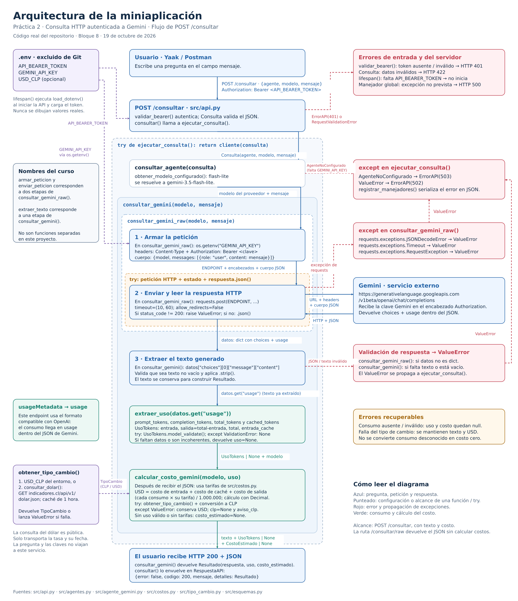
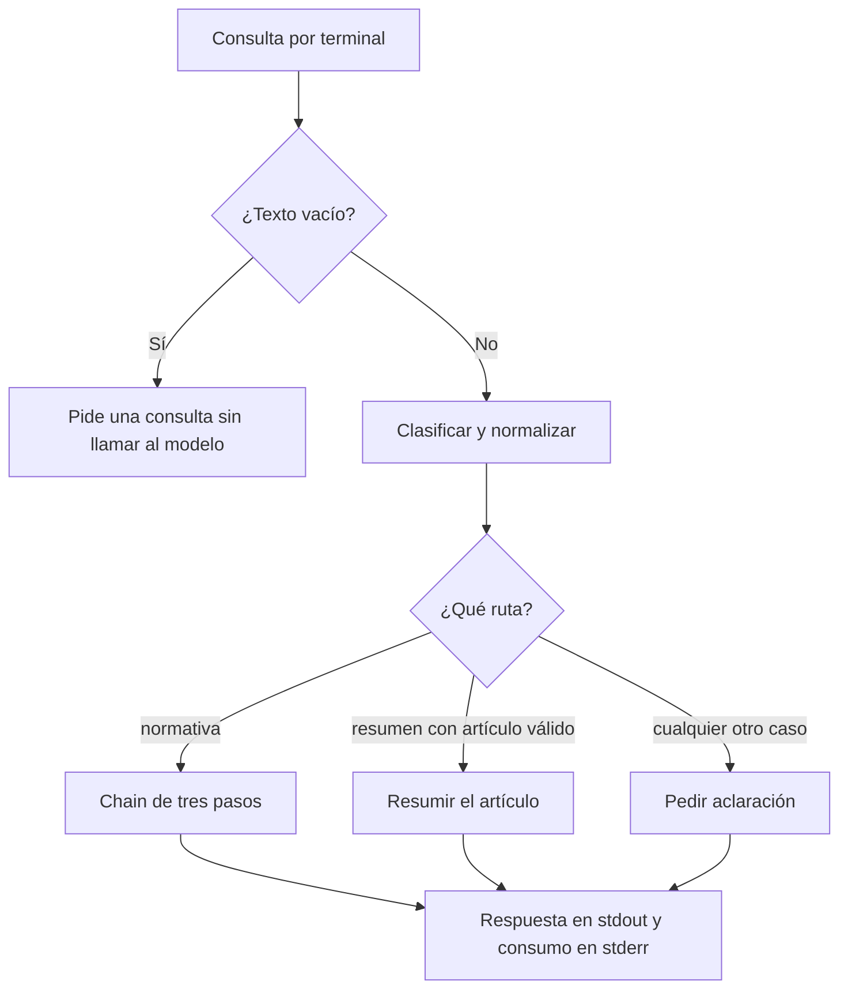
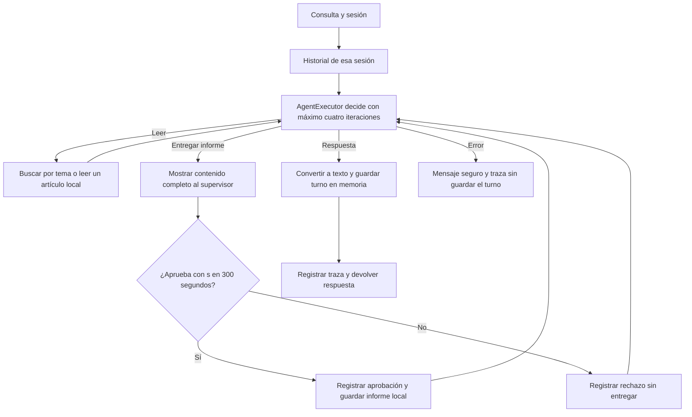
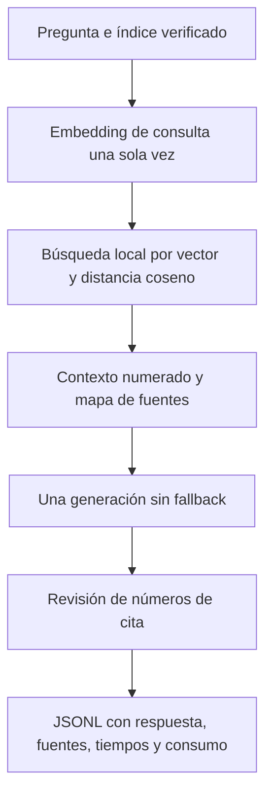

# Arquitectura de la miniaplicación

Actividad práctica del Bloque 8: recorrido de una pregunta desde el usuario hasta la respuesta, con credenciales, manejo de errores, consumo de tokens y costo estimado.

La [decisión de arquitectura del Bloque 9](seleccion-modelo.md) utiliza este diagrama y documenta la comparación de modelos con mediciones reales de costo y latencia.



El diagrama representa el flujo base entregado en el Bloque 8. El Bloque 10 agrega la selección opcional de prompts, las instrucciones de sistema y la validación del contenido JSON, descritas en esta nota y en la [guía de prompts](../estudio/bloque-10-prompts.md). El Bloque 12 incorpora la política interna de reintentos descrita abajo y en la [guía de uso](../guias/guia-completa.md#cliente-con-reintentos-bloque-12). El archivo [editable de draw.io](diagramas/flujo-api.drawio) permite modificar las cajas, los textos y las conexiones. Para abrirlo, usa **Archivo → Abrir desde → Dispositivo** en diagrams.net.

## Correspondencia con la actividad

La consigna parte de tres funciones llamadas `armar_peticion`, `enviar_peticion` y `extraer_texto`. Las primeras dos responsabilidades se reúnen aquí en `consultar_gemini_raw()`; desde el Bloque 10, `extraer_texto()` existe como función independiente. Las tres cajas numeradas del diagrama identifican los tramos originales:

| Responsabilidad del curso | Implementación en este repositorio |
| --- | --- |
| `armar_peticion` | Primer tramo de `consultar_gemini_raw()`: lee `GEMINI_API_KEY` y arma los encabezados y el cuerpo. |
| `enviar_peticion` | `_enviar_peticion()` hace un solo `requests.post()`, clasifica el estado HTTP y decodifica el JSON. `consultar_gemini_raw()` la ejecuta mediante `con_reintento()`. |
| `extraer_texto` | `extraer_texto()`, invocada por `consultar_gemini()`, lee `choices[0].message.content`, valida el texto y elimina espacios en los extremos. |

El proyecto utiliza el endpoint compatible con OpenAI de Gemini. Por eso el dato de consumo se llama **`usage`**, en lugar de **`usageMetadata`**, que es el nombre utilizado en la consigna. El diagrama muestra el campo que procesa el código real.

## Recorrido de la consulta

1. El usuario envía a `POST /consultar` un JSON con `agente`, `modelo` y `mensaje`, opcionalmente `prompt`, junto con el Bearer token de la API local.
2. `validar_bearer()` autentica y `Consulta` valida los datos. `consultar()` llama a `ejecutar_consulta()` con `consultar_agente`.
3. `consultar_agente()` resuelve el modelo del catálogo y ejecuta `consultar_gemini(modelo, mensaje)`, pasando también `prompt` si fue seleccionado.
4. `consultar_gemini_raw()` prepara la petición a Gemini y llama a `con_reintento()` con `_enviar_peticion()`. Si se eligió un prompt, agrega un mensaje `system` y un `response_format` con el JSON Schema del banco. La credencial del proveedor se utiliza en `Authorization: Bearer <GEMINI_API_KEY>` y se conserva el mismo cuerpo entre intentos.
5. Con el JSON recibido, `consultar_gemini()` usa `extraer_texto()`. Con un prompt exige finalización `stop` y llama a `parsear_respuesta_json()`, que interpreta el contenido y lo valida estrictamente con Pydantic. Después llama a `extraer_uso(datos.get("usage"))`.
6. `calcular_costo_gemini()` utiliza el consumo y las tarifas registradas para calcular USD. Luego intenta obtener el tipo de cambio y convertir a CLP.
7. `consultar_gemini()` devuelve `Resultado(respuesta, uso, costo_estimado)` y la API lo publica dentro de `RespuestaAPI.detalles`.

`.env` se carga al iniciar la API mediante `load_dotenv()`, dentro de `lifespan()`. `API_BEARER_TOKEN` autentica al cliente ante la API local; `GEMINI_API_KEY` autentica la petición saliente ante Gemini. El diagrama identifica las variables sin incluir sus valores.

## Manejo de errores

| Lugar | Alcance y comportamiento |
| --- | --- |
| `_enviar_peticion()` | Hace un intento y convierte errores de Requests en categorías de `errores_cliente.py`. HTTP 401/403 genera `ErrorAutenticacion`; 429/500/502/503/504 genera `ErrorTemporalProveedor`; los demás estados generan `ErrorPeticion`. Los cuerpos de error del proveedor no se leen ni se exponen. |
| Transporte y lectura | `ConnectTimeout` y fallos identificados de apertura/DNS son temporales. `Timeout` de lectura genera `ErrorTimeoutLectura`, sin reintentos por defecto. Un error TLS o una conexión interrumpida cuyo momento se desconoce no se reintenta. Se consulta el tipo de error interno de urllib3 para identificar fallos anteriores al envío, sin activar un segundo motor de reintentos. |
| `con_reintento()` | Solo repite errores temporales autorizados por la política: hasta 3 intentos, backoff con jitter, `Retry-After` y presupuesto compartido de 90 s. Devuelve el resultado o lanza `ReintentosAgotados` con causa y cantidad de intentos. Una política de un intento conserva el error original. |
| `consultar_gemini_raw()` y `consultar_gemini()` | Un JSON que no es un objeto, texto ausente, salida truncada o incumplimiento del esquema genera `ErrorRespuesta`. La extracción y validación del texto ocurren después del reintento HTTP y no provocan otra generación. |
| `ejecutar_consulta()` | `AgenteNoConfigurado` conserva HTTP 503. Los errores del cliente se traducen a 502 para fallos permanentes o respuestas inválidas, 503 para intentos temporales agotados y 504 para timeout de lectura o presupuesto agotado. Incluye categoría, código del proveedor cuando se conoce e intentos al agotar la política; otros `ValueError` conservan HTTP 502. |
| `extraer_uso()` | El `try` envuelve `UsoTokens.model_validate()`. `except ValidationError` devuelve `None`. También se rechaza el consumo incompleto o incoherente. |
| `calcular_costo_gemini()` | El `try` envuelve la obtención del tipo de cambio y la conversión. `except ValueError` conserva los costos en USD y publica `aviso_clp`; los campos de conversión quedan en `None`. |
| `obtener_tipo_cambio()` | Si existe `USD_CLP`, intenta convertirlo a `Decimal` y construir `TipoCambio`. Captura `InvalidOperation` y `ValidationError`, y genera `ValueError`. |
| `consultar_dolar()` | El `try` comprende la consulta pública, la lectura del JSON y la validación del tipo de cambio. Captura `RequestException` y `ValueError`, y genera un `ValueError` explicativo. |

Las validaciones de entrada producen HTTP 401 o 422. Los manejadores registrados en `src/api/respuestas.py` mantienen el contrato JSON de error; una excepción no prevista produce HTTP 500.

Con un prompt, una salida truncada o que no cumple su esquema genera `ErrorRespuesta` y la API responde HTTP 502 sin reintentar. `Resultado.respuesta` admite texto libre u objeto validado según la selección. El modo raw permite observar incluso contenido inválido sin transformarlo.

La API y el CLI usan la política predeterminada; las funciones públicas aceptan `politica=PoliticaReintento(...)`. El CLI expone `--intentos` y `--presupuesto-segundos`. Los evaluadores de modelos y de prompts pasan `SIN_REINTENTOS` explícitamente para conservar una sola petición por medición. No registran como cero el costo de un intento sin consumo recibido. La estimación del cliente normal describe la respuesta final y no prueba el costo total de intentos anteriores.

El presupuesto se comprueba antes de cada intento y espera y reduce los timeouts; no cancela de forma estricta una petición ya en curso. Los mensajes de reintento usan `logging`, sin prompts, claves ni cuerpos del proveedor, y no contaminan el JSON de stdout.

Si faltan metadatos válidos, `uso` y `costo_estimado` quedan en `null`. Si hay consumo válido pero no existen tarifas para el modelo, solo `costo_estimado` queda en `null`. En ambos casos se conserva el texto generado.

## Flujo orquestado: bloques 18 a 20

`src/orquestacion/` es una segunda entrada, solo por terminal, para consultas de Ley REP. No pasa por la API ni por `consultar_gemini_raw()`, y el diagrama de esta nota no la representa. Por eso las secciones anteriores sobre reintentos, categorías de error y cuerpos del proveedor no se aplican a este flujo.



Cada ruta está protegida por `construir_ruta_segura()`: si falla, se repite con el modelo secundario y, si este también falla, entrega un texto de respaldo. Un fallo fuera de las rutas, como el de la clasificación, llega al `try/except` de `procesar_consulta_segura()`.

| Aspecto | Cliente propio | Flujo orquestado |
| --- | --- | --- |
| Entrada | API local y terminal. | Solo terminal. |
| Conexión con Gemini | Endpoint compatible con OpenAI, con `requests`. | API nativa, con `ChatGoogleGenerativeAI`. |
| Reintentos | Hasta 3 intentos con backoff, salvo política distinta. | Un intento por llamada: un fallo pasa directamente al modelo secundario. |
| Tiempo | Presupuesto compartido de 90 s. | 30 s por llamada, sin límite común para todo el flujo. |
| Errores | Categorías de `src/clientes/errores.py`. | Excepciones del conector, registradas por `registrar_error()`. |
| Cuerpos del proveedor | No se leen ni se exponen. | El registro incluye el mensaje del error, que puede traer ese cuerpo. |
| Salida | JSON con respuesta, uso y costo. | Texto libre, sin validar las citas. |
| Costos | Se registran después de los reintentos. | `RegistroLlamadas` registra cada llamada en el mismo registro de sesión. |

Una respuesta vacía no lanza una excepción en el conector, así que `exigir_texto()` la convierte en error para que actúe el fallback. Las decisiones están en el [PRD 02](../planes/prd-02-orquestacion-langchain.md) y los resultados y límites en la [entrega de los bloques 18 a 20](../entregas/bloques-18-20.md).

## Agente con supervisión: bloques 21 a 23

Es otra entrada por terminal, independiente de la API y del enrutamiento del PRD 02.
Reutiliza `crear_modelo()` y el registro de costos, pero no repite el flujo ni cambia
de modelo cuando falla: podría duplicar una entrega ya aprobada.



La memoria guarda solo consulta y respuesta final y se pierde al terminar el
proceso. Las herramientas y observaciones quedan en la traza, no en el historial.
Cada sesión se identifica mediante la configuración del runnable; la herramienta
de entrega obtiene ese identificador del contexto, sin pedírselo al modelo.

`supervision.py` escribe decisiones y trazas JSONL en `output/agente/`, ignorado por
Git. El registro de aprobación es previo e independiente de la respuesta final del
modelo. Si este falla después de actuar, puede perderse la acción en los
`intermediate_steps`, pero se conserva su decisión y el archivo entregado. El
registro de aprobación no es una transacción con el archivo: un fallo de guardado
no se presenta como entrega confirmada.

La entrega es simulada y requiere una terminal interactiva; solo crea un Markdown
local, sin contacto con clientes. Los límites y el estado de la verificación humana
se detallan en [límites de autonomía](limites-autonomia-agente.md) y en
[la entrega](../entregas/bloques-21-23.md).

## RAG medido: bloques 24 a 28

Otra entrada de terminal, separada del agente y de la API. No ejecuta herramientas
ni envía informes. `src/rag/corpus.py` carga los 50 documentos existentes y genera
99 chunks con fuente, artículo, páginas, versión, ID y offset. La indexación con
`scripts/indexar_corpus.py` calcula embeddings de documentos una vez y persiste
vectores, textos y metadata en Chroma. Un manifiesto verifica configuración y
contenido al recargar; no se crean índices vacíos durante una consulta.



`scripts/evaluacion_recuperacion.py` se detiene tras recuperar: compara los IDs con
diez casos etiquetados y guarda precisión/recall. `scripts/registro_rag.py` ejecuta
el flujo completo, cronometra las tres etapas y conserva tokens reales de
generación. No se repite el embedding dentro de la búsqueda.

Los registros distinguen tiempo de pared de la suma de etapas y costo conocido
de generación del costo completo desconocido. El SDK de embeddings puede
reintentar internamente; no se afirma una única petición HTTP ni se estima su
consumo como cero. La indexación y la carga inicial no se incluyen en el tiempo
de una consulta con el sistema ya cargado.

Índice en `vectorstore/`, registros en `output/rag/`, ambos ignorados. Se
deshabilita la telemetría anónima de Chroma; las pruebas bloquean red y usan
embeddings/modelos falsos con Chroma real en temporales. Las consultas y respuestas
se guardan completas: no se ha implementado anonimización ni operación pública.
El texto sigue siendo una copia de 2016; citas existentes no prueban respaldo
semántico o vigencia. Ver [PRD 04](../planes/prd-04-rag-ley-rep.md), [guía de estudio](../estudio/bloques-24-28.md)
y [entrega con estado de las corridas reales](../entregas/bloques-24-28.md).

## Alcance y entrega

La imagen muestra el flujo base de `POST /consultar`; la selección opcional de prompts se describe arriba. La ruta `POST /consultar/raw` devuelve el JSON del proveedor sin extraer texto ni calcular costos. La entrada por terminal reutiliza el cliente Gemini; el diagrama se centra en la entrada HTTP de la miniaplicación.

Los archivos de entrega son `docs/arquitectura/diagramas/flujo-api.png` y su fuente editable `docs/arquitectura/diagramas/flujo-api.drawio`. Esta nota documenta cómo se adaptó la consigna al proyecto.

Para registrar y publicar únicamente esta documentación, desde la raíz del repositorio:

```bash
git add docs/arquitectura/diagramas/flujo-api.png docs/arquitectura/diagramas/flujo-api.drawio docs/arquitectura/vision-general.md
git commit -m "agrega diagrama de arquitectura de la miniaplicación"
git push
```

Las funciones y los datos representados se contrastaron con `src/api/app.py`, `src/agentes.py`, `src/clientes/gemini.py`, `src/catalogo.py`, `src/costos/calculadora.py`, `src/costos/tipo_cambio.py`, `src/api/esquemas.py` y `src/api/respuestas.py`.
