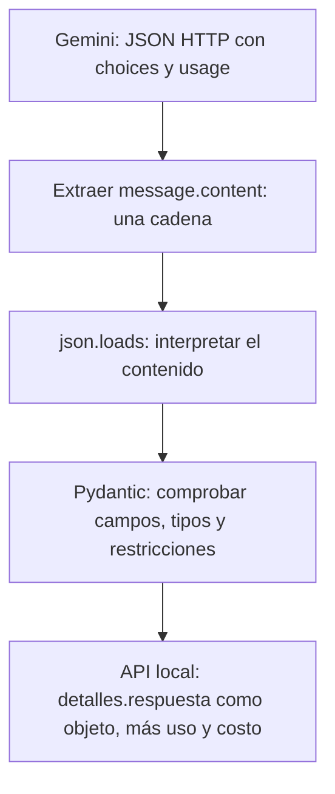

# Bloque 10: aprender los PDF con este proyecto

Las tres lecciones forman una secuencia: separar las instrucciones del contenido, pedir una estructura que Python pueda utilizar y medir si esa combinación funciona repetidamente. El proyecto implementa esa secuencia en [el banco](../prompts/banco.py), [el cliente](../src/agente_gemini.py), [el validador](../src/salida_estructurada.py) y [el evaluador real](../prompts/test_consistencia.py).

## 1. Prompt de sistema: las reglas de una tarea

Piensa en una ficha de trabajo. La ficha dice qué debes hacer y cómo entregar el resultado; debajo aparecen los datos del caso. Al cambiar los datos, las reglas de la ficha se reutilizan.

En una llamada al modelo:

| Parte | Ejemplo | Quién la administra aquí |
| --- | --- | --- |
| Sistema | Explica conceptos en español e incluye explicación, analogía y ejemplo en JSON. | La aplicación, mediante el banco. |
| Usuario | ¿Qué es una API? | Quien hace la consulta. |

Nuestro cliente envía ambos mensajes por separado:

```python
"messages": [
    {"role": "system", "content": definicion.system_instruction},
    {"role": "user", "content": mensaje}
]
```

El rol no es parte del texto: es un campo del protocolo. Escribir "SYSTEM: ..." dentro de la pregunta no crea un mensaje de sistema.

El punto de entrada es `prompts/banco.py`, que reúne los grupos. En [base.py](../prompts/base.py), `REGLAS_DE_SALIDA` reúne idioma y formato; en [educativos.py](../prompts/educativos.py), `REGLAS_COMUNES` añade el rol educativo; en [ley_rep.py](../prompts/ley_rep.py), `REGLAS_REP` añade el rol documental para Ley REP. Cada tarea añade sus reglas particulares junto a su esquema y ejemplo. Por ejemplo, el diagnóstico HTTP debe distinguir la credencial de Google del token de la API local.

La separación permite revisar y versionar las instrucciones. También ayuda a marcar que el texto del usuario es contenido a procesar. No convierte el prompt en una barrera infalible contra instrucciones maliciosas; esa resistencia requeriría pruebas específicas.

**No hay memoria automática:** cada petición vuelve a enviar el mensaje de sistema. Reutilizarlo en Python evita duplicar su definición, pero sus tokens siguen formando parte de la entrada enviada al proveedor.

## 2. Salida estructurada: una ficha que Python puede leer

Una persona puede entender este párrafo:

> Parece que el token está mal. Revisa el encabezado de autorización.

Pero para mostrar un código de error, una causa y una lista de pasos en una interfaz, conviene recibir campos separados. Esta es una forma ilustrativa de la salida de diagnóstico:

```json
{
  "codigo_http": 401,
  "causa_probable": "Podría faltar el Bearer token de la API local.",
  "pasos_revision": [
    "Comprobar que Authorization use el esquema Bearer.",
    "Comparar el token enviado con API_BEARER_TOKEN del servidor."
  ]
}
```

Python puede consultar `datos["codigo_http"]` o recorrer `datos["pasos_revision"]`. No necesita adivinar dónde aparecen esos datos en un párrafo.

En JSON, `401` es un número; `"401"` es texto. Los corchetes `[]` representan una lista, las llaves `{}` un objeto y `null` expresa ausencia de un valor. Nuestro diagnóstico exige que `codigo_http` esté presente, pero permite `null` si el usuario no indicó un código.

### Pedirlo y validarlo son pasos diferentes

La instrucción de sistema pide JSON. Además, el cliente envía una configuración de salida estructurada:

```python
"response_format": {
    "type": "json_schema",
    "json_schema": {
        "name": prompt,
        "strict": True,
        "schema": definicion.response_schema
    }
}
```

El esquema describe los campos, sus tipos y sus restricciones. Lo generamos desde Pydantic para utilizar una misma definición al pedir el resultado y al validarlo en Python.

La API de los PDF y nuestro endpoint expresan estas piezas de manera diferente:

| PDF: `models.generateContent` | Proyecto: `openai/chat/completions` |
| --- | --- |
| `systemInstruction` | Mensaje `system` dentro de `messages`. |
| `contents` | Mensaje `user` dentro de `messages`. |
| `generationConfig.responseSchema` | `response_format` con `json_schema`. |
| Texto en `candidates` | Texto en `choices[0].message.content`. |

La [documentación oficial de compatibilidad de Gemini](https://ai.google.dev/gemini-api/docs/openai#structured-output) describe la separación de roles y la salida estructurada. Seguimos usando `requests`; no hace falta instalar un SDK para construir estos campos.

### Hay tres estructuras distintas en el recorrido



1. `respuesta.json()` interpreta el cuerpo HTTP del proveedor. Que ese cuerpo sea JSON no significa que el texto generado dentro también lo sea.
2. `parsear_respuesta_json()` utiliza `json.loads()` para interpretar el contenido generado y Pydantic para validarlo.
3. FastAPI publica el objeto ya validado dentro de `detalles.respuesta`. Python añade el consumo y calcula el costo; esos importes no los inventa el modelo.

Sin `prompt`, la consulta permite texto libre como antes. Con `prompt`, una salida inválida se rechaza: no se publica como si hubiera cumplido el contrato. El modo raw sirve para inspeccionar el cuerpo original del proveedor, incluso cuando el contenido generado no cumple.

### Qué comprobamos antes de aceptar una salida

| Resultado recibido | Decisión |
| --- | --- |
| Objeto completo que cumple el esquema. | Aceptar. |
| Objeto válido envuelto en un único bloque de Markdown. | Retirar las marcas y validar. |
| JSON cortado o prosa antes del objeto. | Rechazar: no se reconstruyen fragmentos. |
| Lista cuando se esperaba un objeto. | Rechazar. |
| Falta una clave o aparece una no permitida. | Rechazar. |
| `codigo_http` es `"401"`, `true` o un número fuera de 100–599. | Rechazar. |
| Texto vacío o lista de pasos vacía. | Rechazar. |
| Gemini informa finalización distinta de `stop`. | Rechazar como salida incompleta. |

El parser genera un `ValueError` explicativo y la API lo convierte en HTTP 502. No hay reintentos automáticos que oculten un fallo o consuman llamadas adicionales. El evaluador conserva los errores y diferencia un fallo de estructura de un error HTTP, de cuota o de conexión.

## 3. Banco de prompts: tareas reutilizables y evidencia

Un banco organiza una definición completa por tarea:

| Elemento | Para qué sirve |
| --- | --- |
| Nombre y versión. | Identificar qué configuración estamos usando. |
| Instrucción de sistema. | Establecer el comportamiento de la tarea. |
| Ejemplo de usuario. | Probar siempre la misma entrada. |
| Modelo Pydantic y JSON Schema. | Definir y comprobar la salida. |

El banco contiene seis prompts. Los educativos son `explicar_concepto`, `diagnosticar_error_http` y `resumir_texto_tecnico`. La preparación del proyecto final agrega `preparar_consulta_rep`, `resumir_fragmento_rep` y `responder_ley_rep`; sus entradas y ejemplos están en el [README](../README.md#prompts-para-el-proyecto-final-de-ley-rep). Al elegir uno desde la API se envía su nombre, no instrucciones de sistema arbitrarias del cliente.

La actividad pide al menos tres repeticiones reales por prompt. La cuenta es:

```text
6 prompts × 3 repeticiones = 18 llamadas a Gemini
consistencia observada = respuestas válidas / intentos realizados
```

Consistente no significa idéntico palabra por palabra: pueden cambiar la analogía o la redacción y conservar el contrato. El evaluador registra cada intento, las instrucciones, la entrada y el esquema, la respuesta original, el resultado validado, el consumo, el costo estimado y la latencia HTTP.

`prompts/registro_resultados.json` contiene la evaluación de las instrucciones de los tres prompts educativos; los tres nuevos de Ley REP aún no tienen evaluación real. La primera ejecución se conserva en `prompts/registro_resultados_inicial.json`. Cada error queda guardado, no desaparece del denominador. Los HTTP fallidos sin consumo informado tienen costo desconocido (`null`), no costo cero. Si llegó consumo de una salida inválida, también se conserva.

La ejecución inicial del **21 de octubre de 2026** utilizó `gemini-3.5-flash-lite` y produjo estos resultados:

| Prompt | Válidas | Fallos |
| --- | --- | --- |
| `explicar_concepto` | 3/3 | 0 |
| `diagnosticar_error_http` | 3/3 | 0 |
| `resumir_texto_tecnico` | 3/3 | 0 |

Las primeras nueve llamadas sumaron **US$ 0.0041241 de costo estimado**, calculado con las tarifas registradas y el consumo informado. No es un comprobante de facturación.

### Qué ajustamos después de revisar el contenido

Aunque todas las estructuras cumplieron, la lectura de los textos mostró dos problemas:

| Observación en el registro inicial | Ajuste en el banco |
| --- | --- |
| Las tres explicaciones propusieron código de un SDK que este proyecto no utiliza. | `explicar_concepto` pasó a versión 1.1: el ejemplo debe ser un uso descrito en lenguaje natural, sin código ni versiones. |
| El tercer diagnóstico mencionó la posibilidad de un token local expirado. Nuestro token es un secreto estático. | `diagnosticar_error_http` pasó a versión 1.1: el sistema explica que no hay firma, expiración ni renovación automática. |

Se repitió la evaluación completa con las instrucciones ajustadas, guardando una segunda evidencia. Los registros conservan la versión y las instrucciones exactas de cada corrida; las respuestas originales no se reescribieron. Este ajuste surge de revisar el contenido, no de un fallo del parser.

La evaluación posterior volvió a obtener **3/3 por prompt (9/9)** y costó **US$ 0.0039965 estimados**. Al leerla, las tres explicaciones usan ejemplos en lenguaje natural y los tres diagnósticos se refieren al token estático sin suponer su expiración. Es una observación de esta muestra, no una garantía para futuras respuestas. Las dos corridas suman **18 llamadas reales, 6.440 tokens y US$ 0.0081206 estimados**.

Un resultado de 3/3 muestra que esos tres intentos cumplieron. No demuestra que el prompt acertará siempre, que entiende todos los temas ni que resiste ataques. La corrección del contenido se revisa aparte. Si aparece un fallo repetido, ajustamos instrucciones o esquema, cambiamos la versión y guardamos otra evaluación para comparar.

## 4. Pruébalo paso a paso

Desde la raíz del repositorio, con `.env` configurado, ejecuta una explicación:

```bash
uv run python -m src.agente_gemini --prompt explicar_concepto "¿Qué es un Bearer token?"
```

Observa que `respuesta` es un objeto con cuatro campos. Cambia solo la pregunta a `¿Qué es un timeout?`: se reutilizan las mismas reglas y el mismo esquema.

Prueba otra tarea:

```bash
uv run python -m src.agente_gemini --prompt diagnosticar_error_http "Mi API local devuelve HTTP 401 antes de consultar Gemini."
```

Para ver el cuerpo original del proveedor, añade `--raw` a cualquiera de los comandos. Esa acción realiza una nueva consulta real: no recupera la respuesta de la ejecución anterior.

En Postman o Yaak, envía a `POST /consultar` el Bearer token local habitual y este cuerpo:

```json
{
  "agente": "gemini",
  "modelo": "flash-lite",
  "prompt": "resumir_texto_tecnico",
  "mensaje": "Python configura timeouts al consultar Gemini. Los errores de cuota se registran y el consumo lo informa el proveedor."
}
```

La colección `api.postman_collection.json` incluye una solicitud por cada tarea educativa original.

Para repetir toda la actividad y conservar la primera evidencia:

```bash
uv run python -m prompts.test_consistencia --salida prompts/registro_resultados_nueva_ejecucion.json
```

Elige un nombre de salida que no exista. El script llama a Gemini 18 veces por defecto y consume cuota. Las pruebas de `uv run python -m tests -v` utilizan simulaciones y verifican nuestro código; el script anterior verifica las salidas reales del modelo.

## 5. Comprueba que lo entendiste

1. **¿Cambias el sistema para preguntar por APIs y luego por timeouts?** No, si ambas preguntas pertenecen a `explicar_concepto`: cambia el mensaje del usuario.
2. **¿`{"codigo_http": "401"}` es JSON válido?** Sí. Pero no cumple nuestro contrato: falta el resto de los campos y el código tiene tipo texto.
3. **¿Un JSON completo demuestra que la causa del error es correcta?** No. Estructura y exactitud del contenido se evalúan por separado.
4. **¿Tres resultados válidos prueban que nunca fallará?** No. Son una muestra inicial de consistencia para la actividad.

Los prompts de Ley REP permiten preparar la consulta, resumir un artículo y devolver respuesta, citas y antecedentes faltantes como campos separados. La [fuente local](../datos/ley_rep/README.md) conserva el PDF aportado, su texto y 50 artículos con páginas y procedencia. Una pregunta normal con `responder_ley_rep` carga todos los artículos; `resumir_fragmento_rep` admite referencias como `artículo 3`. El contexto explícito en JSON sigue disponible. Esta integración usa la copia de 2016 y no comprueba vigencia actual.

Pydantic exige citas para el estado `respondida` y antecedentes para `requiere_aclaracion`; no verifica su existencia ni su respaldo documental. La recuperación de documentos y la comprobación de respaldo siguen pendientes para el RAG.

## Material de clase consultado

- [Separar el prompt de sistema y la conversación](</home/brandonhc/Downloads/b2b-accenture-especializacion-en-ia-2-octubre-2026_ Prompt de sistema con salida JSON estructurada (Bloque 10) _ Prompt de sistema, no conversación_ la diferencia real _ Skillnest.pdf>).
- [Forzar salida JSON y manejar respuestas inválidas](</home/brandonhc/Downloads/b2b-accenture-especializacion-en-ia-2-octubre-2026_ Prompt de sistema con salida JSON estructurada (Bloque 10) _ Cómo forzar salida JSON y qué hacer si el modelo se resiste _ Skillnest.pdf>).
- [Construir el banco y validar su consistencia](</home/brandonhc/Downloads/b2b-accenture-especializacion-en-ia-2-octubre-2026_ Prompt de sistema con salida JSON estructurada (Bloque 10) _ Construye tu banco de prompts y valida su consistencia [Actividad core] _ Skillnest.pdf>).
