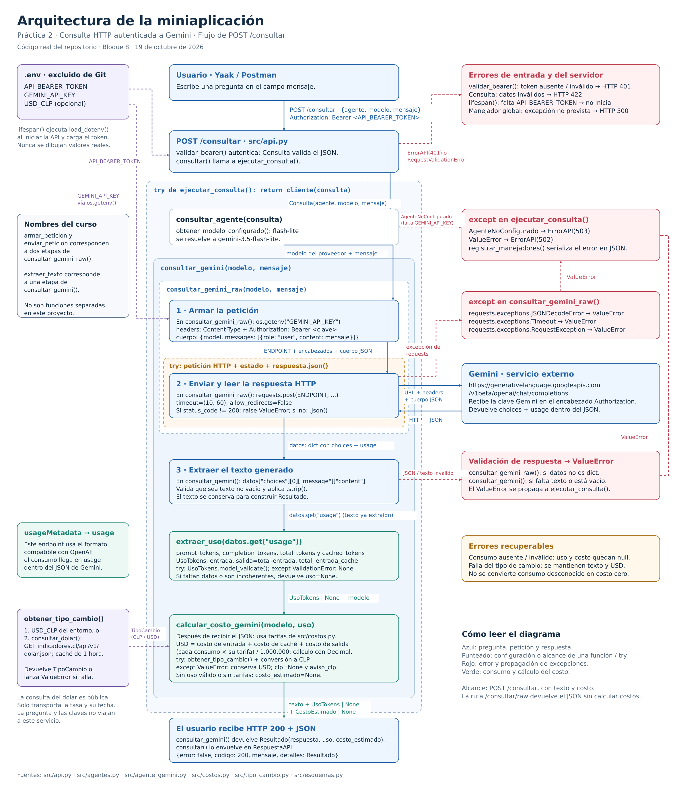

# Decisión de arquitectura: elección de modelo

**Actividad:** Skillnest, Bloque 9, registro de decisión de arquitectura.

**Fecha:** 20 de octubre de 2026, America/Santiago.

**Estado:** aceptada para el alcance actual de la miniaplicación.

Este registro corresponde a la práctica HTTP. La selección de modelos para el [proyecto RAG de Ley REP](../README.md#proyecto-final-de-skillnest-asistente-rag-para-ley-rep) requiere una evaluación específica de calidad normativa.

## Modelo elegido

Se elige **Gemini 3.5 Flash-Lite**, identificador `gemini-3.5-flash-lite`. La API lo resuelve mediante `agente: "gemini"` y `modelo: "flash-lite"` en [src/catalogo.py](../src/catalogo.py). La prueba por terminal utiliza el mismo modelo.

La miniaplicación atiende preguntas breves de aprendizaje sobre Python, APIs y autenticación. Para ese uso se prioriza el costo por consulta, seguido del tiempo de respuesta, con una revisión de calidad del contenido. Los importes que publica la aplicación se calculan con código y `Decimal`, a partir del consumo informado por Gemini.

## Diagrama de arquitectura



Se reutiliza el diagrama del Bloque 8, guardado en esta misma carpeta. Están disponibles su [fuente editable en draw.io](diagrama_arquitectura.drawio) y la [explicación del recorrido y manejo de errores](arquitectura.md).

La evaluación llama al cliente `consultar_gemini_raw()` que usa la aplicación. Después del tramo HTTP procesa el consumo y aplica `calcular_costo_gemini()`. Los dos candidatos usan el mismo endpoint compatible con OpenAI de Gemini, `https://generativelanguage.googleapis.com/v1beta/openai/chat/completions`, con la misma clave de proveedor. El Bearer token de la API local se valida antes de ese tramo y no se envía a Google.

## Comparación de candidatos

### Disponibilidad y selección

El endpoint `GET /v1beta/models`, autenticado con la clave de este proyecto, devolvió **63 entradas**. El inventario completo, con nombres, límites y métodos, está en [la evidencia de la evaluación](evaluaciones/gemini-2026-10-20.json), campo `modelos_disponibles`. Entre otros, enumera modelos de texto como `gemini-3.1-flash-lite`, `gemini-3.5-flash-lite`, `gemini-3.6-flash`, `gemini-3.8-flash` y `gemini-4-argon`, además de modelos de imagen, audio, video y embeddings.

Se compararon el modelo ya integrado, **Gemini 3.5 Flash-Lite**, y una alternativa de la familia Flash, **Gemini 3.6 Flash**. Es una comparación acotada de dos candidatos para esta aplicación, no una búsqueda del modelo óptimo entre todo el catálogo. Se mantienen identificadores de versión, en lugar de alias `latest`, para identificar qué se evaluó. Las fichas oficiales documentan ambos como versiones estables: [Flash-Lite](https://ai.google.dev/gemini-api/docs/models/gemini-3.5-flash-lite) y [Flash](https://ai.google.dev/gemini-api/docs/models/gemini-3.6-flash).

Inicialmente se intentó comparar Flash-Lite con **Gemini 3.8 Flash**. Este último devolvió dos HTTP 503 consecutivos, después de **50.685 s** y **39.686 s**. Se detuvo esa serie durante una tercera solicitud a Flash 3.8, cuyo resultado y consumo son desconocidos. La [evidencia de esa serie interrumpida](evaluaciones/gemini-3.8-evaluacion-interrumpida-2026-10-20.json) conserva los cinco intentos finalizados y registra por separado la solicitud interrumpida. Se sustituyó el candidato para poder medir respuestas reales; esto no demuestra indisponibilidad permanente ni global de Flash 3.8. Figurar en el inventario no garantiza cuota ni éxito al generar una respuesta.

### Método de medición

- **Ejecución:** 20 de octubre de 2026, de 21:07:11 a 21:10:12 en Santiago; los registros usan UTC, del `2026-10-21T00:07:11` al `2026-10-21T00:10:12`.
- **Carga:** tres preguntas en español: explicar una API, diagnosticar errores HTTP y calcular un costo con datos fijados en la pregunta. Se pidieron secciones breves y entre 150 y 200 palabras. Los textos exactos están en `casos` del JSON y en [src/comparar_modelos.py](../src/comparar_modelos.py).
- **Muestra:** tres repeticiones por caso y modelo: nueve intentos por candidato, **18 consultas reales** en la serie principal. La serie inicial interrumpida se conserva aparte y no participa en sus promedios.
- **Condiciones:** solicitudes independientes, secuenciales, sin historial ni streaming; se intercalaron los modelos y se rotó quién consultaba primero. Se usó el mismo cuerpo de petición que la aplicación, con los parámetros predeterminados de cada modelo, sin ajustar temperatura, longitud máxima ni presupuesto de razonamiento. No hubo calentamiento ni reintentos automáticos.
- **Latencia:** `perf_counter()` alrededor de `consultar_gemini_raw()`, hasta recibir y decodificar el JSON completo. Incluye red y conexión HTTP; excluye el cálculo de costos y la consulta del dólar. No es tiempo al primer token ni latencia completa de `POST /consultar`. Los timeouts son 10 s de conexión y 60 s de lectura; el timeout de lectura no es un límite total de ejecución.
- **Consumo:** se conserva `usage` original. Entrada = `prompt_tokens`; salida facturable = `total_tokens - prompt_tokens`, para incluir razonamiento aunque no aparezca en `completion_tokens`. No se suman ambos campos de salida. No se reportaron tokens de entrada desde caché en estas respuestas.
- **Errores:** se guardan duración y causa. Sin consumo informado, el costo queda en `null`, nunca en cero. Una respuesta completa requiere texto, `finish_reason: "stop"` y consumo válido; la corrección del contenido se revisa por separado.
- **Comparación equivalente:** los promedios principales usan únicamente las seis parejas de caso y ronda en que ambos modelos respondieron correctamente a nivel de transporte, dos parejas por cada caso. Así se compara el mismo conjunto de preguntas. El JSON conserva también los promedios de todas las respuestas completas y los errores de los nueve intentos de cada candidato.

### Tarifas y fórmula

Tarifas **Standard de pago**, verificadas el 20 de octubre de 2026, en USD por **1.000.000 de tokens**. Los valores corresponden a texto y no incluyen herramientas, almacenamiento de caché ni impuestos. Fuente: [precios oficiales de Gemini](https://ai.google.dev/gemini-api/docs/pricing).

| Modelo | Entrada sin caché | Entrada desde caché | Salida, incluido razonamiento |
| --- | ---: | ---: | ---: |
| `gemini-3.5-flash-lite` | USD 0.30 | USD 0.03 | USD 2.50 |
| `gemini-3.6-flash` | USD 0.75 | USD 0.075 | USD 3.75 |

Los precios de Flash 3.6 son promocionales hasta el **31 de diciembre de 2026**. Google publica USD 1.50 / 0.15 / 7.50 para entrada / caché / salida desde el 1 de enero de 2027. El evaluador exige actualizar las tarifas después del vencimiento. La evidencia guarda las tarifas aplicadas para conservar el cálculo histórico.

```text
costo_USD = ((entrada - entrada_cache) × tarifa_entrada
             + entrada_cache × tarifa_cache
             + salida_facturable × tarifa_salida) / 1.000.000
costo_CLP = costo_USD × CLP_por_USD
```

Se utilizó **981.86 CLP por USD**, dato del **20 de octubre de 2026**, obtenido de [indicadores.cl](https://indicadores.cl/api/v1/dolar.json). La fecha, tasa y fuente quedan registradas en cada medición. El tipo de cambio **950** del caso `calculo_costo` es un dato hipotético del ejercicio, no la tasa usada para valorar las consultas reales.

### Resultados reales

En las tablas se usa punto decimal. Los valores de presentación se redondean; los registros conservan mayor precisión.

| Métrica | Gemini 3.5 Flash-Lite | Gemini 3.6 Flash |
| --- | ---: | ---: |
| Respuestas completas / intentos de la serie principal | **9 / 9** | **6 / 9** |
| HTTP 503 observados | 0 | 3 |
| Parejas completas usadas para comparar costo y latencia | 6 | 6 |
| Latencia media de las parejas | **2.507 s** | **16.070 s** |
| Latencia mediana de las parejas | 2.551 s | 14.852 s |
| Latencia mínima a máxima de las parejas | 1.777 a 3.171 s | 9.591 a 23.246 s |
| Tokens medios de entrada de las parejas | 95.667 | 95.667 |
| Tokens medios de salida facturable de las parejas | **302.500** | **3308.333** |
| Costo medio por request de las parejas, USD | **0.00078495** | **0.012478** |
| Costo medio por request de las parejas, CLP | **0.770711** | **12.251649** |
| Proyección de 1.000 respuestas equivalentes, USD | **0.78495** | **12.478** |
| Proyección de 1.000 respuestas equivalentes, CLP | **770.711007** | **12251.64908** |

Los valores comparables salen de `resumen_pares_completos` del [JSON de evidencia](evaluaciones/gemini-2026-10-20.json). Los costos incluyen los tokens consumidos realmente por cada respuesta, no un supuesto de igual cantidad de salida. La mayor salida facturable de Flash explica que la diferencia por request sea mayor que la diferencia de tarifa por token.

Como comprobación con toda la muestra, las nueve respuestas completas de Flash-Lite promedian **2.783 s** y **USD 0.000786478** por request; las seis completas de Flash promedian **16.070 s** y **USD 0.012478**. El campo `resumen` conserva esos resultados. Los HTTP 503 de Flash están en las mediciones **6, 10 y 14**, con duraciones de **8.339, 13.660 y 37.049 s**. Esas duraciones no se mezclan con la latencia de las respuestas exitosas.

La proyección a 1.000 consultas multiplica el costo medio observado por 1.000. No es una medición de 1.000 peticiones, no incluye reintentos y no permite conocer cargos de solicitudes sin metadatos. Los importes usan precios de pago como referencia: no se verificó si esta cuenta utiliza nivel gratuito, créditos o descuentos.

### Revisión de calidad

Se revisaron los textos completos de las 15 respuestas exitosas de la serie principal. Los siguientes conteos describen requisitos concretos; no constituyen una puntuación general ni un benchmark de capacidades.

| Comprobación sobre respuestas recibidas | Flash-Lite | Flash |
| --- | ---: | ---: |
| Explicación de API con analogía, recorrido y función de la clave | 3 / 3 | 2 / 2 |
| Cobertura de 401, 429 y timeout, distinguiendo las dos credenciales | 3 / 3 | 2 / 2 |
| Cálculo numérico sin alterar el total por redondeo intermedio | **2 / 3** | **2 / 2** |
| Longitud solicitada de 150 a 200 palabras, aproximada por espacios | **3 / 9** | **6 / 6** |

Flash mostró mejor cumplimiento de la extensión y no cometió el error de redondeo observado. En la medición **12**, Flash-Lite redondeó CLP 5.035 a CLP 5.04 antes de multiplicar por 1.000 y publicó CLP 5040, en lugar de CLP 5035. Las mediciones **5 y 17** de Flash-Lite y **11 y 18** de Flash conservaron correctamente ese total. Flash-Lite fue más breve de lo solicitado en los tres cálculos.

También hay recomendaciones técnicas que requieren revisión. Flash-Lite menciona un timeout predeterminado de `requests` en las mediciones **9 y 16**; [Requests no establece timeout si no se configura explícitamente](https://requests.readthedocs.io/en/latest/user/quickstart/#timeouts). Flash propone validar firma y expiración del token local en la medición **15**, mientras este proyecto usa un secreto estático. Por ello la cobertura temática no implica exactitud técnica completa ni que las sugerencias puedan copiarse directamente al código.

## Justificación

**El costo por request fue el criterio principal y la latencia el segundo**, dentro del alcance de un asistente educativo de consultas breves. En las seis parejas comparables, Flash-Lite costó aproximadamente **93.7 % menos** y redujo la latencia media en **84.4 %** frente a Flash. Además completó los nueve intentos, mientras Flash devolvió tres HTTP 503 durante esta ventana de medición.

Flash-Lite cubrió los temas solicitados con respuestas breves, pero mostró menor cumplimiento de extensión y un error numérico. Se acepta ese compromiso para la explicación introductoria; la elección no supone equivalencia de calidad con Flash. Para los importes de consumo, la arquitectura ya utiliza `src/costos.py` y `Decimal`: el costo publicado en los campos estructurados de la aplicación no depende de las operaciones escritas por el modelo. Una respuesta textual puede contener errores aunque esos campos estén bien calculados.

La decisión mantiene la integración simple que ya existe. No añade un segundo proveedor ni una nueva ruta de ejecución: se conserva el cliente autenticado de Gemini y el alias `flash-lite` del catálogo. La evaluación de candidatos se ejecuta por separado con una herramienta reproducible.

## Alternativa descartada y por qué

Se descarta **Gemini 3.6 Flash (`gemini-3.6-flash`) para el uso actual**. Su mejor cumplimiento de la extensión y del ejercicio numérico no compensa, para estas consultas introductorias, un costo por request de aproximadamente **15.9 veces** el de Flash-Lite y una latencia media de **16.070 s**, frente a **2.507 s**. La salida facturable media fue mucho mayor con la configuración predeterminada y se observaron tres fallos HTTP 503 de nueve intentos. Los precios promocionales considerados favorecen a Flash respecto de sus tarifas anunciadas para 2027 y aun así no cambian la elección en esta muestra.

**Gemini 3.8 Flash** quedó fuera de la comparación principal por los dos HTTP 503 consecutivos de la exploración inicial. No se le asigna costo por respuesta ni puntuación de calidad, porque no se recibió una respuesta exitosa de ese candidato.

La decisión deberá revisarse si la aplicación exige cálculos correctos dentro del texto generado, una longitud estricta, razonamiento complejo o nuevas capacidades. También conviene ampliar candidatos, incluyendo versiones más económicas del inventario, antes de afirmar que se encontró el mínimo costo global.

### Límites y reproducción

Nueve intentos por candidato en una sola sesión permiten una decisión práctica para el curso, pero no estiman disponibilidad futura, percentiles de producción ni rendimiento bajo concurrencia. Las condiciones de red y servicio pueden variar. Se compararon los parámetros predeterminados de la aplicación, sin igualar el presupuesto de razonamiento; no se concluye que estos modelos tengan esa misma diferencia con otras configuraciones.

Desde la raíz del repositorio, con `GEMINI_API_KEY` configurada en `.env`:

```bash
# Inventario, sin generar texto.
uv run python -m src.comparar_modelos --listar-modelos

# Nueva serie de 18 solicitudes; requiere una ruta de salida que no exista.
uv run python -m src.comparar_modelos --repeticiones 3 --salida docs/evaluaciones/gemini-nueva-ejecucion.json

# Pruebas sin consumo de la API.
uv run python -m tests -v
uv run ruff check src tests
uv run basedpyright
```

El evaluador conserva cada intento antes de continuar. Si hay errores o respuestas incompletas, termina con código **1** y deja la evidencia para revisión; una interrupción durante una solicitud se registra con costo desconocido y termina con código **130**. La verificación local pasó **70 pruebas**, Ruff y BasedPyright.

Para registrar y publicar esta entrega completa, incluyendo su herramienta de reproducción:

```bash
git add .env.example README.md docs/arquitectura.md docs/decision-arquitectura.md \
    docs/evaluaciones/ src/catalogo.py src/comparar_modelos.py src/costos.py \
    tests/test_comparar_modelos.py tests/test_consultas.py tests/test_consultas_raw.py \
    tests/test_validaciones.py
git commit -m "documenta decisión de arquitectura: elección de modelo"
git push
```

Los archivos de entrega están en `docs/`, junto al diagrama del Bloque 8, y quedan enlazados desde el README. Las evidencias no contienen las credenciales de `.env`.
