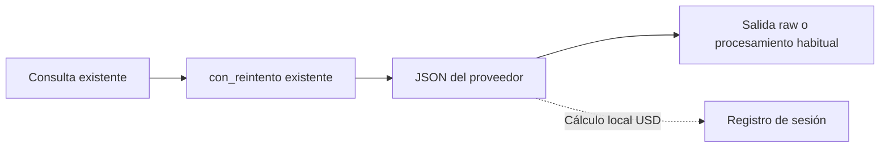

# Entrega de los bloques 13 y 14

Fecha: 28 de octubre de 2026, America/Santiago.

La implementación completa los requisitos de costo acumulado, pruebas automatizadas y ensayo real de HTTP 429 sobre el cliente existente. Conserva sus políticas de reintento, clases de error, contratos HTTP y salidas JSON del CLI. `src/reintentos.py` y sus pruebas se conservaron exactamente como estaban al comenzar esta implementación, incluidos los cambios locales previos.

## Qué se incorporó

- [`src/registro_costos.py`](../src/registro_costos.py): acumulado exacto de USD y tokens, intentos sin uso reportado y sesiones aisladas. Protege las sumas cuando se comparte la instancia entre hilos.
- [`src/costos.py`](../src/costos.py): cálculo puro de USD reutilizado por el registro; el cálculo y la conversión a CLP siguen ofreciendo el mismo resultado.
- [`src/agente_gemini.py`](../src/agente_gemini.py): registro de una respuesta después de los reintentos y antes de procesar su contenido. El recorrido raw conserva el JSON original y no consulta el dólar.
- [`tests/test_cliente_modular.py`](../tests/test_cliente_modular.py): pruebas unitarias directas de transporte y fachada, usando el contrato de errores del proyecto.
- [`tests/test_registro_costos.py`](../tests/test_registro_costos.py): acumulación, aislamiento, concurrencia, costo desconocido y ausencia de duplicados.
- [`scripts/ensayo_rate_limit.py`](../scripts/ensayo_rate_limit.py): ensayo manual acotado, con ejecución real o simulada y evidencia incremental en JSON.
- [`tests/test_ensayo_rate_limit.py`](../tests/test_ensayo_rate_limit.py): límites y conservación de evidencias del ensayo.
- `pytest` declarado en desarrollo y fijado en los archivos de dependencias. [`tests/conftest.py`](../tests/conftest.py) impide conexiones externas durante la suite de pytest.

El recorrido conserva una sola capa de reintentos:



El registro predeterminado dura lo que dura el proceso; no representa automáticamente una sesión de cada usuario. `sesion_costos()` permite aislar un conjunto de consultas y restaura el contexto anterior al salir. Los procesos independientes mantienen registros distintos.

## Correspondencia con el checklist del curso

| Requisito | Implementación y prueba |
| --- | --- |
| 401/403 clasificados y sin reintentos | `ErrorAutenticacion`; pruebas directas en `test_cliente_modular` e integración existente. |
| 429 y fallos temporales recuperables | `ErrorTemporalProveedor`; pruebas de 429, 500, 502, 503 y 504. |
| Devolver el JSON exitoso | Prueba directa del transporte y pruebas existentes de raw. |
| Reintentar, esperar y agotar intentos | Las 17 pruebas existentes de `test_reintentos`, con reloj, jitter y esperas simulados. |
| Propagar errores permanentes | Pruebas directas de fachada y de la política; conservan el mismo objeto de error. |
| Cálculo de costo con tokens conocidos | Cálculo puro USD, pruebas de caché y cobertura existente de USD/CLP. |
| Acumular costo entre operaciones | Dos respuestas de prueba acumulan exactamente `Decimal("0.0106")`; también se comprueba la suma concurrente. |
| Aislar estado entre pruebas | Instancias y contextos de sesión nuevos, restaurados al terminar cada prueba. |
| No gastar tokens en la suite | Transporte simulado y bloqueo de sockets en pytest. |
| No esperar tiempo real | Mocks de espera y reloj en pruebas y ensayo simulado. |
| Error final comprensible | `ReintentosAgotados` conserva la causa; API y CLI mantienen su traducción existente. |
| Ensayo real de rate limit | Las capturas de terminal muestran HTTP 429 y agotamiento controlado de los tres intentos. La ejecución complementaria anterior demuestra recuperación en el tercer intento. |

Los nombres `enviar_peticion`, `registrar_costo` y `consultar_modelo` de los PDF corresponden a responsabilidades distribuidas entre nuestros módulos. Los ejemplos del curso usan `ValueError`, `TimeoutError` y `RuntimeError`; este proyecto conserva categorías propias más específicas. Las pruebas comprueban ese contrato propio. No se afirma compatibilidad literal con una prueba que importe las funciones o excepciones del ejemplo sin adaptarlas.

La política mantiene su lista explícita de 5xx recuperables. HTTP 501 y 505 siguen siendo permanentes, como verifican las pruebas existentes.

## Pruebas y capturas

| Evidencia | Resultado | Archivos |
| --- | --- | --- |
| Suite completa | 152 pruebas y 389 subcasos correctos, 1,08 segundos en la ejecución capturada por el usuario. | [Captura de terminal](evidencias/mis-capturas/bloque-14/01-suite-completa.png). |
| Checklist seleccionado | 36 pruebas y 38 subcasos correctos en 0,32 segundos, incluyendo transporte, fachada, reintentos y registro. | [Comando e inicio](evidencias/mis-capturas/bloque-14/02-checklist-inicio.png), [continuación y resumen](evidencias/mis-capturas/bloque-14/03-checklist-resumen.png). |
| Ensayo simulado | 200, luego 429→503→200; dos respuestas, cuatro envíos, US$ 0.0106 de costo de prueba. | [Captura de terminal](evidencias/mis-capturas/bloque-13/01-ensayo-simulado.png), [JSON original](evidencias/mis-capturas/ensayo-simulado-01.json). |
| Ensayo real | Primer 429 en la consulta 16; agotamiento de tres intentos, 15 respuestas exitosas y US$ 0.0000888 conocidos estimados. | [Comando e inicio](evidencias/mis-capturas/bloque-13/02-ensayo-real-inicio.png), [429 y resultado](evidencias/mis-capturas/bloque-13/03-ensayo-real-resultado.png), [JSON original](evidencias/mis-capturas/ensayo-real-01.json). |

Las seis capturas principales fueron tomadas directamente desde la terminal por el usuario y copiadas sin modificar su contenido ni resolución. El [índice de capturas](evidencias/mis-capturas/README.md) las organiza por bloque y explica cada imagen. Su [manifiesto](evidencias/mis-capturas/manifest.json) conserva los nombres originales, dimensiones y SHA-256 para comprobar las copias.

### Verificaciones complementarias anteriores

| Evidencia | Resultado | Archivos |
| --- | --- | --- |
| Ruff | Correcto. | [Salida](evidencias/bloques-13-14/05-comprobaciones.txt). |
| BasedPyright | 0 errores y 0 advertencias. | [Salida](evidencias/bloques-13-14/06-tipos.txt). |
| Runner unittest anterior | 152 pruebas correctas. | [Salida](evidencias/bloques-13-14/07-unittest.txt). |

El directorio [bloques-13-14](evidencias/bloques-13-14/) conserva las salidas de una ejecución anterior y sus capturas de un visor HTML local mediante Chromium. Esas imágenes son complementarias y se distinguen de las capturas de terminal del usuario en `mis-capturas/`. Cada visor identifica su archivo fuente y SHA-256; la captura real anterior muestra expresamente las últimas 40 líneas y conserva la salida íntegra en texto.

## Ensayo real de HTTP 429

- **Evidencia principal:** [capturas de terminal y JSON del usuario](evidencias/mis-capturas/README.md#bloque-13-backoff-límite-de-uso-y-costo-acumulado).
- **Fecha local:** 28 de octubre de 2026, de 22:13:34 a 22:14:19, America/Santiago.
- **Fechas del JSON:** UTC, desde `2026-10-29T01:13:34.924255+00:00` hasta `2026-10-29T01:14:19.453482+00:00`.
- **Modelo:** `gemini-3.5-flash-lite`, alias `flash-lite` del catálogo existente.
- **Pregunta:** `Prueba N. Responde únicamente OK.`
- **Máximos configurados:** 30 consultas, 36 envíos HTTP y presupuesto total observado de 180 segundos. La política conserva hasta tres intentos por consulta y su presupuesto predeterminado de 90 segundos, acotado al tiempo disponible del ensayo.
- **Consultas realizadas:** 16; 15 completadas y una fallida al agotar los intentos permitidos.
- **Envíos HTTP realizados:** 18.
- **Primer HTTP 429:** primer intento de la consulta 16; envío HTTP número 16.
- **Otros HTTP 429:** segundo y tercer intento de esa consulta; envíos 17 y 18.
- **Esperas observadas:** 1,172 y 2,008 segundos, con backoff y jitter reales.
- **Final de la consulta 16:** `ReintentosAgotados`; el JSON conserva la última causa y el mensaje de agotamiento. Se mantuvo el acumulado de las 15 respuestas anteriores.
- **Duración total observada:** 44,529 segundos.
- **Tokens reportados:** 171 de entrada y 15 de salida; total 186.
- **Costo conocido estimado:** US$ 0.0000888.
- **Intentos sin uso reportado:** 3, correspondientes a los rechazos 429. Se conserva esta incertidumbre en vez de asignarles consumo cero.
- **Resultado:** el ensayo se detuvo después de la primera consulta donde apareció 429, respetando el máximo de tres intentos. `primer_429_observado` describe el resultado del ensayo y no implica que esa consulta se haya recuperado.

Las tarifas configuradas para este modelo son USD 0.30 por millón de tokens de entrada, USD 0.03 de entrada de caché y USD 2.50 de salida. Coinciden con la [tabla estándar de Google consultada el 28 de octubre de 2026](https://ai.google.dev/gemini-api/docs/pricing#gemini-3.5-flash-lite). Para el consumo reportado: `(171 × 0.30 + 15 × 2.50) / 1_000_000 = 0.0000888 USD`. Es una estimación con tarifas de pago; no acredita la facturación efectiva de la cuenta.

El umbral de costo conocido del script se comprueba entre consultas y no es un tope estricto de facturación. Las solicitudes ya iniciadas y los intentos sin uso reportado conservan las limitaciones documentadas del cliente.

### Recuperación observada en la ejecución complementaria

La ejecución anterior, de 21:54:50 a 21:55:33 del mismo día, sí se recuperó: recibió dos HTTP 429 en la consulta 20 y completó el tercer intento, con esperas de 1,154 y 2,120 segundos. Terminó con 20 respuestas exitosas, 22 envíos, 251 tokens reportados y US$ 0.0001193 conocidos estimados. Se conservan su [JSON](evidencias/bloques-13-14/04-ensayo-real-flash-lite.json), [salida de texto](evidencias/bloques-13-14/04-ensayo-real-flash-lite.txt) y [captura del visor](evidencias/bloques-13-14/04-ensayo-real-flash-lite.png).

Las dos ejecuciones documentan los desenlaces previstos por la política: recuperación o agotamiento controlado. Sus resultados y capturas se presentan por separado.

## Cómo repetir la verificación

Desde la raíz del repositorio:

```bash
uv sync --locked
uv run python -m pytest tests -v
uv run ruff check src tests prompts scripts/ensayo_rate_limit.py scripts/capturar_evidencia.py
uv run basedpyright src tests prompts scripts/ensayo_rate_limit.py scripts/capturar_evidencia.py
```

El runner anterior también funciona:

```bash
uv run python -m tests -v
```

Para repetir solo el ensayo simulado, elegir una salida nueva:

```bash
uv run python -m scripts.ensayo_rate_limit --simulado --salida docs/evidencias/ensayo-nuevo.json
```

El ensayo real ya está documentado y no es necesario repetirlo para correr las pruebas. Su comando de reproducción, que sí consume cuota y puede generar cobros, es:

```bash
uv run python -m scripts.ensayo_rate_limit --real --modelo flash-lite --consultas 30 --max-envios 36 --presupuesto-total 180 --salida docs/evidencias/ensayo-real-nuevo.json
```

Si no aparece un 429 dentro de los límites, el script conserva el resultado y termina con código 1. No convierte una tanda sin 429 en una evidencia de rate limit ni continúa indefinidamente. El proveedor puede ofrecer límites distintos en otra ejecución.

Para nuevas capturas de entrega, ejecutar estos comandos desde la terminal y fotografiar su salida con la herramienta de capturas del escritorio, como en las seis imágenes principales. El script `capturar_evidencia.py` se conserva como herramienta opcional para reproducir los visores de las salidas anteriores.

## Entrega preparada

El paquete [`entrega-bloques-13-14.zip`](../output/entrega-bloques-13-14.zip) contiene el código, pruebas, dependencias, documentación, capturas y salidas originales. Conserva la estructura del proyecto para ejecutar las pruebas después de extraerlo. No contiene `.env`, el entorno virtual ni el historial Git.

La [revisión inicial de los PDF](revision-bloques-13-14.md) se conserva como antecedente. El [PRD de control preventivo](prd-01-control-consumo-gemini.md) continúa propuesto: frecuencia, concurrencia y pausas compartidas entre consultas son una ampliación distinta del registro de costos implementado aquí.
