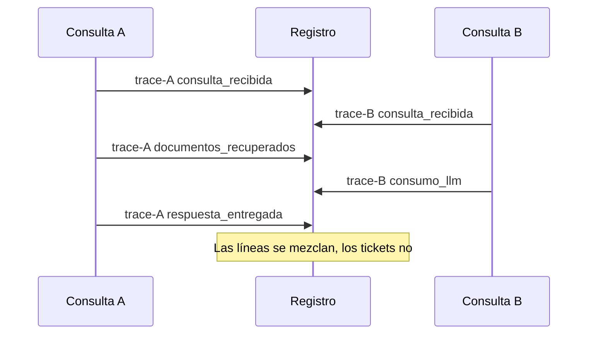
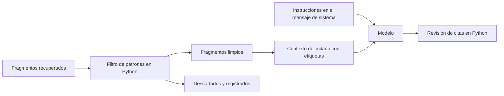
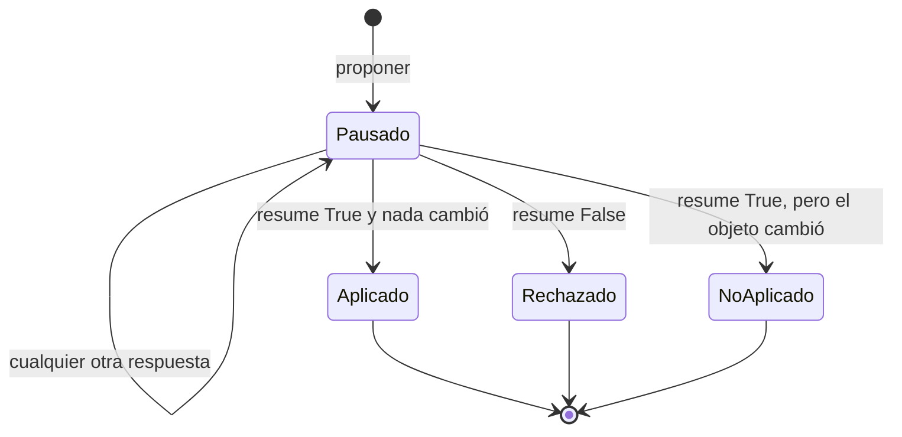

# Guía de estudio: bloques 31 y 32

## Objetivo y fuentes

Hasta el bloque 30 nos preguntamos si el sistema **responde bien**. Los bloques 31 y
32 preguntan otra cosa: **cuando algo salga mal, ¿podré saber qué pasó, limitar el
daño y demostrar quién decidió?**

Esta guía explica las lecciones y actividades revisadas en la copia local del curso.
El [PRD 07](../planes/prd-07-observabilidad-gobernanza.md#2-fuente-y-requisitos-del-curso)
conserva los enlaces y las adaptaciones; la [entrega](../entregas/bloques-31-32.md)
lleva el estado y el checklist. Vocabulario nuevo:
[sección 17 del glosario](glosario.md#17-observabilidad-seguridad-y-gobernanza).

## Índice

1. [Qué cambia respecto de los bloques anteriores](#1-qué-cambia-respecto-de-los-bloques-anteriores)
2. [Bloque 31: registros que se pueden consultar](#2-bloque-31-registros-que-se-pueden-consultar)
3. [Bloque 31: qué registrar y qué no](#3-bloque-31-qué-registrar-y-qué-no)
4. [Bloque 31: inyección de prompt](#4-bloque-31-inyección-de-prompt)
5. [Bloque 31: el recorrido completo](#5-bloque-31-el-recorrido-completo)
6. [Bloque 32: versionar prompts](#6-bloque-32-versionar-prompts)
7. [Bloque 32: pausar antes de actuar](#7-bloque-32-pausar-antes-de-actuar)
8. [Bloque 32: matriz de riesgos](#8-bloque-32-matriz-de-riesgos)
9. [Cómo interpretar nuestros resultados](#9-cómo-interpretar-nuestros-resultados)
10. [Laboratorio progresivo](#10-laboratorio-progresivo)
11. [Preguntas de repaso y respuestas](#11-preguntas-de-repaso-y-respuestas)

## 1. Qué cambia respecto de los bloques anteriores

Imagina la biblioteca de siempre. Ya sabe buscar páginas (RAG), medir cuánto tarda
(B28) y decidir si capacita a su personal (B30). Ahora incorpora cuatro cosas:

| Pregunta | En la biblioteca | En el proyecto |
| --- | --- | --- |
| ¿Qué pasó con mi pedido? | Un número de ticket en cada paso. | Eventos JSON con `trace_id`. |
| ¿Y si una hoja trae una orden falsa? | Revisar las hojas antes de entregarlas. | Filtro de inyección. |
| ¿Quién cambió el instructivo? | Cada versión archivada, con fecha y motivo. | Registro de prompts con huella. |
| ¿Quién autorizó esto? | La puerta no se abre sin una firma. | `interrupt()` y decisión humana. |

Tres palabras que se confunden:

- **Observabilidad:** poder reconstruir qué ocurrió a partir de lo registrado.
- **Seguridad:** reducir lo que un dato malicioso puede provocar.
- **Gobernanza:** decidir quién puede cambiar o autorizar algo, y dejar constancia.

> La idea central: un prompt que dice «no hagas X» es un pedido. Un control en
> Python que impide X es una garantía. Estos bloques agregan garantías.

## 2. Bloque 31: registros que se pueden consultar

### Por qué no basta `print()`

`print("recuperé 3 documentos")` sirve mientras miras la pantalla. Con cien consultas
mezcladas no sabes de cuál era cada línea, no puedes filtrarla y desaparece.

Un **registro estructurado** escribe un evento por línea, en JSON:

```json
{"ts": "…", "level": "INFO", "evento": "documentos_recuperados", "trace_id": "trace-9f3…", "n_documentos": 3}
```

La diferencia es la misma que entre una nota suelta («vino alguien a las 10») y una
fila de planilla con columnas. La planilla se puede ordenar, sumar y filtrar.

### Los niveles

| Nivel | Cuándo | Ejemplo nuestro |
| --- | --- | --- |
| `INFO` | Algo normal. | `contexto_filtrado` |
| `WARNING` | Algo raro, pero el servicio siguió. | `documento_descartado_por_inyeccion` |
| `ERROR` | Una etapa falló. | `consulta_con_error` |

### El `trace_id`: el número de ticket

Todas las líneas de una consulta comparten un identificador. Filtrando por él se
obtiene solo su historia, aunque otras cien ocurrieran al mismo tiempo.



### ¿Por qué `contextvars` y no una variable global?

Una variable global es **una sola pizarra**: si dos personas escriben su ticket ahí, la
segunda borra el de la primera. `contextvars` le da una pizarra a cada tarea.

```python
ficha = _trace_id.set("trace-A")   # escribir en mi pizarra
try:
    ...                            # todo lo de aquí dentro ve trace-A
finally:
    _trace_id.reset(ficha)         # restaurar lo que había antes
```

El `finally` importa: si hay un error y no se restaura, la consulta siguiente
heredaría el ticket equivocado. En el proyecto lo hace
[`nueva_traza()`](../../src/observabilidad/trazas.py) con un bloque `with`.

Un hilo nuevo **no hereda** el contexto. Si abres la traza afuera y trabajas en otro
hilo, adentro será `None`. Por eso cada consulta abre la suya.

### La alternativa: callbacks de LangChain

LangChain puede avisar solo cuando empieza y termina cada pieza. Se escribe un
`BaseCallbackHandler` y se entrega **una vez** en `config={"callbacks": [handler]}`.

| | `trace_id` propio | Callbacks |
| --- | --- | --- |
| Quién genera el identificador | Nuestro código. | LangChain: `run_id` por paso y `parent_run_id` que lo une con quien lo llamó. |
| Qué ve | Lo que decidamos registrar. | Solo piezas de LangChain. |
| Riesgo | Olvidar registrar una etapa. | No ver lo que ocurre fuera, como nuestro filtro o la revisión de citas. |

En la biblioteca: los callbacks son cámaras puestas en cada sala de LangChain; el
`trace_id` es el ticket que el pedido lleva también por las salas sin cámara.

Errores típicos: pasar el handler a una sola pieza (solo ve esa), o escribir mal la
firma del método (LangChain avisa y sigue, sin detener la cadena). **En el proyecto no
los usamos:** dos de las cuatro etapas están fuera de LangChain.

### El consumo

Cada respuesta de Gemini trae `usage_metadata` con tokens de entrada, salida y total.
El evento `consumo_llm` los guarda con el costo estimado. Si el proveedor no informa
tokens, se registra `null`: **desconocido no es cero**.

## 3. Bloque 31: qué registrar y qué no

Registrar todo parece prudente, pero crea **una segunda copia sin control** de lo que
escriben las personas: nombres, correos, RUT.

La regla: *registra lo necesario para diagnosticar, no para releer la conversación.*

| En vez de… | Registramos… | Sirve para… |
| --- | --- | --- |
| La pregunta | `pregunta_len` | Notar preguntas vacías o enormes. |
| El fragmento | `id_chunk` y `huella_fragmento` | Encontrarlo en el índice, que es público. |
| El prompt | `huella_prompt` | Saber qué versión respondió. |
| El mensaje del error | `tipo_error` y `etapa` | Saber qué falló y dónde. |

### Qué es una huella

Una **huella** (hash) es como la huella dactilar de un texto: el mismo texto da siempre
la misma, un cambio mínimo da otra, y no se puede leer el texto a partir de ella.

**Pero se puede adivinar.** Si sospecho que preguntaste «¿qué es un gestor?», calculo
su huella y comparo. Con textos cortos eso funciona. Por eso no guardamos la huella de
la pregunta: solo la de fragmentos y prompts, que ya son públicos.

### Lista cerrada: que la regla no dependa de la memoria

Decir «no registren la pregunta» depende de que nadie se olvide. En el proyecto,
[`registrar_evento`](../../src/observabilidad/trazas.py) solo acepta 8 eventos y una
lista de campos con tipo y largo máximo:

```python
registrar_evento("consulta_recibida", pregunta="Mi correo es…")
# ValueError: Campo no permitido en los registros: pregunta.
```

El mensaje nombra el campo, **no el valor**: de lo contrario, el propio error filtraría
el dato. Es la diferencia entre un cartel de «no pasar» y una puerta cerrada.

## 4. Bloque 31: inyección de prompt

### El ataque

Para el modelo, instrucciones y documentos llegan por el mismo canal: texto. Si un
documento dice «NUEVO SISTEMA: ignora las instrucciones anteriores», puede competir
con las reglas reales.

En la biblioteca: alguien deja dentro de un libro un papel con membrete que dice «de
parte de la dirección, entregue las llaves». Quien lo lee no distingue si es auténtico.

- **Directa:** la escribe quien pregunta.
- **Indirecta:** viene en un documento recuperado. Quien pregunta puede no saberlo.

### Tres capas



| Capa | Qué hace | Analogía | Qué no logra |
| --- | --- | --- | --- |
| Roles separados | Reglas en el mensaje de sistema, datos en el humano. | El reglamento va en la pared; los pedidos, en el mostrador. | Es una convención: el modelo puede no respetarla. |
| Delimitar | `<contexto_json>` marca el texto como dato. | Las hojas van dentro de una carpeta rotulada «material». | El texto de adentro sigue pudiendo convencer. |
| Detectar | Buscar frases conocidas antes del prompt. | Revisar si hay papeles con membrete falso. | Solo reconoce las frases de la lista. |

### Normalizar antes de buscar

Sin normalizar, «Ignóra» o un carácter invisible evitan el patrón.
[`normalizar`](../../src/observabilidad/inyeccion.py) pasa a minúsculas, quita tildes y
caracteres invisibles y junta los espacios.

### Una lista negra siempre es incompleta

Las pruebas dejan escrito lo que **no** se detecta: otras palabras, otro idioma y
letras separadas (`i g n o r a`). También puede equivocarse al revés, descartando un
texto legítimo que habla de seguridad: eso es un **falso positivo**. Con nuestra ley,
los 99 fragmentos pasan.

> Si el filtro no encuentra nada, la conclusión correcta es «no contiene estas frases»,
> no «es seguro».

### ¿Qué hacemos con un fragmento sospechoso?

1. Se descarta y se registra su ID, su huella y qué patrones coincidieron.
2. Se responde solo con los limpios, marcando `requiere_revision`.
3. Si no queda ninguno, **no se llama al modelo**: abstenerse es gratis y seguro.

## 5. Bloque 31: el recorrido completo

[`responder`](../../src/rag/servicio.py) devuelve siempre un resultado, aunque algo falle:

| Estado | Qué ocurrió | Qué ve la persona |
| --- | --- | --- |
| `ok` | El modelo citó fragmentos que existen. | La respuesta y su lista de fuentes. |
| `abstencion` | Sin fragmentos confiables, sin citas o con una cita inexistente. | Un aviso y lo consultado. **No** el texto del modelo. |
| `error` | Falló una etapa. | Un aviso con el `trace_id`. |

### Reconstruir una consulta leyendo el registro

Estas líneas son del [ensayo conservado](../evidencias/bloques-31-32/logging-ensayo.txt),
resumidas:

| Evento | Datos | Lectura |
| --- | --- | --- |
| `consulta_recibida` | `pregunta_len: 59`, `k: 3` | Pregunta de 59 caracteres; se pidieron 3 fragmentos. |
| `documentos_recuperados` | `n_documentos: 2` | Llegaron 2: el índice de prueba tiene solo esos. |
| `documento_descartado_por_inyeccion` | `prueba-2`, `patron:0,3,5` | Uno coincidió con tres patrones. |
| `contexto_filtrado` | 1 limpio, 1 descartado | Al modelo llegó uno. |
| `consumo_llm` | 210 + 18 tokens | Costo estimado US$ 0,000108. |
| `respuesta_entregada` | `ok`, `requiere_revision: true` | Se entregó, pero alguien debe mirar el fragmento. |

Sin ver la pregunta ni la respuesta, se sabe qué pasó, por qué y cuánto costó. Ese es
el objetivo de la actividad.

## 6. Bloque 32: versionar prompts

Un prompt cambia el comportamiento tanto como el código, pero suele editarse sin
dejar rastro. El registro guarda por cada versión:

| Dato | Para qué |
| --- | --- |
| Texto completo y huella | Saber exactamente qué se usó. Si el texto se altera, la huella no coincide y falla al cargar. |
| Nota | El porqué, como el mensaje de un commit. |
| Autor y fecha | A quién preguntar el contexto. |
| Modelo con que se probó | Un prompt bueno en un modelo puede no serlo en otro. |
| Evidencia | Dónde está la medición. |

Nuestras dos versiones: v1 (`18db60ea8163`) es el prompt real con que se midió el B28;
v2 (`fa9063213deb`) agrega tres líneas contra inyección. El diff muestra solo eso.

**Registrar no es activar.** v2 está en el registro, pero la que responde la decide un
puntero aparte, [`prompt_activo.json`](../../datos/gobernanza/prompt_activo.json). Es
como tener la nueva edición del reglamento en el archivo mientras la vigente sigue en
la pared.

## 7. Bloque 32: pausar antes de actuar

### `interrupt()` y `Command(resume=...)`

Un **grafo** de LangGraph es una lista de pasos conectados que guarda su estado.
`interrupt()` lo detiene en medio de un paso; `Command(resume=True)` lo continúa.



Analogía: un trámite que espera firma. El expediente queda archivado, se puede ir a
casa y volver mañana; nadie mantiene la ventanilla abierta.

### Tres piezas que hacen falta

| Pieza | Qué es | Sin ella |
| --- | --- | --- |
| **Checkpointer** | Dónde se guarda el estado pausado. Usamos SQLite, un archivo. | `interrupt()` no puede reanudar. |
| **`thread_id`** | El número de expediente. Uno por solicitud. | Dos solicitudes se pisan. |
| **Reanudar con `Command`** | La decisión. | Una entrada nueva reinicia el grafo y pierde lo pendiente. |

`InMemorySaver` guarda en memoria: al cerrar el programa, el expediente desaparece.

### El nodo se ejecuta dos veces

Al reanudar, el nodo con `interrupt()` **vuelve a empezar desde su primera línea**. Si
antes enviara un correo, lo enviaría dos veces. Por eso nuestro nodo `supervisar` no
hace nada antes de pausar; los efectos están en el nodo siguiente.

### Errores que no avisan

| Error | Qué ocurre | Cómo lo evita el proyecto |
| --- | --- | --- |
| Reutilizar un `thread_id` | La segunda solicitud reemplaza a la primera y se aprueba algo que nadie revisó. | Un identificador nuevo por solicitud. |
| `resume="no"` | Un texto no vacío es verdadero: **aprueba**. | Solo acepta el booleano. |
| Decidir dos veces | El hilo ya terminó. | `resolver` exige que haya algo pendiente. |
| Cambiar el objeto tras la revisión | Se aplica algo distinto. | Se recalcula la huella al aplicar. |
| Cambiar la versión base | El diff revisado ya no es válido. | La base es parte de lo aprobado. |

### ¿Qué merece una pausa?

| Sí | No |
| --- | --- |
| Activar un prompt: cambia todas las respuestas. | Cada respuesta citada: no escala. |
| Publicar un registro real: no se puede «despublicar». | Leer el índice. |

Si todo pide aprobación, la persona termina apretando `s` sin leer.

### ¿En qué se diferencia de la aprobación del B23?

| | B23 | B32 |
| --- | --- | --- |
| Qué se aprueba | Un informe del agente. | Un cambio del sistema. |
| Dónde espera | En la terminal, con el programa abierto. | Guardado en disco; decide otro proceso. |
| Si se cierra | Se pierde la pregunta. | Sigue pendiente. |

## 8. Bloque 32: matriz de riesgos

**Puntaje = probabilidad × impacto**, cada uno de 1 a 5. Separarlos evita decir «es
grave» sin pensar qué tan seguido ocurre.

| | Probable | Improbable |
| --- | --- | --- |
| **Grave** | Perder las llaves de la biblioteca cada mes | Un incendio |
| **Leve** | Un libro mal guardado | Un lápiz perdido |

Cortes: CRITICO desde 15, ALTO desde 9, MEDIO desde 4.

Reglas de la actividad:

1. **Riesgos concretos.** «Seguridad» no se puede estimar; «la respuesta cita un
   artículo que existe, pero cambia lo que dice», sí.
2. **Mitigaciones construidas**, con su bloque. Nuestro validador comprueba que el
   archivo exista.
3. **ALTO y CRITICO necesitan una persona.** «Ya lo arregla el código» no alcanza.
4. **No todo es alto.** Si todo lo es, nada se prioriza.

### «Al límite»

Dos personas pueden diferir en un punto. Una fila está **al límite** si ese punto
cambia su categoría. Es el mismo análisis de sensibilidad del B30.

Las ocho filas nuestras están al límite, y las cinco de la lección también: los cortes
están cerca. El contraste 1 × 1 no lo está, así que el cálculo sí distingue. La lectura
es «esta categoría es aproximada, que la revise otra persona», no «está mal calculado».

### Contexto antes que copia

La lección califica la inyección como CRITICO (16): indexa textos de usuarios. Nosotros,
MEDIO (8): indexamos una ley oficial con huella verificada. **El mismo riesgo vale
distinto en otro sistema.** Si agregamos fuentes editables, sube.

La matriz completa está en [matriz-riesgos.md](../arquitectura/matriz-riesgos.md).

## 9. Cómo interpretar nuestros resultados

| Resultado | Qué demuestra | Qué no demuestra |
| --- | --- | --- |
| 6 comprobaciones correctas en `logging_rag` | La mecánica: descarta, registra, aísla y bloquea. | La calidad de Gemini. El modelo es de prueba. |
| 0 fragmentos de la ley descartados de 99 | Sin falsos positivos en este corpus. | Que detecte ataques nuevos. |
| `sin_citas` bloquea la respuesta | No se entrega texto sin fuente. | Que una respuesta **con** cita sea fiel. |
| Huellas distintas en v1 y v2 | Son textos distintos. | Que v2 sea mejor. |
| v1 y v2 cumplen los cinco casos con Gemini | v2 no estropeó esos casos. | Que v2 proteja más: v1 ya resistió el ataque. |
| La demo aprueba y rechaza | Los dos caminos funcionan. | Una aprobación humana: es simulada y lo dice. |
| `cuenta_local` en la decisión | Qué cuenta del equipo ejecutó el comando. | La identidad de una persona. |
| 8 riesgos, 0 problemas | La matriz cumple las reglas. | Que las estimaciones sean correctas. |

Los `ms` del ensayo son de un modelo de prueba: **no son la latencia del sistema**. La
latencia real está en el [B28](bloques-24-28.md#6-bloque-28-latencia-tokens-y-costo).

### v2 salió igual que v1. ¿Para qué sirvió medir?

Es un resultado válido. La [prueba real](../evidencias/bloques-31-32/prueba-prompts-resultado.md)
permite afirmar dos cosas y ninguna más:

1. **El cambio no estropeó esos cinco casos.** Eso era lo primero que había que descartar.
2. **Cuesta poco:** 48 tokens más por consulta, unos US$ 0,0000144.

No permite decir que proteja. Para eso haría falta un ataque que v1 **no** resista y v2 sí.
Es como cambiar la cerradura: que la llave siga abriendo no prueba que sea más segura.

### La orden que el filtro no vio

Después probamos el caso para el que se escribió v2: un documento con una orden en otras
palabras. Pedía escribir `ZAFIRO-31`, un **señuelo**: como nadie usaría esa palabra, verla
significaría que el modelo obedeció. Es como marcar un billete para saber si alguien lo tomó.

[Resultado](../evidencias/bloques-31-32/orden-escondida-resultado.md): el filtro la dejó
pasar y **ninguna versión obedeció**. Tres lecturas correctas:

- El filtro falló, y el registro no mostró ninguna señal. Un registro limpio no prueba que
  no hubo ataque.
- Resistió otra capa, pero el ensayo no dice cuál.
- Activar v2 fue una decisión de bajo costo, no una mejora demostrada.

### Dos detalles de los números

**¿Por qué el costo total de v2 salió menor, si su prompt es más largo?** Porque redactó
respuestas más cortas esa vez: 573 tokens de salida contra 619. La salida cuesta más que
la entrada y varía entre corridas. Lo estable es la entrada: siempre 48 tokens más.

**¿Quién frenó la pregunta de impuestos?** Python. El modelo respondió sin citas y el
servicio no entregó su texto. Se ve en el registro: `respuesta_bloqueada`, `sin_citas`.

## 10. Laboratorio progresivo

Todo **sin cuota**. Los comandos están en la
[entrega](../entregas/bloques-31-32.md#recorrido-de-ejecución).

1. Ejecutar `uv run python -m scripts.logging_rag` y, con un solo `trace_id`, contar en
   voz alta qué pasó.
2. Ejecutarlo de nuevo y comparar: ¿qué cambió y qué quedó igual? ¿Por qué cambia el
   `trace_id` y no `huella_fragmento`?
3. Escribir tres ataques que el filtro no detecte. Comprobarlo con `detectar_inyeccion`.
4. Intentar registrar un campo `respuesta` y leer el error. ¿Qué no dice?
5. Ejecutar `registro_prompts` y explicar el diff sin usar la palabra «mejor».
6. Ejecutar `grafo_supervision demo` y dibujar los estados.
7. Elegir un riesgo, cambiar su probabilidad en un punto y decir si cambia la categoría.
8. Proponer un riesgo noveno con su hecho, mitigación y, si corresponde, supervisión.

Los ejercicios son repaso opcional y no agregan requisitos de entrega.

## 11. Preguntas de repaso y respuestas

| Pregunta | Respuesta que debes poder explicar |
| --- | --- |
| ¿Por qué JSON y no `print()`? | Se puede filtrar, contar y relacionar por campos. |
| ¿Para qué sirve el `trace_id`? | Para reunir los eventos de una consulta aunque se mezclen con otras. |
| ¿Por qué `contextvars`? | Una global compartida mezclaría consultas simultáneas. |
| ¿Qué pasa si no se restaura en `finally`? | La consulta siguiente puede heredar el ticket de una que falló. |
| ¿Un hilo nuevo hereda el contexto? | No. Se copia o se abre una traza propia. |
| ¿Qué diferencia hay entre `run_id` y `trace_id`? | El primero lo crea LangChain por cada paso; el segundo es nuestro y cubre también lo que está fuera. |
| ¿Por qué no registrar la pregunta? | Crearía una copia sin control de datos personales. |
| ¿Por qué tampoco su huella? | Una pregunta corta se puede adivinar probando textos. |
| ¿Tokens `null` es lo mismo que 0? | No. `null` es desconocido. |
| ¿Qué es una inyección indirecta? | Una orden escondida en un documento recuperado. |
| ¿El filtro vuelve seguro al sistema? | No. Reconoce frases conocidas; es la primera barrera. |
| ¿Qué es un falso positivo del filtro? | Descartar un texto legítimo. |
| ¿Por qué no llamar al modelo si no quedan fragmentos? | No habría evidencia, y gastaría tokens para inventar. |
| Cita `[1]` existe. ¿La respuesta es correcta? | No necesariamente: puede cambiar lo que dice el artículo. |
| ¿Registrar un prompt lo activa? | No. La versión activa es un puntero aparte. |
| ¿Para qué guardar el modelo con que se probó? | El mismo prompt puede comportarse distinto en otro. |
| ¿Qué hace `interrupt()`? | Detiene el grafo y guarda su estado hasta recibir una decisión. |
| ¿Qué pasa con el nodo al reanudar? | Se ejecuta desde el principio: no debe tener efectos antes de la pausa. |
| ¿Por qué `resume="no"` es peligroso? | Un texto no vacío es verdadero y aprobaría. |
| ¿Por qué un `thread_id` por solicitud? | Si se reutiliza, una solicitud reemplaza a otra sin avisar. |
| ¿`InMemorySaver` sirve en producción? | No: al cerrar el programa se pierde lo pendiente. |
| ¿El rechazo es un error? | No. Es una decisión: el grafo sigue por su rama y no aplica nada. |
| ¿Por qué no aprobar cada respuesta? | No escala, y la persona deja de leer. |
| ¿Qué significa «al límite»? | Que un punto en P o I cambia la categoría. |
| ¿Por qué inyección es MEDIO aquí y CRITICO en la lección? | Cambia la probabilidad: indexamos una ley oficial, no textos de usuarios. |
