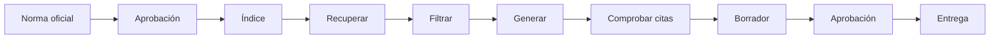
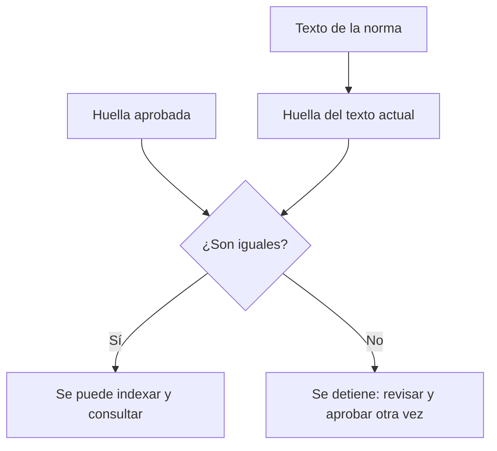

# Guía de estudio: Gate 2

## Objetivo y fuentes

Los bloques 24 a 32 construyeron piezas. El Gate 2 pregunta: **¿funcionan juntas, desde
cero, en un equipo que no es el mío?** Esta guía explica qué se agregó y cómo se leen los
resultados. El [PRD 08](../planes/prd-08-gate-2.md) conserva requisitos y decisiones; la
[entrega](../entregas/gate-2.md), el estado. Vocabulario nuevo:
[sección 18 del glosario](glosario.md#18-gate-2-integrar-y-actualizar).

## Índice

1. [La idea en una imagen](#1-la-idea-en-una-imagen)
2. [Promedio y no compensables](#2-promedio-y-no-compensables)
3. [Desacople de interfaz](#3-desacople-de-interfaz)
4. [Actualizar sin recalcular](#4-actualizar-sin-recalcular)
5. [Una norma como objeto aprobado](#5-una-norma-como-objeto-aprobado)
6. [La tabla que era una imagen](#6-la-tabla-que-era-una-imagen)
7. [La acción de mayor riesgo](#7-la-acción-de-mayor-riesgo)
8. [Registrar no es lo mismo que enviar](#8-registrar-no-es-lo-mismo-que-enviar)
9. [Simulado, local y real](#9-simulado-local-y-real)
10. [Cómo interpretar nuestros resultados](#10-cómo-interpretar-nuestros-resultados)
11. [Laboratorio sin Gemini](#11-laboratorio-sin-gemini)
12. [Preguntas de repaso y respuestas](#12-preguntas-de-repaso-y-respuestas)

## 1. La idea en una imagen

Un restaurante puede tener buen cocinero, buena sala y buena bodega, y fracasar en su
primera noche porque nadie probó el recorrido completo. El Gate 2 es esa noche de ensayo.



Hay **dos puertas con firma**: qué normas entran y qué respuesta sale. En medio, todo es
automático y queda registrado.

## 2. Promedio y no compensables

El promedio suma seis notas con distinto peso. Los cuatro **no compensables** son
condiciones de sí o no: correr sin caerse, citar, no exponer contenido y pausar de verdad.

Es como la revisión técnica de un auto: pintura, luces y tapiz dan puntos, pero sin frenos
no circula. Ningún tapiz compra los frenos.

| Caso | Promedio | No compensables | ¿Aprueba? |
| --- | --- | --- | --- |
| 1 | 88,8 | Falla uno | No |
| 2 | 88,8 | Todos | Sí |
| 3 | 73,8 | Todos | No |

Por eso `autoevaluacion_gate2` no deja **escribir** que se cumplen: ejecuta las pruebas.

## 3. Desacople de interfaz

Una **interfaz** es la forma que una pieza espera. La lección muestra un filtro que pide
`d.contenido` y un buscador que entrega `d.page_content`. Cada uno funciona solo; juntos, no.
Es un enchufe de otro país: ambos están sanos.

Leer el código no basta para verlo. Se descubre cuando el dato **real** de una etapa llega a
la siguiente. Por eso el ensayo usa las normas reales, Chroma real y el servicio real; solo
reemplaza los embeddings y el modelo, que son los que necesitan clave.

## 4. Actualizar sin recalcular

El índice de los bloques 24 a 28 es **inmutable**: si cambia algo, se hace otro. Sirve para
medir, pero agregar una norma obligaría a pagar de nuevo por todas.

El nuevo compara fragmento por fragmento:

| Situación | Qué hace | ¿Paga embedding? |
| --- | --- | --- |
| No existía | Agregar | Sí |
| Cambió el texto | Reemplazar | Sí |
| Cambió solo la fuente o la página | Conservar el vector y cambiar los datos | No |
| Igual | Nada | No |
| Ya no corresponde | Retirar | No |

¿Por qué cambiar la fuente no paga? Porque el vector se calcula **solo con el texto**.

Analogía: en un archivador, si llega una carpeta nueva no se fotocopian las anteriores.

### Qué pasa si se corta la luz

Se guarda en lotes de 25. Mientras no termina, el manifiesto dice `en_proceso` y el índice
**no responde**. Al repetir el comando, continúa.

Nos pasó de verdad: el proveedor cortó por límite de frecuencia tras 100 de 134 fragmentos.
Un minuto después se repitió y solo convirtió los 34 que faltaban. Responder durante el corte
habría sido peor que no responder: el decreto estaría **a medias y parecería completo**.

## 5. Una norma como objeto aprobado

`normas_activas.json` guarda qué normas se usan y la **huella** de lo que se aprobó.



La firma vale para **ese** texto. Si alguien cambia una coma, la huella cambia y hay que
volver a firmar. Y se puede **retirar** una norma: si se anula, deja de responder sin
reconstruir las demás.

## 6. La tabla que era una imagen

El DS 12/2020 publica sus metas en cuatro tablas. Al extraer el texto, el artículo 21 decía
«las siguientes metas:» y después, **nada**. No hubo ningún error: el PDF contiene
fotografías de las tablas.

Es el tipo de falla más peligroso, porque es silenciosa. El índice se habría construido
«completo» y el asistente no podría citar una sola meta.

| Decisión | Motivo |
| --- | --- |
| Transcribir en un archivo aparte, con página | Distinguir lo que venía como texto de lo que se leyó. |
| Dos lecturas, y OCR como contraste | El OCR confundió celdas: solo confirmó una parte. |
| Cada fila es una frase completa | Cortada, «11 %» suelto no dice de qué material ni categoría. |
| Prueba: ninguna meta baja con los años | Detecta una celda cambiada, aunque no prueba que todas estén bien. |
| Revisión humana antes de activar | Un número equivocado y bien citado parece confiable. |

## 7. La acción de mayor riesgo

La rúbrica pide supervisar **la acción de mayor riesgo**, no una cualquiera. La matriz dice
que el riesgo mayor es una respuesta que cita un artículo real, pero cambia lo que dice. El
daño ocurre cuando esa respuesta **llega al cliente**.

- Consultar deja un **borrador**. No se pausa: si hubiera que firmar todo, nadie leería.
- Entregar se **pausa**. La persona ve la respuesta y el texto completo de cada fuente.
- No se puede entregar una abstención, un borrador cambiado ni uno hecho con un prompt en prueba.

Es como un laboratorio: medir es libre; emitir el certificado necesita una firma.

## 8. Registrar no es lo mismo que enviar

El B31 logró que los registros no guarden la pregunta. Pero si la pregunta traía un correo,
Gemini igual lo recibía. Ahora se reemplaza **antes** de calcular el embedding:

```text
¿Qué es un envase? Mi correo es ana.perez@example.com
¿Qué es un envase? Mi correo es [correo oculto]
```

No romper el espejo del baño no protege la ventana de la calle: son dos controles. Este
reconoce correos, RUT, teléfonos y claves. **No** reconoce un nombre propio.

## 9. Simulado, local y real

| Modo | Embeddings | Modelo | Para qué sirve |
| --- | --- | --- | --- |
| Ensayo | De palabras, locales | Copia el primer fragmento y lo cita | Comprobar la mecánica sin clave. |
| Referencia | De palabras, locales | Ninguno | Comparar: ¿cuánto agrega Gemini al buscar? |
| Real | `gemini-embedding-001` | `gemini-3.5-flash-lite` | Medir calidad, tiempo y costo. |

Un **embedding de palabras** solo mira coincidencias: «auto» y «vehículo» no se parecen. El
real compara significado. La referencia evita decir «funciona bien» sin preguntar *comparado
con qué*.

## 10. Cómo interpretar nuestros resultados

### Recuperación, entre los 5 primeros fragmentos

| Grupo | Palabras | Gemini | Mínimo fijado antes |
| --- | --- | --- | --- |
| Una norma, con evidencia | 20 de 21 | **21 de 21** | 90 % |
| Cruza dos normas, con evidencia de ambas | 1 de 4 | **2 de 4, no cumple** | 3 de 4 |

- **¿Por qué la precisión es 0,21 si acierta todo?** Porque casi cada pregunta tiene un solo
  fragmento correcto. Uno de cinco es 0,20: es el máximo posible. Aquí manda la exhaustividad.
- **¿La norma nueva estorbó?** No: las 9 preguntas de la ley conservan 1,00 de exhaustividad,
  igual que en el B27.
- **¿Por qué fallan las cruzadas?** Los cinco lugares se reparten por cercanía. En «cómo se
  establecen las metas y cuáles son las de envases» los cinco fueron del decreto. Una
  solución es reservar cupos por norma. No se aplicó: cambiarlo mirando estas cuatro preguntas
  sería ajustarse al examen. Queda para el Gate 3, con preguntas nuevas.
- **¿Qué demuestra 21 de 21?** Que encontró el fragmento. No que la respuesta sea correcta.

### Prompts

Ambas versiones cumplen los [seis casos](../evidencias/gate-2/prueba-prompts-resultado.md).
La v3 escribe el doble y cuesta 25 % más; en la pregunta sobre 2026 explica por qué no puede
dar un año. Tampoco obedeció siempre: en un caso no nombró el artículo dentro del texto.
La lista «Fuentes», que arma Python, sí lo hizo. **Pedir no es garantizar.**

### Lo que no sabemos

La vigencia se revisó a mano: LeyChile mostraba una versión única. Eso no cubre
interpretaciones ni sentencias. Las preguntas y etiquetas no tienen revisión jurídica.

## 11. Laboratorio sin Gemini

1. Ejecutar `uv run python servicio_rag.py` y señalar las dos puertas con firma.
2. Ejecutar `uv run python -m pytest test_gate2.py -v` y decir qué criterio cubre cada prueba.
3. En una copia, cambiar una palabra de `ds_12_2020.json` y ejecutar `servicio_rag.py estado`.
   ¿Por qué se detiene?
4. Ejecutar `uv run python -m scripts.evaluar_normas` y elegir una pregunta que falle. ¿Qué
   palabras tienen en común la pregunta y los fragmentos recuperados?
5. Calcular a mano el promedio ponderado y comparar con `autoevaluacion_gate2`.
6. Proponer una quinta pregunta cruzada, con etiquetas, **antes** de buscarla.

Son repaso opcional; no agregan requisitos de entrega.

## 12. Preguntas de repaso y respuestas

| Pregunta | Respuesta que debes poder explicar |
| --- | --- |
| ¿Qué es un no compensable? | Una condición de sí o no que ningún promedio reemplaza. |
| ¿Qué es un desacople de interfaz? | Dos piezas sanas que esperan formas distintas. |
| ¿Por qué ensayar desde un entorno limpio? | Descubre lo que solo existía en mi equipo. |
| ¿Qué es una actualización incremental? | Cambiar solo lo distinto, sin recalcular el resto. |
| ¿Por qué cambiar la fuente no paga embedding? | El vector depende solo del texto. |
| ¿Por qué cerrar el índice mientras se actualiza? | Una norma a medias parecería completa. |
| ¿Para qué sirve la huella aprobada? | Para que la firma valga solo para el texto revisado. |
| ¿Por qué faltaban las metas? | Estaban como imágenes y la extracción no falló. |
| ¿Por qué cada fila es una frase? | Para que un corte no separe el número de su categoría. |
| ¿Cuál es la acción de mayor riesgo y por qué? | Entregar una respuesta: ahí el error llega al cliente. |
| ¿Por qué no pausar cada consulta? | Con demasiadas firmas, nadie lee. |
| ¿No registrar un correo evita enviarlo? | No. Se oculta antes de llamar al proveedor. |
| ¿Para qué medir una búsqueda por palabras? | Para saber cuánto aporta la otra. |
| ¿Por qué 0,21 de precisión no es malo aquí? | Hay un solo fragmento correcto por pregunta. |
| ¿Por qué no se corrigieron las cruzadas? | Ajustar mirando las mismas preguntas no demuestra mejora. |
| Cita válida y 21 de 21: ¿la respuesta es correcta? | No necesariamente; por eso una persona compara. |
