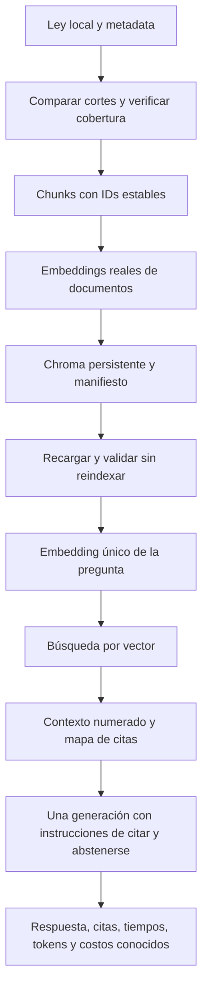

# PRD 04: RAG de Ley REP — bloques 24 a 28

**Estado:** fases 0–5 implementadas y validación real de la fase 6 registrada;
índice, recarga, evaluación, actividad 28 y abstención ejecutados con Gemini.
Las citas se contrastaron de forma asistida. La ampliación está integrada y
publicada solo en `main`; rama de bloques conservada local e instalación desde
GitHub verificada. El estado de cierre se mantiene en el checklist de la entrega.
Ver [entrega](../entregas/bloques-24-28.md),
[resultados reales](../evidencias/bloques-24-28/README.md) y
[publicación](../evidencias/bloques-24-28/verificacion-github.md).
**Línea base:** `607c61f`, 263 pruebas y 481 subpruebas; revisión del 16-11-2026.

## 1. Objetivo y alcance

Agregar un flujo de terminal que indexa la copia local de Ley REP una vez, recupera
fragmentos por significado y genera una respuesta con fuentes numeradas. Medir por
separado calidad de recuperación, latencia y consumo. No reemplazar la API, las
chains de los bloques 18–20 ni el agente supervisado de los bloques 21–23.

No incluye entrenamiento, actualización normativa, servicio público, memoria RAG
conversacional, envío de informes, LangGraph ni requisitos del Gate 2 todavía no
implementados.

## 2. Fuente y requisitos del curso

Se revisó la copia de lectura de
`/home/brandonhc/proyectos/extraccion-skillnest/curso-skillnest/markdown/`.
Los enlaces siguientes identifican las lecciones originales; los comandos y la
organización de archivos se adaptan a este repositorio, no se copia todo el curso.
La vista incrustada de la actividad 28 solo contiene su enlace, no una rúbrica
adicional ni un formulario que podamos enviar desde aquí.

| Bloque | Requisito | Fuente |
| --- | --- | --- |
| 24 | Corpus propio de al menos cinco documentos; chunking elegido con criterio; embeddings reales y Chroma persistente; recarga sin reindexar; índice ignorado por Git. | [20451](https://learning-pro.skillnest.com/mod/page/view.php?id=20451), [20452](https://learning-pro.skillnest.com/mod/page/view.php?id=20452), [actividad 20453](https://learning-pro.skillnest.com/mod/page/view.php?id=20453). |
| 25 | Integridad, persistencia y diagnóstico. Réplica con cinco políticas de una tienda ficticia, en otro índice: ejercicio no entregable. | [20454](https://learning-pro.skillnest.com/mod/page/view.php?id=20454), [20455](https://learning-pro.skillnest.com/mod/page/view.php?id=20455), [20456](https://learning-pro.skillnest.com/mod/page/view.php?id=20456). |
| 26 | Recuperación semántica, metadata e IDs explícitos por chunk; prompt con citas, abstención y mapa de fuentes. Dos preguntas distintas, una fuera del corpus y una cita revisada manualmente. | [20457](https://learning-pro.skillnest.com/mod/page/view.php?id=20457), [20458](https://learning-pro.skillnest.com/mod/page/view.php?id=20458), [actividad 20459](https://learning-pro.skillnest.com/mod/page/view.php?id=20459). |
| 27 | Entre 8 y 15 preguntas, relevantes etiquetados leyendo el corpus antes del retrieval; precisión y recall por caso y promedio, configuración y fecha; comparar k y repetir sin cambios. | [20460](https://learning-pro.skillnest.com/mod/page/view.php?id=20460), [20461](https://learning-pro.skillnest.com/mod/page/view.php?id=20461), [actividad 20462](https://learning-pro.skillnest.com/mod/page/view.php?id=20462). |
| 28 | Medición por etapa del flujo real; tokens de `usage_metadata`, sin inventarlos; JSONL con al menos tres preguntas del B27; misma pregunta con k=3 y k=6; revisar qué etapa domina. | [20463](https://learning-pro.skillnest.com/mod/page/view.php?id=20463), [checklist 20464](https://learning-pro.skillnest.com/mod/page/view.php?id=20464), [actividad core 20465](https://learning-pro.skillnest.com/mod/page/view.php?id=20465). |

## 3. Decisiones y alternativas

| Tema | Decisión | Alternativa y motivo |
| --- | --- | --- |
| Corpus | Los 50 artículos y transitorios ya extraídos, cada uno como documento de origen. Conservar referencia, versión, páginas, URL y hash del PDF. | No inventar un corpus genérico ni tratar las preguntas de evaluación como documentos. |
| Fragmentación | Comparar cortes fijos y recursivos, con tamaños 400 y 800 caracteres. Recursivo 800, overlap 100 produce 99 chunks y conserva todo texto no blanco; se inspeccionaron los cortes del artículo 9. | Artículos completos pueden ser demasiado largos; cortar toda la ley como un solo texto pierde el límite entre artículos. No afirmar que 800 es óptimo sin evaluación real. |
| Índice | `langchain-chroma`, colección propia, distancia coseno, `vectorstore/` desde la raíz del proyecto. Manifestar corpus, chunks, modelo, dimensiones y configuración. | No usar un servicio externo ni escribir un vector store casero. |
| Embeddings | `models/gemini-embedding-001`, 3072 dimensiones, tipos de tarea de documento y consulta del conector oficial. | Mantener el modelo textual de la actividad; cambiar a Embedding 2 implicaría otro contrato de tareas y reindexación. |
| Persistencia | IDs deterministas por documento y posición. Reutilizar solo un índice completo y compatible; ante diferencias o creación interrumpida, pedir una carpeta nueva. | No borrar índices automáticamente ni agregar duplicados cada vez que se ejecuta el comando. |
| Recuperación | Calcular el vector de la pregunta una vez y consultar Chroma por ese vector. No reindexar desde la consulta. | El ejemplo que calcula `embed_query` y luego llama `similarity_search(pregunta)` vuelve a hacer el embedding y mezcla latencias. |
| Generación | Una llamada a `crear_modelo("flash-lite")`, sin herramientas, memoria ni fallback; reutilizar catálogo, límites y calculadora de USD. | El RAG de esta unidad es un flujo fijo, no necesita convertirlo en otro agente. |
| Citas | Contexto numerado y mapa número → chunk/artículo/fuente. Comprobar números inexistentes y avisar si no hay citas. | Una cita sintácticamente válida no demuestra que la afirmación esté respaldada; conservar revisión humana. |
| Evaluación | Diez preguntas etiquetadas y versionadas antes de consultas reales; IDs de chunks y configuración fijados; k=3 y k=5 sobre un mismo ranking. | No ajustar etiquetas a los resultados ni confundir relevancia por artículo con métricas por chunk. |
| Instrumentación | `perf_counter`, tiempos separados de embed, búsqueda y generación; tiempo total de pared y suma de etapas diferenciados; guardar también errores. | No usar solo cronómetro externo ni exigir que la generación sea siempre la etapa más lenta. Se observa, no se fuerza. |
| Consumo | Tokens reales de generación, costo estimado con las tarifas versionadas. El conector de embeddings solo devuelve vectores: sus tokens y costo real quedan desconocidos; una aproximación por caracteres va separada y rotulada. | No presentar `len(texto)//4` como tokens reales ni un subtotal de generación como costo completo del RAG. |
| Evidencias | Runtime en `output/rag/`, ignorado; resultados reales revisados en `docs/evidencias/bloques-24-28/`. Nunca mezclar fakes con evidencia real ni sobrescribir una corrida. | Los tests usan Chroma real y modelos/embeddings falsos en temporales; no prueban calidad semántica ni latencia de Gemini. |
| Git | Rama local `bloques-24-28`; ninguna publicación de ramas de bloques. | Merge y push de este cambio a `main` solo con autorización específica; el cierre anterior no autoriza publicar una ampliación nueva. |

La documentación oficial consultada confirma la disponibilidad de
[`gemini-embedding-001`](https://ai.google.dev/gemini-api/docs/embeddings).
Las tarifas de pago de [Gemini](https://ai.google.dev/gemini-api/docs/pricing)
son referencias, no la factura de la cuenta. No se necesita acceder a secretos
para desarrollar ni probar este flujo.

## 4. Recorridos

La evaluación del B27 se detiene después de buscar: no genera respuestas. El
ensayo de la actividad 28 sí ejecuta las tres etapas y registra cada corrida en
JSONL inmediatamente, para no perder resultados si falla una posterior.

## 5. Plan por fases y archivos

| Fase | Trabajo | Consumo de Gemini |
| --- | --- | --- |
| 0 | Línea base, dependencia Chroma y splitter explícito, lock y export de requirements. | No. |
| 1 — B24/25 | `src/rag/corpus.py`, `indice.py`, `scripts/indexar_corpus.py`; comparación local, integridad, metadata, manifiesto, recarga y réplica separada. | Solo al ejecutar la indexación real. |
| 2 — B26 | `src/rag/recuperacion.py`: embedding único, distancia, prompt, mapa y validación limitada de citas. | Solo en consultas reales. |
| 3 — B27 | `datos/evaluacion/recuperacion_rag.json`, `src/rag/evaluacion.py`, `scripts/evaluacion_recuperacion.py`; métricas y reportes reproducibles. | Embeddings de preguntas, sin generación. |
| 4 — B28 | `src/rag/registro.py`, `scripts/registro_rag.py`; tres etapas, errores, tokens, costos y ensayo de cuatro corridas: tres preguntas, primera también con k=6. | Cuatro embeddings de consulta y cuatro generaciones, además de la indexación inicial. |
| 5 | Tests sin red en `tests/rag/` y `tests/scripts/`; guía de estudio, entrega, uso en README, guía completa y arquitectura. | No. |
| 6 — cierre | Corridas reales autorizadas, comparación y repetición del B27, fuera de corpus y cita revisada; evidencias, conclusión, publicación autorizada e instalación limpia. | Sí; documentar uso real y cualquier fallo, no ocultarlos. |

Los nombres del curso se conservan en `scripts/indexar_corpus.py`,
`scripts/evaluacion_recuperacion.py` y `scripts/registro_rag.py`. No agregar
copias de esos módulos en la raíz solo para duplicar rutas.

## 6. Criterios de aceptación

- [x] Al menos cinco documentos reales, sin mezclar artículos al fragmentar.
- [x] Comparación de las dos estrategias y dos tamaños, con ejemplos inspeccionables.
- [x] Ningún chunk vacío, IDs únicos, metadata completa y cobertura del texto
      no blanco original comprobada por offsets; espacios de borde omitidos
      registrados y overlap no confundido con duplicación accidental.
- [x] Indexar, cerrar proceso y recargar sin recalcular embeddings de documentos.
- [x] Reejecutar una configuración compatible no agrega duplicados ni gasta embeddings (prueba local).
- [x] Índice ausente, vacío, incompatible o incompleto falla antes de consumir cuota.
- [x] Recuperación por vector usa exactamente una invocación de embedding por pregunta.
      El SDK puede reintentar HTTP internamente; no se declara su número de intentos.
- [x] Prompt conserva pregunta, contexto numerado, fuentes, obligación de citar y abstención.
- [x] Diez casos etiquetados antes de retrieval, ligados al corpus y chunking.
- [x] Precisión y recall por caso y promedio; vacíos y duplicados no inflan métricas.
      Recall sin relevantes es `null`, no un cero inventado.
- [x] Reportes registran fecha, huella del índice, k, IDs y configuración.
- [x] JSONL del B28 incluye pregunta, k, tres tiempos, total, respuesta, citas, tokens,
      modelos, tarifas aplicadas, costo conocido y partes desconocidas.
- [x] Los fallos de consulta dejan registro parcial y salida no exitosa, sin repetir
      el flujo completo. No se confunde con los reintentos internos del SDK de embeddings.
- [x] Suite completa, ruff, basedpyright, comandos documentados y `git diff --check`.
      Ver [verificación local](../evidencias/bloques-24-28/verificacion-local.md).
- [x] Ensayos reales de B24/26/27 y actividad 28, con conclusiones basadas en sus resultados.
- [x] Cita contrastada de forma asistida con el texto local y pregunta fuera de corpus revisada.
- [x] Revisión de etiquetas y conclusiones completada.
- [x] Ampliación integrada y publicada en `main`, sin publicar la rama de bloques.
- [x] Validación desde instalación limpia de GitHub.
- [ ] Presentación de la actividad en Skillnest.

## 7. Límites de interpretación

1. Más k no garantiza menor precisión en cada caso: puede agregar un relevante.
   Sobre un mismo ranking el recall no disminuye; evaluar y explicar los resultados.
2. Una pregunta fuera del corpus también recibe vecinos: top-k no detecta por sí
   solo ausencia de respuesta. La abstención se instruye y se ensaya.
3. Las etiquetas son un conjunto de estudio pequeño, no un benchmark de producción.
   Una selección de k sobre esos mismos casos necesita después un conjunto independiente.
4. El texto es una copia de 2016, no una verificación de la normativa vigente.
5. Una medición local o con modelos falsos nunca sustituye la evidencia real que
   pide la actividad 28. No se inventan registros para marcarla completa.
