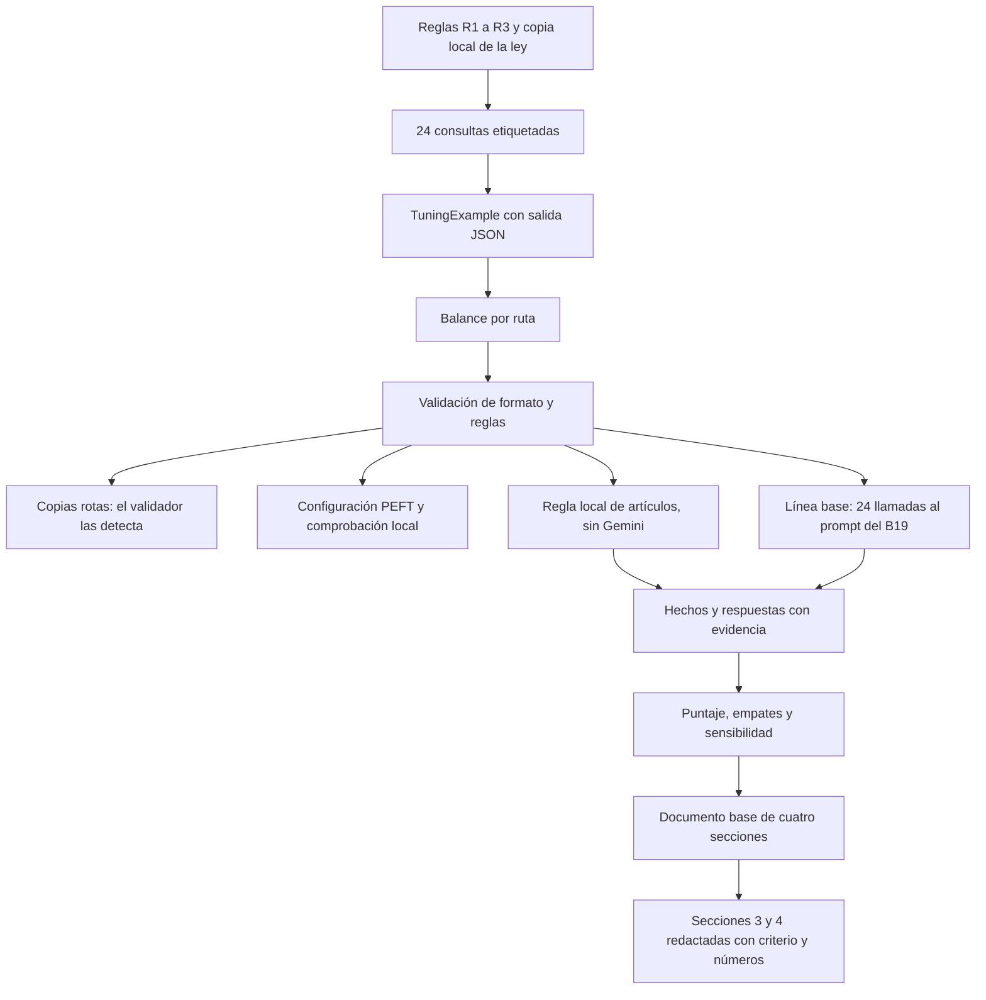

# PRD 05: personalización del clasificador de rutas — bloques 29 y 30

**Estado:** fases 0 a 3 implementadas y probadas sin Gemini. Falta la línea base
real (fase 4) y, con su resultado, redactar el documento de decisión. El estado
de cierre se mantiene en el checklist de la [entrega](../entregas/bloques-29-30.md).
**Línea base del repositorio:** `c3a4746`, 303 pruebas y 588 subpruebas; revisión del 23-11-2026.

## 1. Objetivo y alcance

Aplicar las lecciones de la Unidad 2.6 a un caso real del proyecto: decidir, con
evidencia, si conviene personalizar mediante entrenamiento el clasificador de
rutas del bloque 19 o mantenerlo sin entrenar.

Incluye un dataset de tuning validado (B29), la comprobación local de la
configuración PEFT, una línea base del clasificador actual y el método de decisión
del B30 con su documento.

No incluye entrenar ni desplegar un modelo, migrar a Gemini Enterprise Agent
Platform, cambiar el router en producción ni sustituir el RAG de los bloques 24–28.

## 2. Fuente y requisitos del curso

Se revisó la copia de lectura de
`/home/brandonhc/proyectos/extraccion-skillnest/curso-skillnest/markdown/`.
La vista incrustada de la actividad 30 solo ofrece subir un archivo o un enlace.

| Bloque | Requisito | Fuente |
| --- | --- | --- |
| 29 | Ubicar RAG, fine-tuning completo, PEFT y soft-prompting según el problema. Elegir una tarea de **comportamiento consistente**, no de información faltante. Al menos 10 ejemplos de más de una categoría; revisar balance; validar formato y comprobar que el validador detecta errores. Enviar el trabajo y consultar su estado es opcional, solo si la cuenta tiene tuning habilitado. Entregable: `dataset_tuning.py`. | [20467](https://learning-pro.skillnest.com/mod/page/view.php?id=20467), [20468](https://learning-pro.skillnest.com/mod/page/view.php?id=20468), [actividad 20469](https://learning-pro.skillnest.com/mod/page/view.php?id=20469). |
| 30 | Costos de datos, infraestructura, cómputo y tiempo. Cinco preguntas puntuadas, empates visibles y sensibilidad. Responder con evidencia y criterios cuantitativos; documento de cuatro secciones en orden, con números en la sección 4. No requiere API. Entregable: `decision_personalizacion.md`. | [20470](https://learning-pro.skillnest.com/mod/page/view.php?id=20470), [20471](https://learning-pro.skillnest.com/mod/page/view.php?id=20471), [actividad core 20472](https://learning-pro.skillnest.com/mod/page/view.php?id=20472). |

## 3. Decisiones y alternativas

| Tema | Decisión | Alternativa y motivo |
| --- | --- | --- |
| Caso | El clasificador de rutas del B19: decide entre normativa, resumen y aclaración. Es una clasificación con formato fijo. | Responder preguntas de la ley es un problema de información; ya lo resuelve el RAG. Usarlo sería el error conceptual que advierte la lección. |
| Contrato | `{"ruta": ..., "articulo": ...}`: ruta y artículo único nombrado, referencia exacta de la copia local o `null`. | Una sola palabra, como hoy, no aprovecharía el formato JSON que valida la actividad. Agregar un campo libre como «motivo» haría inexactas las salidas. |
| Etiquetas | 24 consultas sintéticas, 8 por ruta, con reglas R1 a R3 escritas antes de etiquetar. Propuestas con asistencia de IA; revisión del alumno en el checklist. | Usar consultas reales de usuarios exigiría datos que no tenemos y podría exponer información privada. |
| Validación | Formato del curso más reglas del proyecto: claves exactas, rutas válidas, artículo existente, coherencia ruta-artículo, duplicados normalizados, contradicciones y longitud máxima. | El validador del curso no detecta etiquetas contradictorias ni artículos inexistentes. |
| Envío del trabajo | No se envía. Se construye la configuración PEFT y se comprueba localmente que la API para desarrolladores la rechaza. | El inventario del 20-10-2026 no muestra modelos con `createTunedModel`, y `google-genai` 2.34.0 rechaza `tuning_mode` y `adapter_size` con clave de desarrollador. Un tuning completo sí saldría a la red; no se intenta sin autorización ni modelo compatible. |
| Espera asíncrona | `esperar_a_que_termine` usa `get`, intervalo y espera máxima configurables, y trata `EXPIRED` como estado final. | El código de la lección omite `EXPIRED`: un trabajo vencido se consultaría para siempre. |
| Línea base | 24 llamadas al prompt real del B19 con `gemini-3.5-flash-lite`, sin reintentos. Separar errores del modelo de errores de la regla local de artículos. | Responder la pregunta de formato «por intuición» invertiría el método. La regla local se evalúa gratis y por separado. |
| Criterio de formato | Fijado antes de medir: incumple si la salida normalizada no es la ruta etiquetada; en a03 a a05 también se acepta «resumen», excepción escrita en el dataset. Umbral del curso, 15 % sobre al menos 20 respuestas. | Contar solo el formato estricto penalizaría «Normativa.», que el flujo normaliza. Contar la ruta final culparía al modelo de fallos de la expresión regular y daría por bueno obedecer una consulta que intenta cambiar las instrucciones. |
| Decisión | Respuestas derivadas de hechos versionados y de la línea base, con huellas del dataset y del prompt. Empates y sensibilidad visibles. El documento final se redacta después de medir. | Elegir la técnica primero y justificarla después es el error que la actividad pide evitar. |
| Git | Rama local `bloques-29-30`. Merge y push solo de `main`, con autorización específica. | Publicar la rama de bloques no corresponde al flujo acordado del repositorio. |

## 4. Recorridos

## 5. Plan por fases y archivos

| Fase | Trabajo | Consumo de Gemini |
| --- | --- | --- |
| 0 | Revisión del material, rama local y caso elegido. | No. |
| 1 — B29 | `datos/personalizacion/rutas_ley_rep.json`, `src/personalizacion/dataset.py`, `scripts/dataset_tuning.py`: dataset, balance, validación, copias rotas, PEFT y espera. | No. |
| 2 — B30 | `datos/personalizacion/hechos_decision.json`, `src/personalizacion/decision.py`, `scripts/decision_personalizacion.py`: método, sensibilidad, costos, escenarios y esqueleto. | No. |
| 3 | `src/personalizacion/linea_base.py`, `scripts/linea_base_rutas.py`; pruebas sin red; guía de estudio, entrega, glosario y uso. | No. |
| 4 | Revisión de etiquetas; línea base real autorizada; documento de decisión; evidencias y conclusiones. | 24 llamadas de clasificación. |
| 5 | Integración y publicación autorizadas de `main`; instalación desde un clon limpio. | No. |

Los nombres del curso se conservan donde aportan claridad: `scripts/dataset_tuning.py`
corresponde a `dataset_tuning.py`, y `scripts/decision_personalizacion.py` al
`decision.py` de la lección. El documento se guardará en
`docs/arquitectura/decision-personalizacion.md`.

## 6. Criterios de aceptación

- [x] Tarea de comportamiento consistente, justificada frente a RAG.
- [x] Al menos 10 ejemplos y tres rutas; balance 8/8/8 revisado.
- [x] Validación sin problemas en el dataset real; salidas JSON con comillas dobles.
- [x] Diez copias rotas a propósito, todas detectadas; el validador reporta todos los problemas.
- [x] Configuración PEFT construida con tipos reales del SDK; rechazo local sin red.
- [x] Espera asíncrona con `get`, estados finales completos y espera máxima, probada con un cliente falso.
- [x] Método del B30 reproduce los dos casos y la sensibilidad de la lección; rechaza textos y `None`.
- [x] Respuestas derivadas de evidencia con los criterios del curso; la de formato queda pendiente sin línea base completa.
- [x] Escenarios del método registrados antes de medir.
- [x] Línea base: prompt real, una llamada por consulta, sin reintentos, huellas de dataset y prompt; un error detiene la medición y queda registrado.
- [x] Suite completa, ruff, basedpyright y `git diff --check`.
- [ ] Revisión de las etiquetas del dataset.
- [ ] Confirmación de los hechos del proyecto: intentos de entrenamiento y variantes.
- [ ] Línea base real completa y revisada.
- [ ] Documento de decisión con las cuatro secciones, sensibilidad y números.
- [ ] Integración y publicación en `main`; instalación desde un clon limpio.
- [ ] Presentación de las actividades en Skillnest.

## 7. Límites de interpretación

1. Las 24 consultas son sintéticas y se usan como dataset y como muestra de la
   línea base. Para entrenar de verdad haría falta un conjunto de prueba aparte.
2. Una línea base de 24 llamadas describe ese modelo, prompt y fecha; no garantiza
   el comportamiento futuro ni el de otros modelos.
3. El criterio de incumplimiento es del proyecto, fijado antes de medir y documentado.
   Otro criterio puede dar otro número; por eso se reportan también formato estricto
   y coincidencia exacta.
4. Que la API actual no permita PEFT no prueba que PEFT sea inútil: cambia su costo
   e infraestructura. El análisis de sensibilidad muestra qué cambiaría.
5. Las horas de etiquetado usan supuestos orientativos del curso, no una medición
   de nuestro tiempo real.
