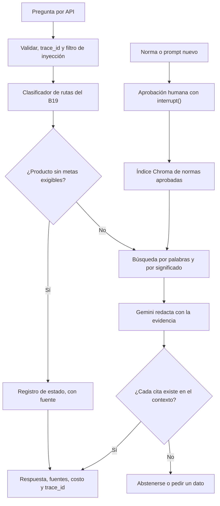

# PRD 06: MVP del asistente Ley REP para el Gate 3

**Estado:** alcance de cinco normas definido. No hay nada implementado.

**Fecha:** 24 de noviembre de 2026.

## 1. Problema y objetivo

Una empresa que importa, fabrica o vende productos en Chile necesita saber si la
Ley REP la alcanza, qué debe hacer y en qué norma lo dice. La ley sola no
responde: fija el marco y remite a un decreto por producto.

El RAG de los bloques 24 a 28 indexa una sola norma. El MVP debe responder sobre
**envases, neumáticos, pilas y aparatos eléctricos**, citar norma y artículo, e
informar el estado de los productos que hoy no tienen metas exigibles.

## 2. Por qué más de una norma

| Pregunta | Evidencia | Consecuencia |
| --- | --- | --- |
| ¿Alcanza con la ley? | El artículo 10 enumera seis productos prioritarios y el artículo 12 encarga sus metas a decretos supremos. | No. Las metas y plazos están en otras normas. |
| ¿Se relacionan? | La ley define los sujetos; cada decreto, sus metas; el catálogo de envases, qué objetos cuentan. | Hay que recuperar y citar varias a la vez. |
| ¿Conviene indexar todo? | Cada documento agrega fragmentos que compiten por entrar en la respuesta. | No. Se agrega por etapas y se vuelve a medir. |

También se revisó en solo lectura el prototipo externo `leyrep-agente`, para saber qué
normas aparecen juntas. Sus datos y mediciones no se publican aquí.

## 3. Corpus propuesto

| Etapa | Normas | Qué permite responder |
| --- | --- | --- |
| Hoy | Ley 20.920 | El marco general, con 99 fragmentos reales. |
| **Gate 2** | + DS 12/2020 | Envases y embalajes. |
| **MVP Gate 3** | + DS 8/2019, DS 22/2025 y Res. Ex. 240/2022 | Neumáticos, pilas y aparatos eléctricos, y qué objetos son envases. |
| Ampliación | + DS 29/2024, DS 148/2003, Res. Ex. SMA 2.084/2023 y Ley 21.368 | Instalaciones, residuos peligrosos, reportes y plásticos de un solo uso. |

La cantidad de fragmentos y el costo de indexar se calculan al incorporar cada texto,
sin llamar a la API.

**La Res. Ex. 240 entra con condición.** Es un catálogo formado por tablas. Si no se
pueden contrastar a tiempo, la reemplaza el DS 29/2024, que es texto corrido.

### Registro de estado normativo

Una tabla propia, con hechos breves, fecha y enlace oficial, sin copiar los actos.
Responde por regla, sin que el modelo deduzca la vigencia.

| Producto | Estado | Fuente | Verificación |
| --- | --- | --- | --- |
| Aceites lubricantes | DS 47/2023 anulado totalmente por sentencia del 6-8-2026; el procedimiento vuelve a la etapa de propuesta. | [Res. Ex. 5.193/2026, Diario Oficial del 24-9-2026](https://www.diariooficial.interior.gob.cl/publicaciones/2026/09/24/44557/01/2873948.pdf) | Texto leído el 24-11-2026. No indica si la sentencia está firme. |
| Baterías | Anteproyecto, Res. Ex. 821/2026. | Por enlazar | Por verificar |
| Textiles | Producto prioritario sin decreto de metas, Res. Ex. 3.914/2025. | Por enlazar | Por verificar |

Un resumen de estado no responde preguntas sobre el contenido de esos actos: para eso
el asistente remite al enlace oficial.

### Derechos de autor y procedencia

- **Lo comprobado:** en la [Ley 17.336](https://www.wipo.int/wipolex/es/text/489615),
  versión de 2014, no se encontró una exclusión expresa para leyes y decretos; el
  tramo final, desde el artículo 100 bis, no se revisó completo. El artículo 88 da al Estado la titularidad de las obras de sus funcionarios. No se
  pudo confirmar la licencia de la BCN en su propio sitio.
- **Entra:** texto de leyes, decretos y resoluciones publicados, obtenido de la
  fuente oficial, sin notas editoriales de terceros, con enlace, fecha y hash.
- **No entra:** guías, manuales, preguntas frecuentes, estudios, hojas de ruta,
  historia de la ley, normas técnicas pagadas ni material de terceros.
- **No se copia del prototipo:** sus textos preparados, índice, relaciones, prompts,
  preguntas ni mediciones. Solo se usa como mapa de qué normas importan.

Esto reduce el riesgo, pero no es una opinión jurídica.

### Repositorios

Este repositorio público conserva las prácticas y la entrega del Gate 2. El Gate 3 irá
en **otro repositorio público**, con el MVP y su documentación. Después de la
certificación el desarrollo continúa a partir de ese repositorio.

## 4. Alcance del MVP

| Incluye | No incluye |
| --- | --- |
| Preguntas sobre las 5 normas, con cita de norma y artículo. | Aplicar la ley a una empresa con valor jurídico. |
| Estado de aceites, baterías y textiles desde el registro. | Metas o plazos de normas anuladas o en trámite. |
| Pedir un dato faltante o abstenerse. | Sentencias completas, guías o un corpus más amplio. |
| API con FastAPI, contenedor, matrices de pruebas y riesgos. | WhatsApp, CRM, formularios comerciales o datos de clientes. |
| Aprobación humana antes de activar una norma o un prompt. | Entrenar modelos ([decisión](../arquitectura/decision-personalizacion.md)). |

## 5. Arquitectura

| Tema | Decisión propuesta | Motivo |
| --- | --- | --- |
| Índice | Mantener Chroma; dejar pgvector para después. | Ya funciona y cinco normas no justifican otro servicio. |
| Actualización | Agregar, reemplazar y retirar **por norma**, con IDs estables. | El Gate 2 exige actualización incremental y el índice actual es inmutable. |
| Búsqueda | Medir palabras, significado y combinación con las mismas preguntas; elegir después. | La búsqueda por palabras sirve de referencia simple y sin costo. |
| Metadatos | Norma, artículo, vigencia y fuerza jurídica en campos separados. | Vigente y vinculante son cosas distintas. |
| Relaciones | Una lista corta y revisada, como «Ley 20.920 art. 10 habilita DS 12». | Una relación sin revisar puede llevar a citar la norma equivocada. |
| Citas | Si falta una o no existe en el contexto, no se entrega la respuesta. | Hoy solo se avisa. |
| Supervisión | Pausar antes de activar una norma o un prompt. | Un error ahí afecta a todas las respuestas. |

## 6. Qué falta para el Gate 2

| Requisito | Hoy | Falta |
| --- | --- | --- |
| Índice persistente e incremental | Persistente, inmutable | Agregar DS 12 sin recalcular la ley |
| **Citar siempre** (crítico) | Se detecta, no se bloquea | Bloquear y abstenerse |
| Métricas de recuperación | 10 preguntas, una norma | Repetir con dos normas |
| Costo y latencia | Medido en B28 | Repetir con el índice nuevo |
| Personalización | Documento propuesto | Revisión |
| **Logs sin contenido crudo** (crítico) | El registro guarda pregunta, respuesta y fragmentos | Longitudes, huellas y `trace_id` |
| Filtro de inyección | Solo instrucción en el prompt | Filtro sobre los fragmentos |
| **Supervisión real** (crítico) | Aprobación en terminal (B23) | `interrupt()` y `Command` de LangGraph |
| Versiones de prompt y riesgos | No hay | Registro con dos versiones y matriz de 5 riesgos o más |
| **Sin excepciones** (crítico) | Pruebas actuales en verde | Ensayo limpio y `test_gate2.py` |

Los bloques 31 y 32 cubren casi todo lo pendiente.

## 7. Plan

El Gate 2 se entrega lo antes posible, una vez terminadas las actividades 31 y 32; el
calendario lo registraba para el 23-11. El Gate 3 es el 14-12 y el 8-12 es feriado.

| Fechas | Trabajo | Resultado |
| --- | --- | --- |
| 24 al 27 nov | Actividades 31 y 32; después, DS 12 incremental y ensayo limpio | Entrega del Gate 2 |
| 30 nov al 4 dic | Repositorio nuevo, DS 8, DS 22, Res. 240, registro de estado y contenedor | Corpus del MVP cerrado el 4-12 |
| 7 al 11 dic | 40 preguntas, matrices, README y ensayo limpio | Versión candidata |
| 14 dic | Demo y defensa | Gate 3 |

La ampliación a 9 normas solo empieza si el corpus del MVP está cerrado y medido.

Las 40 preguntas son propias y se etiquetan antes de medir: 20 de una norma, 8 que
cruzan normas, 6 de estado y 6 fuera de alcance o de ataque. Son unas 3,6 horas con
los supuestos del curso: 5 minutos por pregunta y 2 de segunda revisión al 20 %.

## 8. Criterios de aceptación

Se fijan antes de medir y no se ajustan después.

- [ ] Las cuatro condiciones críticas del Gate 2 pasan en un entorno limpio.
- [ ] Agregar una norma no recalcula los vectores de las demás.
- [ ] La norma esperada aparece entre los 5 primeros fragmentos en 18 de las 20 preguntas de una norma.
- [ ] En 6 de las 8 preguntas cruzadas aparecen todas las normas esperadas.
- [ ] 0 respuestas con citas inexistentes y 0 metas de normas anuladas.
- [ ] 6 de 6 preguntas fuera de alcance o de ataque terminan en abstención.
- [ ] Los logs no contienen la consulta, la respuesta ni un correo de prueba.
- [ ] El contenedor se levanta desde cero siguiendo solo el README.
- [ ] Cada norma tiene enlace oficial, fecha, hash y revisión de tablas.

## 9. Después del Gate 3

| Paso | Condición para empezar |
| --- | --- |
| 9 normas | MVP medido y tablas contrastadas. |
| Más documentos | Cada grupo nuevo no hace perder evidencia a las preguntas anteriores. |
| WhatsApp, CRM y datos reales | Revisión de privacidad y autorización de la empresa. |
| Otro país de Latinoamérica | Un índice separado por país y fuentes oficiales propias. |

## 10. Riesgos y preguntas abiertas

- Quedan 14 días hábiles, contando el 24-11 y el 14-12; la lectura de tablas es lo más lento.
- Faltan las 8 dimensiones de la rúbrica del Gate 3.
- No se comprobó la versión vigente de los decretos: la página de LeyChile no se
  pudo leer de forma automática. Se confirma al obtener cada texto.
- Las 40 preguntas propias tampoco tendrán revisión jurídica experta.
- La comparación con el prototipo exige usar el mismo conjunto de preguntas; hasta
  entonces no se afirma que este asistente sea mejor.

La propuesta se preparó con asistencia de IA.
