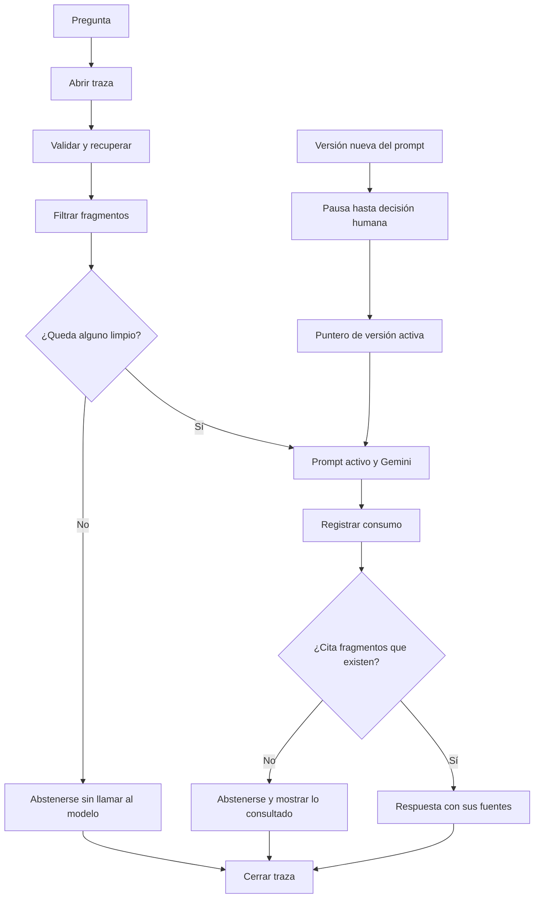

# PRD 07: observabilidad, seguridad y gobernanza — bloques 31 y 32

**Estado:** fases 0 a 4 ejecutadas: matriz revisada, versiones medidas y v2 activa. Falta
la publicación. El estado de cierre se
mantiene en el checklist de la [entrega](../entregas/bloques-31-32.md).
**Línea base del repositorio:** `92679d7`, 346 pruebas y 630 subpruebas; 24-11-2026.

## 1. Objetivo y alcance

Poder explicar después qué ocurrió en una consulta RAG, reducir el efecto de
instrucciones escondidas en los documentos y exigir una decisión humana antes de las
acciones difíciles de revertir.

Incluye eventos JSON con `trace_id`, consumo por consulta, filtro de inyección,
citas obligatorias (B31); versiones de prompt con huella y diff, un grafo que se pausa
con `interrupt()` y la matriz de riesgos (B32).

No incluye exponer el RAG por la API, autenticar a quien aprueba, un servicio externo
de monitoreo, ni detectar inyecciones por significado.

## 2. Fuente y requisitos del curso

Se revisó la copia local de la lección y de las actividades, extraída el 12-11-2026.

| Bloque | Requisito | Fuente |
| --- | --- | --- |
| 31 | Logging JSON con `trace_id`; `usage_metadata` de cada llamada; filtro sobre los documentos recuperados antes del prompt, con el descarte registrado; unir las tres piezas en una consulta reconstruible solo con los logs. Probar un documento limpio y uno con inyección. La conexión real es opcional. Entregable: `logging_rag.py`. | [20474](https://learning-pro.skillnest.com/mod/page/view.php?id=20474), [20475](https://learning-pro.skillnest.com/mod/page/view.php?id=20475), [actividad core 20476](https://learning-pro.skillnest.com/mod/page/view.php?id=20476). |
| 32 | Al menos dos versiones reales del prompt con huella, nota y diff; grafo con `interrupt()` y `Command(resume=...)`, un `thread_id` por solicitud, aprobación y rechazo; al menos cinco riesgos propios con P × I y límite; supervisión para ALTO y CRITICO; dos mitigaciones ya construidas con su bloque. Entregables: `registro_prompts.py`, `grafo_supervision.py`, `matriz_riesgos.py`. | [20477](https://learning-pro.skillnest.com/mod/page/view.php?id=20477), [20478](https://learning-pro.skillnest.com/mod/page/view.php?id=20478), [actividad 20479](https://learning-pro.skillnest.com/mod/page/view.php?id=20479). |

## 3. Decisiones y alternativas

| Tema | Decisión | Alternativa y motivo |
| --- | --- | --- |
| Dónde instrumentar | Un módulo nuevo, `src/rag/servicio.py`. El instrumento de medición del B28 queda igual. | Cambiar el B28 alteraría un instrumento con mediciones publicadas. |
| Qué se registra | Lista cerrada de eventos y campos, con tipo y largo máximo. Un campo no previsto falla. | La lección pide no registrar contenido; una lista cerrada no depende de recordarlo en cada llamada. |
| Huella de la pregunta | No se registra; solo su longitud. | La lección propone longitud o huella. Una pregunta corta se puede adivinar probando textos; un fragmento público, no tiene ese problema. |
| `trace_id` | Identificador aleatorio completo en `contextvars`, abierto y cerrado en un bloque `with`. | La lección usa 8 caracteres. El completo evita choques y el bloque restaura la traza anterior aunque falle. |
| Callbacks de LangChain | Se estudian; no se usan. | El servicio es una función con cuatro etapas propias, dos de ellas fuera de LangChain (filtro y citas). Un callback no las vería. |
| Filtro | Siete patrones sobre texto normalizado, aplicado a `page_content`. Descarta el fragmento y marca `requiere_revision`. | Sin normalizar, una tilde o un carácter invisible evita el patrón. Se mide que no descarte ningún fragmento de la ley. |
| Fragmento sospechoso | Se responde solo con los limpios y se pide revisión; si no queda ninguno, no se llama al modelo. | Detener toda respuesta permitiría que un documento bloquee el servicio. El riesgo es MEDIO con el corpus actual. |
| Citas | Sin citas, o con una cita inexistente, el texto del modelo no se entrega. | El B28 solo lo registraba. Es un criterio no compensable del Gate 2. |
| Errores | `responder` no propaga excepciones; registra etapa y tipo, nunca el mensaje. | El mensaje de un proveedor puede repetir la consulta. |
| Versiones de prompt | v1 es el prompt medido en B26–B28, con su evidencia. v2 agrega tres líneas contra inyección. La versión activa es un puntero aparte. | Reemplazar el texto en el código perdería la versión con la que se midió. |
| Probar antes de aprobar | `--prompt HUELLA` ejecuta una versión sin activarla. | Aprobar sin medir convertiría la supervisión en un trámite. |
| Acciones supervisadas | Activar un prompt y copiar un registro real a las evidencias públicas. | Aprobar cada respuesta no escala; la lección lo desaconseja. |
| Estado pausado | SQLite. Quien propone y quien decide pueden ser procesos distintos. | `InMemorySaver` pierde la solicitud al cerrar el programa. |
| Qué cuenta como decisión | Solo el booleano `True` o `False`, con la huella revisada. En terminal, solo `s` o `n`. | Con `resume="no"`, un texto no vacío es verdadero y aprobaría. |
| Cambio después de revisar | Al aplicar se recalculan la huella y la versión base; si cambiaron, no se aplica. | Aprobar un objeto y aplicar otro es el error que describe la lección. |
| Dependencias | `langgraph` (ya instalado como dependencia de LangChain) y `langgraph-checkpoint-sqlite`. | La lección pide ambos para el estado durable. |

## 4. Recorrido

## 5. Plan por fases y archivos

| Fase | Trabajo | Consumo de Gemini |
| --- | --- | --- |
| 0 | Revisión del material y rama local. | No. |
| 1 — B31 | `src/observabilidad/`, `src/rag/servicio.py`, `scripts/logging_rag.py`. | No. |
| 2 — B32 | `src/gobernanza/`, `datos/gobernanza/`, `scripts/registro_prompts.py`, `scripts/grafo_supervision.py`, `scripts/matriz_riesgos.py`. | No. |
| 3 | Pruebas sin red, guía de estudio, entrega, glosario y evidencias. | No. |
| 4 | Revisión de la matriz; prueba real de v1 y v2; decisión sobre v2; orden escondida. | 12 generaciones. |
| 5 | Integración y publicación autorizadas de `main`; clon limpio. | No. |

## 6. Criterios de aceptación

- [x] Cada evento es una línea JSON con `trace_id`; dos consultas simultáneas no se mezclan.
- [x] Los registros no contienen la pregunta, la respuesta, los fragmentos ni el mensaje de un error.
- [x] Consumo tomado de `usage_metadata`; sin metadatos queda desconocido, no cero.
- [x] Un documento limpio sigue y uno con inyección se descarta, con su registro.
- [x] Ningún fragmento de la ley se descarta: 99 de 99 pasan el filtro.
- [x] Respuesta sin citas o con cita inexistente: no se entrega.
- [x] Fallos controlados en validación, recuperación y generación.
- [x] Dos versiones reales del prompt, con huella comprobada y diff.
- [x] El grafo se pausa, aprueba, rechaza, sobrevive a otro proceso y no decide dos veces.
- [x] Ocho riesgos propios; supervisión en los cuatro ALTO y CRITICO; archivos de mitigación existentes.
- [x] Suite completa, ruff, basedpyright y `git diff --check`.
- [x] Revisión de las estimaciones de la matriz.
- [x] Prueba real de v1 y v2, con el criterio escrito antes.
- [x] Decisión sobre v2: aprobada y activa.
- [x] Orden escondida que el filtro no reconoce, probada con ambas versiones.
- [ ] Integración y publicación en `main`; instalación desde un clon limpio.
- [ ] Presentación de las actividades en Skillnest.

## 7. Límites de interpretación

- El filtro reconoce frases conocidas. Con otras palabras, otro idioma o letras
  separadas, no detecta. Está probado que esos casos pasan.
- Una cita existente no demuestra que el artículo diga lo que afirma la respuesta.
- La aprobación del B23 cubre los informes del agente. Una respuesta RAG directa no
  pasa por ella: queda sujeta solo a los controles automáticos.
- La aprobación para publicar evidencias es un procedimiento. No impide copiar un
  archivo a mano.
- `cuenta_local` identifica la cuenta del equipo que ejecutó el comando, no a una persona.
- El ensayo usa índice, embeddings y modelo de prueba: comprueba la mecánica.
