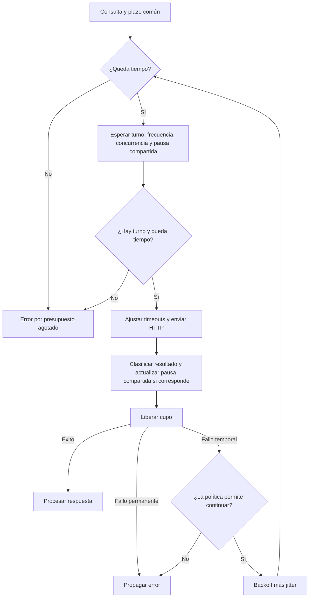

# PRD 01: control de consumo de Gemini

- **Estado:** propuesto; pendiente de implementación.
- **Fecha:** 26 de octubre de 2026.
- **Primera versión:** control de frecuencia y concurrencia dentro de un proceso.

## 1. Resumen: objetivo y enfoque

**Objetivo:** reducir los rechazos por exceso de peticiones y ordenar el consumo continuo de Gemini, conservando un tiempo de espera acotado para cada consulta.

**Cómo se haría:** incorporar un controlador compartido por modelo antes de cada envío HTTP. Este controlador espaciaría las peticiones según una frecuencia configurable y permitiría inicialmente una sola petición en curso por modelo. Las consultas adicionales esperarían su turno dentro del presupuesto de tiempo de la consulta. Los reintentos también pasarían por este control.

La recuperación ante fallos seguiría a cargo de la política existente: hasta tres intentos, backoff exponencial, jitter y respeto de `Retry-After`. Un HTTP 429 con `Retry-After` válido establecería además una pausa compartida para las nuevas peticiones al mismo modelo.

**Resultado esperado:** envíos distribuidos en el tiempo, menos ráfagas y una salida controlada cuando no sea posible continuar. La primera versión regularía peticiones por minuto; el control de tokens, cuota diaria y consumo entre procesos quedaría para una ampliación.

## 2. Problema y situación actual

1. [consultar_gemini_raw()](../src/agente_gemini.py) construye la petición y delega su ejecución en [con_reintento()](../src/reintentos.py).
2. La política actual espera después de determinados fallos. Las consultas exitosas consecutivas pueden enviarse sin separación preventiva.
3. Cada consulta tiene sus propios contadores y presupuesto. Tres intentos por consulta no limitan la cantidad total de peticiones por minuto.
4. Varias consultas concurrentes al mismo modelo pueden iniciar peticiones al mismo tiempo. La espera por `Retry-After` solo afecta actualmente a la consulta que recibió el error.
5. El presupuesto predeterminado es de 90 segundos e incluye peticiones y backoff. Los timeouts se reducen según el tiempo restante, aunque no garantizan cancelar estrictamente una petición ya iniciada.

Gemini aplica límites por proyecto y modelo, que pueden incluir peticiones por minuto, tokens de entrada por minuto y peticiones por día. Los valores reales deben consultarse en Google AI Studio; este plan no presupone una cuota disponible. Véase la [documentación de límites](https://ai.google.dev/gemini-api/docs/rate-limits).

## 3. Alcance de la primera versión

| Incluido | Pospuesto |
| --- | --- |
| Frecuencia configurable por modelo. | Estimación y regulación preventiva de tokens por minuto. |
| Una petición en curso por modelo como valor inicial. | Control de cuota diaria y gasto acumulado. |
| Estado compartido entre llamadas del mismo proceso. | Coordinación entre API, CLI, workers o servidores independientes. |
| Control aplicado a peticiones iniciales y reintentos. | Redis, colas persistentes y ejecución en segundo plano. |
| Espera acotada por el presupuesto de la consulta. | Cancelación estricta de peticiones HTTP en curso. |
| Pausa compartida por HTTP 429 con `Retry-After` válido. | Ajuste automático de cuotas a partir de errores del proveedor. |
| Registros y pruebas con tiempo simulado. | Un servicio externo de métricas o un panel de administración. |

Los puntos de entrada serían `POST /consultar`, `POST /consultar/raw`, el CLI, las funciones Python y los evaluadores, a través del mismo cliente Gemini. `SIN_REINTENTOS` conservaría una sola petición por medición y podría esperar su turno antes de enviarla.

## 4. Comportamiento esperado

### 4.1. Recorrido de una consulta

1. Resolver el modelo y preparar el cuerpo y los encabezados, como ocurre actualmente.
2. Establecer un plazo común con reloj monotónico a partir del presupuesto de la consulta.
3. Antes de cada envío, consultar el controlador del modelo. Verificar la frecuencia permitida, la concurrencia y cualquier pausa compartida vigente.
4. Si hace falta esperar, hacerlo dentro del plazo común. Si no queda margen para enviar, terminar sin iniciar otra petición HTTP.
5. Obtener el turno de forma atómica, volver a calcular el tiempo restante y ajustar los timeouts inmediatamente antes del envío.
6. Ejecutar una sola petición y clasificar el resultado.
7. Ante un HTTP 429 con `Retry-After` válido, extender la pausa compartida del modelo antes de liberar el cupo y propagar el error. Liberar el cupo al finalizar cualquier intento, incluso si falla, para que el siguiente envío observe la pausa actualizada.
8. Si el error permite otro intento, aplicar el backoff con jitter existente y regresar al paso 3. El cupo de concurrencia queda libre durante el backoff.
9. Ante una respuesta exitosa, conservar la extracción de texto, validación y cálculo de consumo actuales.

### 4.2. Ejemplo de frecuencia

Con un límite local **ficticio** de 15 peticiones por minuto, el intervalo mínimo entre inicios sería `60 / 15 = 4 segundos`.

| Momento | Evento | Resultado |
| --- | --- | --- |
| Segundo 0 | A pide turno con el controlador libre. | Se envía A. |
| Segundo 1 | B pide turno para el mismo modelo. | B espera. |
| Segundo 4 | Se cumple el intervalo mínimo. | B puede salir si A terminó y no hay una pausa compartida. |
| Después de un fallo de B | B solicita reintentar. | Respeta el backoff y vuelve a solicitar turno. |

Este valor ilustra el mecanismo; la configuración definitiva se elegirá según la cuota real y el consumo de otras aplicaciones del proyecto.

## 5. Requisitos funcionales

| ID | Requisito |
| --- | --- |
| RF-01 | Mantener un controlador compartido y seguro ante llamadas desde distintos hilos, identificado por el modelo real resuelto desde el catálogo. |
| RF-02 | Separar los inicios de envío al menos `60 / RPM` segundos. No acumular permisos durante periodos sin actividad que permitan una ráfaga posterior. |
| RF-03 | Permitir inicialmente una petición en curso por modelo. Distintos modelos podrán avanzar independientemente dentro de sus límites configurados. |
| RF-04 | Hacer pasar cada envío HTTP, incluidos los reintentos, por el controlador. Esperar turno no incrementará el contador de peticiones realizadas. |
| RF-05 | Consumir un único presupuesto para espera de turno, peticiones y backoff. Recalcular los timeouts después de la espera. |
| RF-06 | Si el turno no cabe en el plazo disponible, terminar sin enviar. Informar cero intentos si todavía no se realizó ninguna petición y conservar la última causa cuando exista. |
| RF-07 | Ante HTTP 429 con `Retry-After` válido, bloquear nuevos envíos al mismo modelo hasta el plazo indicado. Actualizar ese estado antes de liberar el cupo; una pausa nueva solo podrá extender el plazo compartido vigente. |
| RF-08 | Conservar el jitter al final del cálculo de la pausa de reintento, después del backoff base y de `Retry-After`. El controlador y la política comprobarán sus plazos sin repetir dos veces la misma espera solicitada por el proveedor. |
| RF-09 | Liberar el cupo en todos los caminos de salida. Las esperas no mantendrán bloqueado el acceso al estado compartido. |
| RF-10 | Conservar las categorías de errores actuales y `reintentar_lectura=False`. Con `SIN_REINTENTOS`, un fallo del proveedor mantendrá su categoría original. |
| RF-11 | Registrar modelo, motivo y duración de las esperas y número real de envíos. Mantener fuera de los registros las credenciales, prompts y cuerpos del proveedor. |

## 6. Diseño y configuración propuestos

### 6.1. Responsabilidades y archivos

| Archivo | Cambio previsto |
| --- | --- |
| `src/limites.py` — nuevo | Configuración validada, estado por modelo, cálculo de turnos y pausas compartidas con reloj monotónico. |
| `src/agente_gemini.py` | Solicitar turno antes de cada envío, recalcular timeouts, liberar el cupo y comunicar al controlador los HTTP 429 con `Retry-After`. |
| `src/reintentos.py` | Coordinar el presupuesto común y contabilizar los envíos reales, conservando un único bucle de reintentos. |
| `src/errores_cliente.py` y `src/api.py` | Representar el agotamiento durante la espera y mantener su traducción a HTTP 504, incluidos cero intentos cuando corresponda. |
| `.env.example` y `README.md` | Documentar la activación, los límites por modelo y el alcance por proceso. |
| `tests/test_limites.py` — nuevo | Verificar turnos, separación de envíos, concurrencia y pausas compartidas con tiempo simulado. |
| Pruebas existentes del cliente y evaluadores | Comprobar la integración y la compatibilidad de errores y mediciones. |

### 6.2. Configuración

Los nombres siguientes son una propuesta; todavía no existen como opciones de la aplicación.

| Opción propuesta | Regla |
| --- | --- |
| `GEMINI_CONTROL_CONSUMO` | Desactivado por defecto para una incorporación optativa. Al activarlo se validará la configuración antes de enviar peticiones. |
| `GEMINI_RPM_POR_MODELO` | Mapa de alias del catálogo a enteros positivos de peticiones por minuto. Debe cubrir los modelos que se habiliten con el control activo. |
| Concurrencia inicial | Una petición en curso por modelo; ampliar o hacer configurable este valor quedará para una revisión posterior. |
| Presupuesto | Reutilizar `PoliticaReintento.presupuesto_segundos`, con sus 90 segundos predeterminados. |

El catálogo resolverá cada alias a su identificador real, evitando controladores separados para alias equivalentes. Con el control activo, una cuota ausente o inválida para un modelo impedirá consultarlo con un error de configuración explícito. No se deducirá una cuota segura a partir del nombre del modelo ni de la clave.

### 6.3. Compatibilidad y observación

1. Conservar los formatos exitosos de `/consultar` y `/consultar/raw` y el contrato local de errores.
2. Identificar el agotamiento de presupuesto durante la espera mediante su causa y la cantidad real de peticiones realizadas. No inventar un código HTTP del proveedor si no hubo respuesta.
3. Mantener el JSON exitoso del CLI en stdout y los registros en stderr.
4. En los evaluadores, seguir midiendo una sola petición por consulta. Documentar que la latencia observada puede incluir espera de turno; registrar esa espera por separado para interpretar las comparaciones.
5. Con el control desactivado, conservar el comportamiento existente de llamadas y reintentos.

## 7. Plan de implementación enumerado

1. **Confirmar cuotas y alcance operativo.** Registrar los modelos y sus límites disponibles en AI Studio, el margen local elegido y qué otras aplicaciones usan el mismo proyecto.
2. **Construir el controlador.** Implementar la configuración validada y los turnos por modelo, con separación mínima de envíos y una petición activa.
3. **Integrar el presupuesto.** Compartir el plazo entre controlador y reintentos; recalcular timeouts y contar únicamente los envíos realizados.
4. **Integrar `Retry-After`.** Actualizar la pausa compartida ante HTTP 429 y coordinarla con el backoff de cada consulta.
5. **Conectar las entradas existentes.** Verificar API normal y raw, CLI, funciones públicas y evaluadores sin duplicar controladores dentro de un proceso.
6. **Completar verificación y documentación.** Ejecutar las pruebas simuladas, revisar mensajes de error y registrar la configuración y las limitaciones en el README.

## 8. Criterios de aceptación

| ID | Escenario | Resultado verificable |
| --- | --- | --- |
| CA-01 | Límite local de 15 RPM, sin peticiones activas ni pausas. | Los inicios consecutivos del mismo modelo quedan separados al menos cuatro segundos, incluso tras un periodo sin actividad. |
| CA-02 | Varias llamadas simultáneas al mismo modelo. | Solo una petición permanece en curso; las demás respetan el turno y su presupuesto. |
| CA-03 | Dos modelos con límites independientes. | Esperar por uno no ocupa el cupo ni modifica el plazo del otro. |
| CA-04 | Un intento falla temporalmente y se recupera al repetir. | Ambos envíos pasan por el controlador y se conserva el backoff con jitter. |
| CA-05 | Una consulta recibe HTTP 429 con `Retry-After: 12`. | Ninguna petición posterior del mismo modelo comienza antes del plazo compartido; una pausa anterior más larga se conserva. |
| CA-06 | El presupuesto se agota antes del primer envío o entre intentos. | No se inicia otra petición. La API devuelve HTTP 504 y el contador refleja cero o los envíos realmente realizados. |
| CA-07 | Se consume parte del presupuesto esperando turno. | Los timeouts enviados a Requests se calculan con el tiempo restante después de la espera. |
| CA-08 | Error permanente, timeout de lectura predeterminado o `SIN_REINTENTOS`. | Se conserva la categoría de error y no aparece un envío adicional. |
| CA-09 | Un envío falla o termina por excepción. | Se libera el cupo para que otra consulta pueda avanzar. |
| CA-10 | Configuración inválida con el control activo. | Se informa el problema antes del envío y no se consulta Gemini. |
| CA-11 | API, CLI y evaluadores con respuestas simuladas. | Mantienen sus contratos y cantidad de peticiones; las pruebas no consumen tokens reales ni esperan tiempo de pared. |
| CA-12 | Control desactivado. | Continúan pasando las pruebas actuales de cliente y reintentos. |

La verificación combinará reloj, esperas y transporte simulados con coordinación de hilos para los escenarios concurrentes. No se provocarán límites reales del proveedor para demostrar el funcionamiento.

## 9. Limitaciones y ampliaciones

1. **Alcance por proceso.** API, CLI y workers independientes tendrán estados distintos. Para sumar su consumo se necesitará un coordinador compartido, por ejemplo Redis. Reiniciar el proceso también perderá los turnos y pausas en memoria.
2. **Otras cuotas.** Respetar RPM no garantiza evitar HTTP 429 por tokens, cuota diaria o límites de gasto. Esas causas requieren controles adicionales.
3. **Cuotas compartidas.** Otras aplicaciones del proyecto y posibles agrupaciones de cuota entre modelos no quedan coordinadas por esta primera versión; deberán considerarse al elegir los límites locales.
4. **Carga sostenida.** Si llegan consultas más rápido de lo que pueden atenderse, aumentará la espera hasta agotar presupuestos. Antes de ampliar a uso intensivo habrá que definir un máximo de consultas pendientes y su respuesta de admisión.
5. **Disponibilidad del proveedor.** El control reduce ráfagas propias, pero no evita fallos HTTP 500/503 ni garantiza que una petición iniciada termine antes del plazo.

## 10. Referencias

1. [Arquitectura actual de la aplicación](arquitectura.md).
2. [Cliente con reintentos en el README](../README.md#cliente-con-reintentos-bloque-12).
3. [Límites de Gemini y alcance por proyecto](https://ai.google.dev/gemini-api/docs/rate-limits).
4. [Recomendaciones de Gemini sobre reintentos y jitter](https://ai.google.dev/gemini-api/docs/troubleshooting#retry-strategy).

Las referencias externas describen el comportamiento del proveedor; los nombres de configuración, requisitos y etapas de este PRD son decisiones propuestas para este repositorio.
