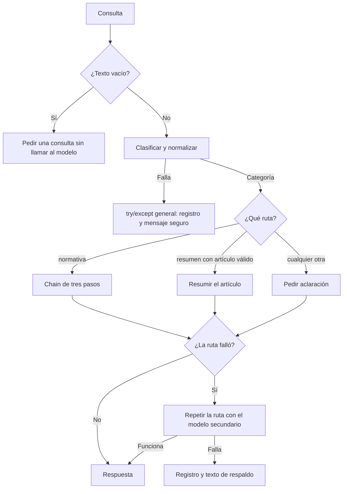

# PRD 02: orquestación de consultas de Ley REP con LangChain

- **Estado:** implementado.
- **Fecha:** 5 de noviembre de 2026.
- **Bloques cubiertos:** 18, 19 y 20 (Unidad 2.3).
- **Primera versión:** flujo de terminal con clasificación, tres rutas y manejo de errores por paso. La API no cambia.

## Índice

1. [Resumen: objetivo y enfoque](#1-resumen-objetivo-y-enfoque)
2. [Situación actual](#2-situación-actual)
3. [Alcance](#3-alcance)
4. [Decisiones de diseño](#4-decisiones-de-diseño)
5. [Comportamiento esperado](#5-comportamiento-esperado)
6. [Requisitos funcionales](#6-requisitos-funcionales)
7. [Archivos y responsabilidades](#7-archivos-y-responsabilidades)
8. [Plan de implementación por fases](#8-plan-de-implementación-por-fases)
9. [Criterios de aceptación](#9-criterios-de-aceptación)
10. [Entregables por bloque](#10-entregables-por-bloque)
11. [Riesgos y limitaciones](#11-riesgos-y-limitaciones)
12. [Referencias](#12-referencias)

## 1. Resumen: objetivo y enfoque

**Objetivo:** responder consultas de Ley REP con un flujo de varios pasos que cumpla las actividades de los bloques 18 a 20: una chain de tres pasos, enrutamiento según el tipo de consulta y manejo de errores por paso, todo verificado con pruebas sin red.

**Cómo se haría:** agregar el módulo `src/orquestacion/` con LangChain. Cada consulta se clasifica primero. Una consulta normativa pasa por la chain de tres pasos; una solicitud de resumen de un artículo usa su propia ruta; cualquier otro caso pide aclaración en vez de responder. Si una ruta falla, se intenta con un segundo modelo y luego con un texto de respaldo. Un `try/except` general protege el flujo completo.

**Resultado esperado:** un comando de terminal que siempre entrega una respuesta entendible, incluso si Gemini falla, y que deja cada llamada registrada en el control de costos existente.

| Qué se realizará | Qué no cambia |
| --- | --- |
| Nuevo módulo `src/orquestacion/` y sus pruebas. | `src/api/`, sus endpoints y sus contratos. |
| Dependencias `langchain` y `langchain-google-genai`. | `src/clientes/gemini.py` y su política de reintentos. |
| Conexión de las llamadas de LangChain con el registro de costos. | `src/costos/`, salvo su uso desde el nuevo módulo. |
| Documento de entrega y evidencias de los bloques 18 a 20. | El banco de prompts y las evaluaciones de los bloques 15 a 17. |

## 2. Situación actual

1. El proyecto llega al Bloque 17: cliente Gemini, API autenticada, banco de prompts y evaluación de respuestas. La suite tiene 166 pruebas en verde al 5 de noviembre.
2. No existe ninguna chain, clasificación ni fallback, y LangChain no está entre las dependencias.
3. [consultar_gemini_raw()](../src/clientes/gemini.py) resuelve una llamada por consulta, con reintentos, errores tipados y registro de costos.
4. [preparar_respuesta_rep()](../src/prompts/contexto_ley_rep.py) envía los 50 fragmentos de la ley en cada consulta (52.727 caracteres). Todavía no hay recuperación de fragmentos.
5. Los prompts de [ley_rep.py](../src/prompts/ley_rep.py) exigen JSON validado, por lo que no sirven directamente como pasos de texto. Sí definen los criterios que deben conservarse: no inventar datos, tratar la consulta como dato y no afirmar vigencia.

## 3. Alcance

| Incluido | Pospuesto |
| --- | --- |
| Chain de tres pasos para consultas normativas. | Endpoint en la API y respuesta degradada en su contrato. |
| Clasificación normalizada y tres rutas. | Recuperación de fragmentos con embeddings (RAG). |
| `with_fallbacks` en cada ruta y `try/except` general. | Agente con herramientas (Bloque 21). |
| Registro de costos y de errores por llamada. | Salida JSON validada dentro de la chain. |
| Pruebas sin red del checklist del Bloque 20. | Control de frecuencia del [PRD 01](prd-01-control-consumo-gemini.md). |
| Entrada por terminal y corrida real documentada. | Presupuesto de tiempo común para todo el flujo. |

## 4. Decisiones de diseño

### 4.1. Decisiones

| ID | Tema | Decisión | Motivo |
| --- | --- | --- | --- |
| D-01 | Cliente del modelo | Usar `ChatGoogleGenerativeAI`, recibido por parámetro en cada `construir_*`. | Lo usan el esqueleto de B18.3 y el agente de B21.3. Envolver `consultar_gemini` conservaría el cliente propio, pero se aparta de la actividad y no sirve para el agente. |
| D-02 | Modelos | Principal `flash-lite` y secundario `flash`, leídos desde [catalogo.py](../src/catalogo.py). | Son los modelos evaluados en el Bloque 9 y tienen tarifa registrada. |
| D-03 | Reintentos y tiempo | `max_retries=1` y `timeout=30` en cada modelo. | Los valores por defecto son 6 y sin límite: el fallback tardaría en actuar y una llamada colgada nunca lo activaría. Se usa `1` porque `0` significa "valor por defecto de Google". |
| D-04 | Temperatura | No se configura. | `gemini-3.5-flash-lite` y `gemini-3.6-flash` usan muestreo fijo: la librería descarta `temperature` y emite una advertencia. |
| D-05 | Costos | Un callback propio, `RegistroLlamadas`, agregado al crear el modelo. | Registra cada llamada, incluidas las fallidas, sin tocar la forma de las chains. `output_tokens` ya incluye el razonamiento, igual que `UsoTokens.salida`. |
| D-06 | Normalización | Reutilizar `limpiar_texto()` de [texto.py](../src/evaluacion/texto.py). | Quita mayúsculas, espacios y puntuación. `.strip().lower()` deja `"queja."` y la consulta cae sin aviso en la ruta por defecto. |
| D-07 | Ruta por defecto | `aclaracion`: pide antecedentes y no responde. | Una categoría inesperada no debe terminar en una respuesta legal. |
| D-08 | Ubicación | `src/orquestacion/` y `tests/orquestacion/`, con los nombres de archivo del curso. | Respeta la estructura del repositorio sin perder la correspondencia con las actividades. |
| D-09 | Forma de las pruebas | Clases `unittest.TestCase` con los nombres de prueba del curso. | `python -m tests` usa descubrimiento de `unittest` y no encuentra funciones sueltas. `pytest` ejecuta ambas formas. |
| D-10 | Salida de cada paso | Texto con `StrOutputParser`. | Es el patrón del curso. El JSON validado queda para una versión posterior. |

D-01 define la estructura del módulo: si cambia, hay que revisar las fases 1 a 3 antes de empezar.

### 4.2. Diferencias con el material del curso

| Material | En este proyecto | Razón |
| --- | --- | --- |
| Modelo `gemini-3.8-flash`. | `gemini-3.5-flash-lite`. | Devolvió dos HTTP 503 en la [evaluación del Bloque 9](decision-arquitectura.md). |
| Modelos `gemini-3.8-flash-lite` y `gemini-2.0-flash`. | `gemini-3.6-flash` como secundario. | No figuran en el inventario del 20 de octubre ni en las tarifas. |
| `temperature=0` para clasificar. | Sin temperatura. | Ver D-04. |
| Pruebas de `queja`, `pregunta`, normalización y defecto. | Una prueba por cada ruta, más normalización. | El ejemplo no prueba la segunda condición y repite la rama por defecto. |
| Archivos en una sola carpeta. | `src/` y `tests/`. | Ver D-08. |

### 4.3. Cambios durante la implementación

Estas diferencias aparecieron al implementar las fases 1 a 3. El texto original de los requisitos y las decisiones se conserva.

| Punto del PRD | En el código | Razón |
| --- | --- | --- |
| RF-12: los registros contienen el tipo de error, nunca cuerpos del proveedor. | Registran el tipo y el mensaje del error, que puede incluir el cuerpo del proveedor. El código no registra la consulta y la traza solo aparece en `DEBUG`. | Se siguió el material de B20.1 y B20.3, que registra el error para quien mantiene el proyecto. El límite está en la [entrega](entrega-bloques-18-20.md#límites). |
| D-03: se usa `1` porque `0` significa "valor por defecto de Google". | Se mantiene `max_retries=1`. | El motivo quedó desactualizado: en `google-genai` 2.34.0, `attempts=0` también es un solo intento. |
| Fase 1: confirmar que cada paso devuelve `str`. | Se comprueba con `isinstance`. | `StrOutputParser` entrega `TextAccessor`, subclase de `str`. |
| Sección 5.4: los fallos que activan el fallback. | Se agregó `exigir_texto` después de cada `StrOutputParser` de las rutas. | Un bloqueo del proveedor llega como texto vacío y no activaría el fallback. |

## 5. Comportamiento esperado

### 5.1. Recorrido de una consulta

### 5.2. Chain de tres pasos

| Paso | Entrada | Salida | Responsabilidad |
| --- | --- | --- | --- |
| 1. Interpretar | `{mensaje}` | `interpretacion` | Reformular la consulta y enumerar lo que hay que buscar, sin responderla. |
| 2. Responder | `{mensaje}`, `{interpretacion}`, `{fragmentos}` | `respuesta` | Responder solo con los fragmentos, indicando los artículos usados y lo que falte. |
| 3. Simplificar | `{respuesta}` | Texto final | Reescribir en viñetas y lenguaje simple, sin agregar información ni quitar artículos. |

Cada paso depende del anterior. El tercero no recibe los fragmentos: solo puede trabajar con lo que el segundo respaldó.

### 5.3. Rutas

| Categoría | Condición | Ruta | Llamadas al modelo |
| --- | --- | --- | --- |
| `normativa` | La categoría coincide. | Chain de tres pasos. | 4, incluida la clasificación. |
| `resumen` | La categoría coincide y el mensaje nombra un artículo existente. | Resumen del artículo con sus límites. | 2. |
| Por defecto | Cualquier otro caso, incluido un resumen sin artículo válido. | Pide los antecedentes que faltan, sin responder. | 2. |

### 5.4. Manejo de fallos

| Dónde falla | Quién responde | Qué queda registrado |
| --- | --- | --- |
| Una ruta, con el modelo principal. | La misma ruta con el modelo secundario. | Fallo de la llamada y su tipo de error. |
| Una ruta, con ambos modelos. | Texto de respaldo. | Fallos de las llamadas y tipo de error. |
| La clasificación, o algo no previsto. | `try/except` de `procesar_consulta_segura`. | Tipo de error. |
| Texto vacío. | Mensaje que pide una consulta. | Nada: no se llama al modelo. |

El texto de respaldo debe dejar claro que la consulta quedó sin responder y que eso no significa que no existan obligaciones.

## 6. Requisitos funcionales

| ID | Bloque | Requisito |
| --- | --- | --- |
| RF-01 | 18 | `construir_cadena(modelo)` recibe el modelo y devuelve la chain sin ejecutarla. |
| RF-02 | 18 | La chain usa tres `PromptTemplate` distintos, conectados con `\|`. Cada paso usa la salida del anterior. |
| RF-03 | 18 | Cada paso con modelo termina en `StrOutputParser`. |
| RF-04 | 18 | Las plantillas tratan la consulta como dato, no inventan artículos, plazos ni obligaciones y no afirman vigencia. |
| RF-05 | 19 | `construir_paso_clasificacion(modelo)` devuelve la categoría normalizada con `limpiar_texto()`. |
| RF-06 | 19 | `construir_cadena_con_enrutamiento()` usa `RunnablePassthrough.assign` y `RunnableBranch`, con dos condiciones y una ruta por defecto, y conserva `mensaje`. |
| RF-07 | 19 | Cada ruta usa un prompt realmente distinto. |
| RF-08 | 19 | `buscar_fragmento(mensaje)` devuelve el artículo nombrado o `None`. Sin artículo válido, la consulta va a la ruta por defecto. |
| RF-09 | 20 | `construir_ruta_segura()` protege cada ruta con `with_fallbacks`: primero el modelo secundario y después el texto de respaldo. |
| RF-10 | 20 | El respaldo recibe la excepción mediante `exception_key` y registra su tipo. |
| RF-11 | 20 | `procesar_consulta_segura(cadena, mensaje)` no propaga excepciones y devuelve siempre un texto. Un texto vacío no llama al modelo. |
| RF-12 | 20 | Los registros usan `logging` y contienen el tipo de error, nunca la consulta, credenciales ni cuerpos del proveedor. La traza completa solo aparece en nivel `DEBUG`. |
| RF-13 | Común | `crear_modelo(alias)` aplica D-02 y D-03 y agrega `RegistroLlamadas`. |
| RF-14 | Común | `RegistroLlamadas` registra cada respuesta con `intentos=1` y cada fallo con `registrar_fallo(intentos=1)`. |
| RF-15 | Común | `uv run python -m src.orquestacion.enrutamiento "consulta"` carga `.env`, imprime la respuesta en stdout y el resumen de consumo en stderr. Sin `GEMINI_API_KEY`, termina con un mensaje claro. |
| RF-16 | Común | Las dependencias quedan declaradas en `pyproject.toml`, `uv.lock` y `requirements.txt`. |

## 7. Archivos y responsabilidades

### 7.1. Archivos

| Archivo | Cambio previsto |
| --- | --- |
| `pyproject.toml`, `uv.lock`, `requirements.txt` | Agregar las dependencias con `uv add` y regenerar el archivo con el comando de su encabezado. |
| `src/orquestacion/__init__.py` — nuevo | Marca el paquete. |
| `src/orquestacion/modelo.py` — nuevo | `crear_modelo()` y `RegistroLlamadas`. |
| `src/orquestacion/cadena_tres_pasos.py` — nuevo | Plantillas de la chain, `formatear_fragmentos()` y `construir_cadena()`. |
| `src/orquestacion/enrutamiento.py` — nuevo | Clasificación, rutas, fallbacks, `procesar_consulta_segura()` y entrada por terminal. |
| `tests/orquestacion/` — nuevo | `test_cadena_tres_pasos.py`, `test_enrutamiento.py` y `test_orquestacion.py`. |
| `docs/entrega-bloques-18-20.md` — nuevo | Checklist, resultados y límites. |
| `docs/evidencias/mis-capturas/bloque-18/` a `bloque-20/` — nuevo | Capturas de pruebas y corridas reales. |
| `README.md`, `docs/guia-completa.md`, `docs/arquitectura.md` | Comando nuevo, enlaces y descripción del módulo. |

### 7.2. Funciones principales

| Función | Entrada | Salida |
| --- | --- | --- |
| `crear_modelo(alias="flash-lite")` | Alias del catálogo. | Modelo configurado. |
| `construir_cadena(modelo)` | Modelo. | Chain: `{"mensaje": str}` a `str`. |
| `construir_paso_clasificacion(modelo)` | Modelo. | Chain: `{"mensaje": str}` a categoría. |
| `buscar_fragmento(mensaje)` | Texto. | Fragmento o `None`. |
| `construir_cadena_con_enrutamiento(paso_clasificacion, cadena_normativa=None, cadena_resumen=None, cadena_aclaracion=None)` | Paso y rutas opcionales, como en B19.2. | Chain completa. |
| `construir_ruta_segura(ruta, alternativa=None)` | Ruta y su versión con el modelo secundario. | Ruta con fallbacks. |
| `procesar_consulta_segura(cadena, mensaje)` | Chain y texto. | Texto. |

### 7.3. Convenciones

1. Nombres, comentarios y mensajes en español, con el vocabulario del curso: `plantilla_*`, `paso_*`, `cadena_*`, `construir_*`.
2. Funciones cortas y directas. La única clase nueva es el callback, porque LangChain la requiere.
3. Docstrings de una línea y comentarios solo para explicar un motivo que el código no muestre.
4. Reutilizar lo que ya existe: `AGENTES`, `limpiar_texto`, `cargar_documento_ley_rep`, `obtener_fragmento_ley_rep`, `calcular_costo_usd_gemini` y `obtener_registro_costos`.
5. El modelo siempre entra por parámetro para poder reemplazarlo en las pruebas.
6. Mantener `ruff` y `basedpyright` sin errores con la configuración actual.

## 8. Plan de implementación por fases

| Fase | Contenido | Usa cuota de Gemini |
| --- | --- | --- |
| 0 | Dependencias y línea base. | No. |
| 1 | Bloque 18: modelo y chain de tres pasos. | Sí, una corrida. |
| 2 | Bloque 19: clasificación y rutas. | Sí, seis clasificaciones y tres corridas. |
| 3 | Bloque 20: fallbacks, entrada segura y checklist. | No. |
| 4 | Documentación, evidencias y clon limpio. | Sí, una corrida final. |

Cada fase termina con pruebas, `ruff` y `basedpyright` en verde, una revisión del cambio y un commit propio. Las corridas reales se hacen solo cuando la fase anterior ya pasó sus pruebas.

### Fase 0: preparación

1. Ejecutar `uv add langchain langchain-google-genai`.
2. Regenerar `requirements.txt` con `uv export --frozen --group dev --no-hashes --no-emit-project --output-file requirements.txt`.
3. Confirmar que `uv sync --locked` funciona y que las 166 pruebas siguen pasando.

### Fase 1: Bloque 18

1. Crear `modelo.py` con `crear_modelo()` y `RegistroLlamadas`.
2. Diseñar los tres pasos y describir cada uno en una frase.
3. Probar cada paso por separado y confirmar que devuelve `str`.
4. Encadenarlos en `construir_cadena()` y agregar sus pruebas con mock.
5. Hacer una corrida real con una consulta verdadera de Ley REP y anotar tokens y costo.

### Fase 2: Bloque 19

1. Crear `construir_paso_clasificacion()` y su normalización.
2. Crear las rutas `resumen` y `aclaracion`, y `buscar_fragmento()`.
3. Conectar `RunnablePassthrough.assign` y `RunnableBranch`, con la chain de la Fase 1 como ruta `normativa`.
4. Escribir una prueba por ruta, la de normalización y la de resumen sin artículo.
5. Clasificar seis mensajes reales, dos por categoría, y una corrida completa por ruta.

### Fase 3: Bloque 20

1. Agregar `construir_ruta_segura()` y el texto de respaldo a las tres rutas.
2. Agregar `procesar_consulta_segura()` con `logging`.
3. Crear `main()` para la entrada por terminal.
4. Completar `test_orquestacion.py`, simulando fallos con `RunnableLambda` real.
5. Revisar la suite contra las cuatro preguntas de B20.3.

### Fase 4: cierre

1. Escribir `docs/entrega-bloques-18-20.md` y actualizar README, guía y arquitectura.
2. Guardar las capturas de pruebas y corridas reales.
3. Repetir la instalación desde un clon limpio, como en B11.2.
4. Hacer una corrida final por terminal.

## 9. Criterios de aceptación

| ID | Escenario | Resultado verificable |
| --- | --- | --- |
| CA-01 | Chain con modelo falso de tres respuestas. | `test_cadena_conecta_los_tres_pasos`: tres llamadas y el resultado es la salida del último paso. |
| CA-02 | El modelo devuelve `" Queja. \n"` o `"NORMATIVA."`. | `test_clasificacion_normaliza_antes_de_comparar`: la categoría queda sin mayúsculas, espacios ni puntuación. |
| CA-03 | Categoría `normativa` forzada. | `test_enrutamiento_va_a_cadena_normativa`: se ejecuta solo esa ruta. |
| CA-04 | Categoría `resumen` y mensaje con artículo válido. | `test_enrutamiento_va_a_cadena_resumen`: se ejecuta solo esa ruta. |
| CA-05 | Categoría inventada. | `test_enrutamiento_usa_default_ante_categoria_desconocida`: se ejecuta `aclaracion`, sin error. |
| CA-06 | Categoría `resumen` sin artículo, o con uno inexistente. | `test_resumen_sin_articulo_va_a_aclaracion`: se ejecuta `aclaracion`. |
| CA-07 | Falla el modelo principal de una ruta. | `test_cadena_normativa_usa_fallback_ante_fallo_del_modelo`: responde el secundario y la prueba confirma que se ejecutó. |
| CA-08 | Fallan ambos modelos. | `test_ruta_usa_texto_de_respaldo_si_fallan_ambos_modelos`: se entrega el texto y se registra el tipo de error. |
| CA-09 | Falla la clasificación. | `test_procesar_consulta_segura_no_propaga_excepciones`: se entrega el mensaje seguro y queda registro. |
| CA-10 | Texto vacío o solo espacios. | `test_consulta_vacia_no_llama_al_modelo`: el mock no recibe llamadas. |
| CA-11 | Una llamada exitosa y una fallida con modelos falsos. | `test_registro_cuenta_respuestas_y_fallos`: `sesion_costos()` muestra tokens, costo y una consulta fallida. |
| CA-12 | Modelo creado con una clave ficticia. | `test_crear_modelo_limita_reintentos_y_tiempo`: `max_retries=1`, `timeout=30` y callback presente. |
| CA-13 | Suite completa. | Pasan las 166 pruebas previas y las nuevas con la red bloqueada, sin consumir tokens. |
| CA-14 | Corrida real de las tres rutas. | Cada ruta entrega una respuesta coherente y el consumo aparece en stderr. |

Las cuatro preguntas de B20.3 quedan cubiertas por CA-02, CA-03 a CA-05, CA-07 y CA-09.

## 10. Entregables por bloque

| Bloque | Actividad | Archivos del curso | Archivos en este proyecto |
| --- | --- | --- | --- |
| 18 | Construye tu chain de al menos tres pasos encadenados. | `cadena_tres_pasos.py`, `test_cadena_tres_pasos.py`, `requirements.txt`. | `src/orquestacion/cadena_tres_pasos.py`, `tests/orquestacion/test_cadena_tres_pasos.py`, `requirements.txt`. |
| 19 | Enrutamiento condicional, ya incorporado a tu chain. | `enrutamiento.py`, `test_enrutamiento.py`. | `src/orquestacion/enrutamiento.py`, `tests/orquestacion/test_enrutamiento.py`. |
| 20 | Verifica la ejecución de tu chain de extremo a extremo. | `enrutamiento.py`, `test_orquestacion.py`. | `src/orquestacion/enrutamiento.py`, `tests/orquestacion/test_orquestacion.py`, `docs/entrega-bloques-18-20.md`. |

Si la revisión exige los archivos en la raíz del repositorio, habrá que confirmarlo con el equipo docente antes de entregar.

## 11. Riesgos y limitaciones

1. **Cuota.** Una consulta normativa usa cuatro llamadas. En los ensayos del Bloque 13 el primer HTTP 429 apareció entre las consultas 16 y 20, lo que equivale a unas cuatro o cinco consultas normativas seguidas. El PRD 01 no cubriría estas llamadas, porque actúa dentro de `consultar_gemini_raw()`.
2. **Cliente distinto.** `ChatGoogleGenerativeAI` usa la API nativa de Gemini, no el endpoint compatible con OpenAI del cliente propio. Hasta la Fase 1 no habrá una llamada real por esta vía.
3. **Sin reintentos automáticos.** Un fallo temporal pasa directamente al modelo secundario, que tiene una tarifa mayor.
4. **Tiempo.** El límite de 30 segundos es por llamada, no por flujo. En el peor caso una consulta normativa hace siete llamadas: una de clasificación y tres por cada modelo.
5. **Contexto completo.** El paso 2 envía los 50 fragmentos en cada consulta. Es el paso más costoso y se reemplazará cuando exista recuperación de fragmentos. Su consumo real se medirá en la Fase 1.
6. **Clasificación variable.** Sin control de temperatura no se puede forzar una clasificación estable. La normalización y la ruta por defecto reducen el impacto, pero no lo eliminan.
7. **Errores de programación.** `with_fallbacks` y `except Exception` también atrapan errores propios, como un `KeyError`. Por eso se registra el tipo de error y las pruebas del camino normal comprueban que no se usó el respaldo.
8. **Citas sin validar.** A diferencia de `responder_ley_rep`, la chain produce texto libre y no verifica que los artículos citados existan en los fragmentos.

## 12. Referencias

1. Material del curso: B18.1 a B18.3, B19.1 a B19.3 y B20.1 a B20.3.
2. [Arquitectura actual de la aplicación](arquitectura.md).
3. [Decisión de arquitectura y modelos](decision-arquitectura.md).
4. [Evaluación de respuestas de Ley REP](evaluacion-respuestas.md).
5. [Entrega de los bloques 13 y 14](entrega-bloques-13-14.md).
6. [PRD 01: control de consumo de Gemini](prd-01-control-consumo-gemini.md).

D-03, D-04 y D-05 y el diseño de rutas y fallbacks se comprobaron sin red el 5 de noviembre de 2026 con `langchain` 1.4.9, `langchain-core` 1.7.6 y `langchain-google-genai` 4.4.3. No se hizo ninguna llamada real a Gemini para este documento.
