# PRD 03: agente de consultas de Ley REP con herramientas, memoria y supervisión

- **Estado:** implementación de las fases 0 a 3 preparada; cierre condicionado al ensayo humano del Bloque 23 y la verificación desde GitHub. Ver [estado de entrega](entrega-bloques-21-23.md).
- **Fecha:** 14 de noviembre de 2026.
- **Bloques cubiertos:** 21, 22 y 23 (Unidad 2.4).
- **Primera versión:** agente de terminal con tres herramientas, memoria por sesión, aprobación humana y trazas. La API y el flujo del PRD 02 no cambian.

## Índice

1. [Resumen: objetivo y enfoque](#1-resumen-objetivo-y-enfoque)
2. [Situación actual](#2-situación-actual)
3. [Alcance](#3-alcance)
4. [Decisiones de diseño](#4-decisiones-de-diseño)
5. [Comportamiento esperado](#5-comportamiento-esperado)
6. [Requisitos funcionales](#6-requisitos-funcionales)
7. [Archivos y responsabilidades](#7-archivos-y-responsabilidades)
8. [Plan de implementación por fases](#8-plan-de-implementación-por-fases)
9. [Criterios de aceptación](#9-criterios-de-aceptación)
10. [Entregables por bloque](#10-entregables-por-bloque)
11. [Riesgos y limitaciones](#11-riesgos-y-limitaciones)
12. [Referencias](#12-referencias)

## 1. Resumen: objetivo y enfoque

**Objetivo:** responder consultas de Ley REP con un agente que decide qué herramienta usar, recuerda la conversación de cada sesión y no entrega un informe sin aprobación humana. Así se cumplen las actividades de los bloques 21 a 23.

**Cómo se haría:** agregar a `src/orquestacion/` un agente construido con `create_tool_calling_agent` y `AgentExecutor`. Tendrá dos herramientas de lectura sobre la copia local de la ley (buscar por tema y leer un artículo) y una de acción, `entregar_informe`, que pide aprobación con límite de tiempo antes de actuar. La memoria separa las conversaciones por `session_id`. Cada consulta deja una traza en JSONL y cada decisión de aprobación queda en su propio registro.

**Resultado esperado:** un comando de terminal, un ensayo con casos fijos por bloque y un documento de límites de autonomía respaldado por el código y por trazas reales.

| Qué se realizará | Qué no cambia |
| --- | --- |
| Herramientas, agente, memoria y supervisión en `src/orquestacion/`, con sus pruebas. | `src/api/`, sus endpoints y sus contratos. |
| Dependencia `langchain-classic`. | La chain, el enrutamiento y los fallbacks del [PRD 02](prd-02-orquestacion-langchain.md). |
| Ensayo real por bloque en `scripts/ensayo_agente.py`. | `src/clientes/` y `src/costos/`, salvo su uso desde el agente. |
| Documento de límites de autonomía, entrega y evidencias de los bloques 21 a 23. | El banco de prompts y las evaluaciones de los bloques 15 a 17. |

## 2. Situación actual

Esta sección describe la línea base al redactar el PRD, antes de implementar el
agente. El avance posterior se registra en [la entrega](entrega-bloques-21-23.md).

1. Los bloques 18 a 20 están cerrados: [modelo.py](../src/orquestacion/modelo.py) ofrece `crear_modelo()`, `RegistroLlamadas` y `exigir_texto()`, y [enrutamiento.py](../src/orquestacion/enrutamiento.py) clasifica entre tres rutas con fallbacks. La suite tiene 199 pruebas y 422 subpruebas en verde al 14 de noviembre.
2. El enrutamiento elige entre rutas fijas. No hay agente, herramientas, memoria entre consultas ni aprobación humana.
3. [obtener_fragmento_ley_rep()](../src/prompts/contexto_ley_rep.py) lee un artículo de la copia local, pero con un ordinal ("primero") siempre entrega el transitorio. Por eso `buscar_fragmento()` del PRD 02 rechaza esos casos.
4. No existe una búsqueda por tema: la ruta normativa envía los 50 artículos (52.727 caracteres) en cada consulta.
5. `AgentExecutor` y `create_tool_calling_agent` no están instalados. Desde LangChain 1.x están en el paquete `langchain-classic`.

## 3. Alcance

| Incluido | Pospuesto |
| --- | --- |
| Herramientas `buscar_en_ley` y `obtener_articulo`, de solo lectura. | Endpoint en la API para el agente. |
| Agente con `AgentExecutor`, `intermediate_steps` y límite de pasos. | Reemplazar el enrutamiento del PRD 02 por el agente. |
| `args_schema` en las herramientas con más de un parámetro. | Historial persistente entre reinicios y resumen de conversaciones largas. |
| Memoria por `session_id`, con historiales aislados. | Recuperación con embeddings (Bloque 24 en adelante). |
| `entregar_informe` con aprobación humana y límite de tiempo. | Envío real a clientes: la entrega es simulada. |
| Trazas y registro de aprobaciones en JSONL, y marcado de repeticiones. | Supervisión con `interrupt()` de LangGraph (Bloque 32 y Gate 2). |
| Pruebas sin red, ensayo real por bloque y documento de límites. | Registros sin datos personales, que exigirá el Gate 2. |

## 4. Decisiones de diseño

### 4.1. Decisiones

| ID | Tema | Decisión | Motivo |
| --- | --- | --- | --- |
| D-01 | Agente | `create_tool_calling_agent` y `AgentExecutor` de `langchain-classic` 1.0.8. | Lo exige B21.3. `create_agent` de LangChain 1.x devuelve solo la lista de mensajes, sin `intermediate_steps`. La versión 1.0.8 es compatible con lo instalado y agrega `langchain-text-splitters` y `sqlalchemy`. |
| D-02 | Modelo | `crear_modelo()` del PRD 02: `flash-lite`, un intento, 30 segundos y `RegistroLlamadas`. | Reutiliza el control de consumo y los límites ya probados. |
| D-03 | Fallback | El agente no repite la consulta con el modelo secundario. Ante un error entrega un mensaje seguro y lo registra. | Repetir una corrida repetiría sus herramientas, incluida una entrega ya aprobada. |
| D-04 | Límite de pasos | `max_iterations=4`. | Cada paso es una llamada: el peor caso queda en 4 llamadas por consulta. El valor por defecto es 15. Alcanza para el caso más largo previsto: leer, entregar y responder. |
| D-05 | Herramientas | Tres, con propósitos distintos: buscar por tema, leer por número y entregar. Las de lectura usan la copia local, sin red. | B21.3 advierte que dos herramientas parecidas producen elecciones inconsistentes. `buscar_en_ley` ignora números y la palabra "artículo" para no competir con `obtener_articulo`. |
| D-06 | `args_schema` | Solo en `obtener_articulo` (desde el Bloque 22) y `entregar_informe`. | Son las que tienen más de un parámetro. B22.1 desaconseja `args_schema` para una herramienta de un solo texto. |
| D-07 | Argumentos inválidos | `handle_validation_error` en las herramientas con `args_schema`. | Sin esa opción, un `ValidationError` corta toda la ejecución. Con ella, el agente recibe el problema como observación y puede corregir la llamada. Se comprobó sin red. |
| D-08 | Salida | `salida_como_texto()` convierte la salida en texto, traduce el aviso de límite y rechaza una respuesta vacía. | Con Gemini 3 o posterior, el conector entrega una lista de bloques. `AgentExecutor` la deja así y `RunnableWithMessageHistory` falla con `AttributeError` al guardarla. Se comprobó sin red. |
| D-09 | Memoria | `RunnableWithMessageHistory` con `InMemoryChatMessageHistory`, como en el curso. | Es lo que piden B22.2 y B22.3. Ambas clases emiten un aviso de deprecación, no un error. |
| D-10 | Aprobación | `esperar_aprobacion()` con `select`, 300 segundos y solo `s` como aprobación. Sin respuesta, fin de la entrada o error, no se aprueba. El aviso sale por stderr. | Es el patrón de B23.1. La salida estándar queda reservada para la respuesta. |
| D-11 | Entrega | Simulada: el informe aprobado se escribe en `output/agente/informes_entregados/`. | No hay un canal real con clientes. Se clasifica como riesgo alto por lo que representa: un tercero puede actuar sobre un informe entregado y no se puede retirar. |
| D-12 | Registros | Trazas y aprobaciones en JSONL dentro de `output/agente/`, ignorado por git. La traza guarda la consulta, los argumentos, las observaciones y la respuesta completas. | Decisión del alumno: seguir a B23.2. Se aparta de RF-12 del PRD 02, que no registra la consulta. Solo se publican las trazas de los ensayos. |
| D-13 | Pruebas | Un modelo falso compartido: `GenericFakeChatModel` con `bind_tools` y sin streaming, en clases `unittest.TestCase`. | `create_tool_calling_agent` exige `bind_tools`. El agente pide la respuesta por partes y el modelo falso no lo soporta con llamadas a herramientas. Se mantiene D-09 del PRD 02. |
| D-14 | Ensayo real | `scripts/ensayo_agente.py` con casos fijos por bloque y herramienta esperada. | La prueba de aislamiento necesita dos sesiones en el mismo proceso. Los casos fijos permiten repetir la verificación y comparar la elección. |

### 4.2. Diferencias con el material del curso

| Material | En este proyecto | Razón |
| --- | --- | --- |
| Modelos `gemini-3.8-flash` y `gemini-2.0-flash`. | `gemini-3.5-flash-lite`. | Ver D-02 y la sección 4.2 del PRD 02. |
| Herramientas de envíos, cálculo y reembolso. | `buscar_en_ley`, `obtener_articulo` y `entregar_informe`. | Herramientas del dominio del proyecto, como pide B21.3. |
| Un solo archivo `agente_con_herramientas.py`. | Herramientas, supervisión y agente en tres archivos de `src/orquestacion/`. | Sigue la separación en tres bloques de B22.3 y D-08 del PRD 02. |
| `verbose=True` imprime la traza. | El comando muestra en stderr las herramientas de `intermediate_steps`. | `verbose` escribe en la salida estándar, junto a la respuesta. |
| `max_iterations` por defecto (15). | 4. | Ver D-04. |
| `resultado["output"]` se usa tal cual. | `salida_como_texto()`. | Ver D-08. |
| `registro_aprobaciones` es una lista en memoria. | JSONL persistente. | La lista se pierde al terminar el proceso, y entonces no se podría responder quién aprobó qué. |
| `trazas_agente.jsonl` en la carpeta actual. | `output/agente/`, ignorado por git. | Ver D-12. |
| `input()` y `print()` en la salida estándar. | Aviso de aprobación en stderr. | Ver D-10. |
| `test_agente_no_usa_herramienta_para_pregunta_general` con el modelo real. | La misma prueba con el modelo falso, y la elección real en el ensayo. | La suite bloquea la red. |
| La consulta va como `{entrada}`. | `<consulta>{entrada}</consulta>`, con las reglas del PRD 02. | Las reglas tratan como dato el texto entre etiquetas. |

## 5. Comportamiento esperado

### 5.1. Recorrido de una consulta

```mermaid
flowchart TD
    A[Consulta y session_id] --> B{¿Texto vacío?}
    B -->|Sí| V[Pedir una consulta sin llamar al modelo]
    B -->|No| H[Agregar el historial de la sesión]
    H --> M[El modelo decide]
    M -->|Leer| L[buscar_en_ley u obtener_articulo]
    L --> O[Observación]
    O --> M
    M -->|Entregar| P{¿Aprobación con s en 300 s?}
    P -->|Sí| E[Entregar el informe y registrar la decisión]
    P -->|No| R[Registrar el rechazo]
    E --> O
    R --> O
    M -->|Responder| F[Respuesta en texto]
    M -->|4 llamadas sin terminar| X[Aviso de límite de pasos]
    M -->|Error o respuesta vacía| S[Registro y mensaje seguro]
    F --> T[Guardar historial y traza]
    X --> T
    S --> U[Traza con el error, sin guardar el turno]
```

### 5.2. Herramientas

| Herramienta | Bloque | Parámetros | Cuándo usarla | Riesgo | Aprobación |
| --- | --- | --- | --- | --- | --- |
| `buscar_en_ley` | 21 | `consulta: str` | La consulta pregunta por un tema y no nombra un artículo. | Bajo: solo lee la copia local. | No. |
| `obtener_articulo` | 21, con `args_schema` en 22 | `numero: str`, `transitorio: bool = False` | La consulta nombra un artículo, o hay que leer completo uno que la búsqueda mostró recortado. | Bajo: solo lee la copia local. | No. |
| `entregar_informe` | 23 | `titulo: str`, `contenido: str` | El usuario pide expresamente entregar o enviar un informe. | Alto: un tercero puede actuar sobre el informe y no se puede retirar. | Sí, antes de ejecutar. |

`buscar_en_ley` devuelve hasta tres artículos y recorta cada texto a 1.500 caracteres, con un aviso para leerlo completo con `obtener_articulo`. Así el agente puede encadenar las dos herramientas, como en B21.2.

### 5.3. Llamadas por consulta

| Caso | Llamadas al modelo |
| --- | --- |
| Responde sin herramientas. | 1. |
| Usa una herramienta. | 2. |
| Busca y lee completo, o lee y entrega. | 3. |
| Máximo permitido. | 4 (D-04). |

El número exacto depende de lo que decida el modelo, por eso el costo se presupuesta como un rango (B21.1). Además, con memoria cada turno reenvía todo el historial de su sesión (B22.2).

### 5.4. Manejo de fallos

| Dónde falla | Quién responde | Qué queda registrado |
| --- | --- | --- |
| Una herramienta de lectura no encuentra el tema o el artículo. | El agente, con la observación en texto. | La traza. |
| El modelo envía argumentos inválidos. | El agente, con el error de validación como observación. | La traza. |
| El modelo pide una herramienta inexistente. | El agente, con el aviso de LangChain como observación. | La traza. |
| El agente llega a 4 llamadas sin responder. | Aviso de límite de pasos, en español. | La traza con sus acciones. |
| El supervisor no responde en 300 segundos. | `entregar_informe` informa que no se aprobó. | El registro de aprobaciones, con `aprobado: false`. |
| Falla el modelo, la respuesta llega vacía o algo no previsto. | Mensaje seguro de `consultar_agente()`. | El tipo y el mensaje del error, y una traza sin acciones. |
| Texto vacío. | Mensaje que pide una consulta. | Nada: no se llama al modelo. |

Si el agente falla después de usar una herramienta, la traza pierde esas acciones porque `AgentExecutor` no las devuelve. Por eso las aprobaciones tienen su propio registro.

### 5.5. Memoria

1. Cada sesión guarda su consulta y su respuesta final como texto. No guarda las llamadas a herramientas ni sus observaciones.
2. Cada turno agrega dos mensajes, y la traza anota cuántos tenía el historial en ese momento.
3. Un turno que falla no se guarda en el historial.
4. `cerrar_sesion()` borra el historial de una sesión. Ninguno sobrevive al proceso.

## 6. Requisitos funcionales

| ID | Bloque | Requisito |
| --- | --- | --- |
| RF-01 | 21 | `buscar_en_ley(consulta)` devuelve hasta tres artículos con su referencia y su texto recortado a 1.500 caracteres. Sin coincidencias o sin copia local, devuelve un texto que lo dice y no lanza excepciones. |
| RF-02 | 21 | `obtener_articulo` devuelve el artículo completo con su referencia. Si no existe, devuelve un texto con los artículos disponibles. |
| RF-03 | 21 | Cada docstring explica cuándo usar la herramienta, no cómo está hecha. |
| RF-04 | 21 | `construir_ejecutor(modelo, herramientas)` usa `create_tool_calling_agent` y `AgentExecutor` con `return_intermediate_steps=True` y `max_iterations=4`. |
| RF-05 | 21 | `prompt_agente` contiene, en este orden: sistema con `REGLAS_TEXTO` e instrucciones del agente, `chat_history` opcional, consulta y `agent_scratchpad`. |
| RF-06 | 21 | `consultar_agente(agente, entrada, session_id)` devuelve un diccionario con `output` en texto e `intermediate_steps`. No propaga excepciones, y un texto vacío no llama al modelo. |
| RF-07 | 22 | `obtener_articulo` usa `args_schema=ArgumentosArticulo`, con una descripción por campo. Con `transitorio=True`, `"1"` y `"primero"` llevan al primero transitorio; sin él, `"primero"` lleva al artículo 1. |
| RF-08 | 22 | `construir_agente_con_memoria(ejecutor)` usa `RunnableWithMessageHistory` con `input_messages_key="entrada"` y `history_messages_key="chat_history"`. Existen `obtener_historial()` y `cerrar_sesion()`. |
| RF-09 | 22 | El historial guarda solo texto: `salida_como_texto()` actúa antes de la memoria. |
| RF-10 | 23 | `entregar_informe(titulo, contenido)` usa `args_schema`, pide aprobación con `esperar_aprobacion()`, registra la decisión en todos los casos y escribe el informe solo si se aprobó. |
| RF-11 | 23 | `esperar_aprobacion(mensaje, tiempo_limite_segundos=300)` devuelve `True` solo con `s` (sin distinguir mayúsculas ni espacios). Devuelve `False` sin respuesta a tiempo, al terminar la entrada o ante un error. |
| RF-12 | 23 | `registrar_aprobacion()` y `registrar_traza()` agregan una línea JSON en UTF-8 por evento. `registrar_traza()` funciona aunque falte `intermediate_steps`. |
| RF-13 | 23 | `marcar_repeticiones_sospechosas(ruta)` devuelve las sesiones que usaron la misma herramienta dos veces seguidas. Si el archivo no existe, devuelve una lista vacía y lo avisa. |
| RF-14 | Común | `uv run python -m src.orquestacion.agente_con_herramientas [--sesion ID] "consulta" ["consulta" ...]` responde las consultas en una misma sesión. Imprime las respuestas en stdout y las herramientas usadas y el consumo en stderr. Sin `GEMINI_API_KEY`, termina con un mensaje claro. |
| RF-15 | Común | `uv run python -m scripts.ensayo_agente --bloque N --salida archivo.json` ejecuta los casos del bloque, compara la herramienta esperada con la usada y guarda el resultado. |
| RF-16 | Común | `langchain-classic` queda declarada en `pyproject.toml`, `uv.lock` y `requirements.txt`. |
| RF-17 | Común | `output/agente/` queda en `.gitignore`. |

## 7. Archivos y responsabilidades

### 7.1. Archivos

| Archivo | Cambio previsto |
| --- | --- |
| `pyproject.toml`, `uv.lock`, `requirements.txt` | Agregar `langchain-classic` con `uv add` y regenerar `requirements.txt` con el comando de su encabezado. |
| `.gitignore` | Ignorar `output/agente/`. |
| `src/orquestacion/herramientas.py` — nuevo | `buscar_en_ley`, `obtener_articulo`, `ArgumentosArticulo`, `entregar_informe` y `ArgumentosInforme`. |
| `src/orquestacion/agente_con_herramientas.py` — nuevo | `prompt_agente`, `construir_ejecutor()`, `salida_como_texto()`, memoria, `consultar_agente()` y entrada por terminal. |
| `src/orquestacion/supervision.py` — nuevo | `esperar_aprobacion()`, `registrar_aprobacion()`, `registrar_traza()` y `marcar_repeticiones_sospechosas()`. |
| `scripts/ensayo_agente.py` — nuevo | Casos fijos por bloque y su resultado en JSON. |
| `tests/orquestacion/` | `modelo_falso.py`, `test_herramientas.py`, `test_agente_con_herramientas.py` y `test_supervision.py`. |
| `tests/scripts/test_ensayo_agente.py` — nuevo | Ensayo con el modelo falso. |
| `docs/limites-autonomia-agente.md` — nuevo | Documento de límites de autonomía del Bloque 23. |
| `docs/entrega-bloques-21-23.md` — nuevo | Checklist, resultados y límites. |
| `docs/evidencias/bloques-21-23/` — nuevo | Ensayos, trazas y comprobaciones. |
| `README.md`, `docs/guia-completa.md`, `docs/arquitectura.md` | Comando nuevo, enlaces y descripción del agente. Solo se agrega contenido. |

### 7.2. Funciones principales

| Función | Entrada | Salida |
| --- | --- | --- |
| `buscar_en_ley.invoke({"consulta": ...})` | Tema. | Texto con hasta tres artículos. |
| `obtener_articulo.invoke({"numero": ..., "transitorio": ...})` | Número y tipo de artículo. | Texto del artículo. |
| `entregar_informe.invoke({"titulo": ..., "contenido": ...})` | Informe propuesto. | Texto con el resultado de la entrega. |
| `construir_ejecutor(modelo, herramientas)` | Modelo y herramientas. | `AgentExecutor`. |
| `salida_como_texto(resultado)` | Resultado del ejecutor. | El mismo resultado, con `output` en texto. |
| `construir_agente_con_memoria(ejecutor)` | `AgentExecutor`. | Agente con historial por sesión. |
| `consultar_agente(agente, entrada, session_id="terminal")` | Agente, texto y sesión. | Diccionario con `output` e `intermediate_steps`. |
| `esperar_aprobacion(mensaje, tiempo_limite_segundos=300)` | Aviso para el supervisor. | `bool`. |
| `registrar_traza(session_id, entrada, resultado, ruta)` | Interacción. | Una línea en el JSONL. |
| `marcar_repeticiones_sospechosas(ruta)` | Archivo de trazas. | Lista de avisos. |

### 7.3. Convenciones

1. Se mantienen las convenciones del PRD 02: español, vocabulario del curso, funciones cortas, docstrings de una línea y el modelo siempre por parámetro.
2. Las únicas clases nuevas son los esquemas de Pydantic que exige `args_schema`.
3. Reutilizar `crear_modelo`, `REGLAS_TEXTO`, `limpiar_texto`, `cargar_documento_ley_rep`, `obtener_fragmento_ley_rep` y `sesion_costos`.
4. Las rutas de `output/agente/` son constantes del módulo, y las pruebas las reemplazan por una carpeta temporal.
5. Mantener `ruff` y `basedpyright` sin errores con la configuración actual.

## 8. Plan de implementación por fases

| Fase | Contenido | Usa cuota de Gemini |
| --- | --- | --- |
| 0 | Dependencia, `.gitignore` y línea base. | No. |
| 1 | Bloque 21: herramientas de lectura, ejecutor, salida en texto, entrada segura, comando y ensayo. | Sí: tres casos, unas 5 llamadas. |
| 2 | Bloque 22: `args_schema`, validación y memoria. | Sí: dos sesiones, unas 5 llamadas. |
| 3 | Bloque 23: aprobación, entrega simulada, trazas y marcado de repeticiones. | Sí: dos entregas, unas 6 llamadas. |
| 4 | Documento de límites, entrega, evidencias e instalación limpia. | No. |

Cada fase termina con pruebas, `ruff` y `basedpyright` en verde, una revisión del cambio y un commit propio. Las corridas reales se hacen solo con autorización y después de que la fase pase sus pruebas.

### Fase 0: preparación

1. Ejecutar `uv add langchain-classic` y confirmar que conserva las versiones bloqueadas de `langchain-core` y `langchain-google-genai`.
2. Regenerar `requirements.txt` con `uv export --frozen --group dev --no-hashes --no-emit-project --output-file requirements.txt`.
3. Agregar `output/agente/` a `.gitignore`.
4. Confirmar que `uv sync --locked` funciona y que las 199 pruebas siguen pasando.

### Fase 1: Bloque 21

1. Crear `buscar_en_ley` y `obtener_articulo` (solo `numero`) y probarlas directamente.
2. Crear `prompt_agente`, `construir_ejecutor()` y `salida_como_texto()`.
3. Crear `consultar_agente()` y la entrada por terminal.
4. Crear el modelo falso y las pruebas: una herramienta, ninguna, límite de pasos y salida en bloques.
5. Crear `scripts/ensayo_agente.py` con los casos del Bloque 21.
6. Corrida real: una consulta por tema, una por artículo y una sin herramienta. Comparar el consumo registrado con el que informa el conector.

### Fase 2: Bloque 22

1. Agregar `ArgumentosArticulo`, el parámetro `transitorio` y `handle_validation_error`.
2. Agregar `obtener_historial()`, `cerrar_sesion()` y `construir_agente_con_memoria()`, y pasar el comando a la versión con memoria.
3. Probar los dos turnos, el aislamiento y el orden del prompt con el modelo falso.
4. Corrida real: dos turnos en una sesión, donde el segundo depende del primero, y una pregunta sobre el turno anterior hecha desde otra sesión.

### Fase 3: Bloque 23

1. Crear `supervision.py` con `esperar_aprobacion()`, `registrar_aprobacion()`, `registrar_traza()` y `marcar_repeticiones_sospechosas()`.
2. Crear `entregar_informe` con `ArgumentosInforme` y agregarla al agente.
3. Registrar la traza de cada consulta en `consultar_agente()`.
4. Probar aprobación, rechazo, tiempo agotado, fin de la entrada, trazas y repeticiones.
5. Corrida real en la terminal del alumno: dos pedidos de informe. El alumno aprueba uno y rechaza el otro; Claude no responde la aprobación.

### Fase 4: cierre

1. Escribir `docs/limites-autonomia-agente.md` y contrastarlo con el código (`grep -n "esperar_aprobacion(" src/orquestacion/herramientas.py`) y con las trazas (`wc -l` y `grep -c`).
2. Escribir `docs/entrega-bloques-21-23.md` y agregar el agente al README, la guía y la arquitectura.
3. Guardar las evidencias de pruebas, ensayos y trazas.
4. Después del push, clonar el repositorio desde GitHub en una carpeta temporal, instalar con `uv sync --locked` y ejecutar las pruebas, sin llamar a Gemini.

## 9. Criterios de aceptación

| ID | Escenario | Resultado verificable |
| --- | --- | --- |
| CA-01 | `buscar_en_ley` con un tema de la ley. | `test_buscar_en_ley_devuelve_hasta_tres_articulos`: referencias presentes, textos recortados y aviso de recorte. |
| CA-02 | `buscar_en_ley` sin coincidencias, o sin la copia local. | `test_buscar_en_ley_sin_resultados_devuelve_texto`: texto explicativo y ninguna excepción. |
| CA-03 | `obtener_articulo` con un artículo existente o inexistente. | `test_obtener_articulo_devuelve_texto_o_aviso`. |
| CA-04 | El modelo falso pide `obtener_articulo`. | `test_agente_registra_la_herramienta_elegida`: `intermediate_steps[0][0].tool` es esa herramienta y `output` es la respuesta final. |
| CA-05 | El modelo falso responde sin herramientas. | `test_agente_no_usa_herramienta_para_pregunta_general`: `intermediate_steps == []` y una sola llamada. |
| CA-06 | El modelo falso pide herramientas sin terminar. | `test_agente_se_detiene_en_el_limite_de_pasos`: 4 llamadas y aviso en español. |
| CA-07 | La respuesta llega en bloques, o vacía. | `test_salida_como_texto_convierte_bloques` y `test_respuesta_vacia_entrega_mensaje_seguro`. |
| CA-08 | Falla el modelo, o la consulta está vacía. | `test_consultar_agente_no_propaga_excepciones` y `test_consulta_vacia_no_llama_al_modelo`. |
| CA-09 | `args_schema` de `obtener_articulo`. | `test_argumentos_articulo_describen_cada_campo`, `test_transitorio_resuelve_el_ordinal` y `test_argumentos_invalidos_vuelven_como_observacion`. |
| CA-10 | Dos turnos en la misma sesión. | `test_segundo_turno_recibe_el_primero`: la segunda llamada incluye el primer turno y el historial tiene 4 mensajes. |
| CA-11 | Dos sesiones distintas. | `test_sesiones_distintas_no_comparten_historial`: la segunda sesión no recibe mensajes de la primera. |
| CA-12 | Orden del prompt. | `test_prompt_ordena_historial_y_scratchpad`. |
| CA-13 | Entrega aprobada, rechazada o sin respuesta. | `test_entregar_informe_*`: solo la aprobada escribe el informe, y las tres quedan registradas. |
| CA-14 | `esperar_aprobacion` con `s`, `S `, `n`, `si`, silencio y fin de la entrada. | `test_esperar_aprobacion_*`: solo `s` y `S ` aprueban. |
| CA-15 | Traza con y sin `intermediate_steps`. | `test_registrar_traza_*`: una línea JSON válida con las claves de B23.2. |
| CA-16 | Repeticiones seguidas, no seguidas y archivo inexistente. | `test_marcar_repeticiones_*`: solo marca las seguidas. |
| CA-17 | Ensayo con el modelo falso. | `test_ensayo_agente_compara_herramienta_esperada`. |
| CA-18 | Suite completa. | Pasan las 199 pruebas previas y las nuevas con la red bloqueada, sin consumir tokens. |
| CA-19 | Ensayos reales de los bloques 21 a 23. | Cada caso registra la herramienta usada, la sesión y el consumo. Las diferencias con la herramienta esperada se documentan, no se ocultan. |
| CA-20 | Contraste del documento de límites. | `grep` encuentra `esperar_aprobacion(` en `entregar_informe`, y las trazas incluyen al menos una lectura y una entrega. |

## 10. Entregables por bloque

| Bloque | Actividad | Archivos del curso | Archivos en este proyecto |
| --- | --- | --- | --- |
| 21 | Implementa tu agente con al menos dos herramientas. | `agente_con_herramientas.py`. | `src/orquestacion/herramientas.py`, `src/orquestacion/agente_con_herramientas.py`, `tests/orquestacion/test_agente_con_herramientas.py` y el ensayo del Bloque 21. |
| 22 | Tu herramienta personalizada, ya construida e integrada. | No nombra archivos. | Los mismos archivos, con `ArgumentosArticulo`, la memoria y el ensayo del Bloque 22. |
| 23 | Documenta los límites de autonomía de tu agente. | `limites_autonomia_agente.md` y `trazas_agente.jsonl`. | `docs/limites-autonomia-agente.md`, `src/orquestacion/supervision.py` y `docs/evidencias/bloques-21-23/trazas_agente.jsonl`. |

Si la revisión exige los archivos en la raíz del repositorio, habrá que confirmarlo con el equipo docente antes de entregar.

## 11. Riesgos y limitaciones

1. **Elección variable.** Las pruebas con el modelo falso comprueban las conexiones, no que Gemini elija bien. Los ensayos reales son una muestra: otra corrida puede elegir distinto.
2. **Consumo con streaming.** Verificado en los ensayos de las fases 1 y 2: las sumas del conector y del registro coinciden. También tiene una prueba con el SDK simulado.
3. **Firmas de razonamiento.** Verificadas en el ensayo de la Fase 2: dos firmas originales reenviadas, sin comodín. Aceptar una petición no era prueba suficiente; se conserva la observación del pedido saliente.
4. **Costo creciente.** Cada consulta usa de 1 a 4 llamadas, cada turno reenvía el historial y una observación puede llegar a unos 4.700 caracteres con la búsqueda, o a 7.000 al leer completo el artículo 3.
5. **Acciones perdidas en la traza.** Si el agente falla después de entregar un informe, el usuario recibe el mensaje seguro y la traza no registra la entrega. El registro de aprobaciones sí la conserva.
6. **Aprobación solo en terminal.** `select` sobre la entrada estándar funciona en Linux y macOS. En Windows, o sin una terminal interactiva, nunca se aprueba: es una falla segura, no una función.
7. **Inyección.** Una consulta puede pedir que se entregue un informe con contenido falso. El único control es que el supervisor lea el contenido antes de aprobar.
8. **Búsqueda por palabras.** `buscar_en_ley` no reconoce sinónimos ni conceptos. La recuperación semántica llega con el Bloque 24.
9. **Deprecaciones.** `RunnableWithMessageHistory` e `InMemoryChatMessageHistory` se eliminarán en LangChain 2.0, y `langchain-classic` es un paquete heredado.
10. **Datos en las trazas.** Las consultas y respuestas quedan completas en texto plano (D-12). El Gate 2 exigirá registros sin datos personales, así que habrá que revisarlo antes.
11. **Memoria limitada.** El historial no tiene límite de tamaño y se pierde al terminar el proceso.
12. **Citas sin validar.** Como en el PRD 02, la respuesta es texto libre y nada comprueba que los artículos citados coincidan con las observaciones.

## 12. Referencias

1. Material del curso: B21.1 a B21.3, B22.1 a B22.3 y B23.1 a B23.3.
2. [PRD 02: orquestación de consultas con LangChain](prd-02-orquestacion-langchain.md).
3. [Entrega de los bloques 18 a 20](entrega-bloques-18-20.md).
4. [Arquitectura actual de la aplicación](arquitectura.md).
5. [Límites de las métricas](limites_metrica.md), el documento de límites del Módulo 2 que B23.3 toma como modelo.

D-01, D-04, D-07, D-08, D-09 y D-10 se comprobaron sin red el 14 de noviembre de 2026, con `langchain-classic` 1.0.8 instalado en un entorno temporal sobre `langchain` 1.4.9, `langchain-core` 1.7.6 y `langchain-google-genai` 4.4.3. También se comprobó que `create_agent` devuelve solo `messages`. El proyecto no se modificó y no se hizo ninguna llamada real a Gemini para este documento.
